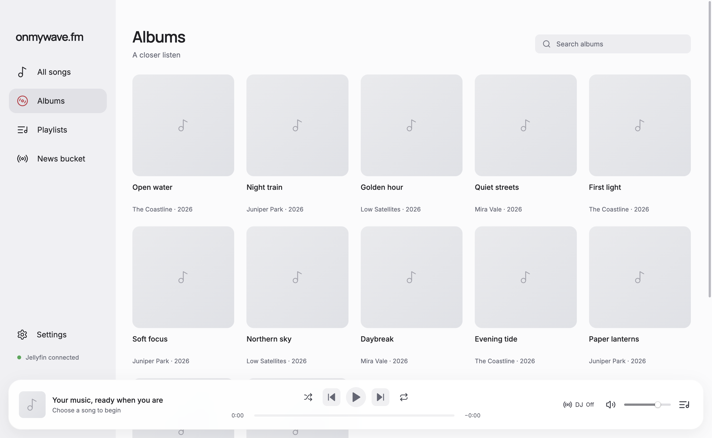

# onmywave.fm

A macOS music player for your Jellyfin library, with optional spoken news between songs. Built with Electron, React, and TypeScript.


Browse songs and albums, build playlists, and keep a listening queue that returns when you reopen the app. Add a DJ when you want news from your chosen sources mixed into your listening session.

## Project status

Early development. macOS is the supported desktop target. Linux CI checks the source and build, but Linux and Windows desktop behavior are not supported yet. Signed and notarized Apple silicon downloads are available from the [releases repository](https://github.com/wapgear/onmywave-app/releases/latest). Installed builds check the releases repository for updates at startup and every six hours. An in-app prompt lets you update now or later, shows download progress, and offers a restart when ready. Settings → General → About and updates also provides a manual check. Playback continues until you choose Restart now to install the downloaded update.

You need your own Jellyfin server, an account with access to at least one music library, and music that your server can stream. This repository includes no music library or Jellyfin server. Navidrome and Subsonic are not supported.

## What works

- Browse and search songs and albums, with genre/tag filters and sorting for songs.
- Create and edit Jellyfin playlists when your account has permission.
- Manage the queue, shuffle, repeat, volume, and playback position. Quitting saves the latest session; reopening restores it paused, ready to continue. Periodic checkpoints provide a fallback after an unexpected exit.
- Close the window on macOS or Windows to keep playback running in the background. Use the menu bar or system tray icon to show the window or quit the app.
- Read Jellyfin lyrics in the player, with timed line highlighting when available and plain-text fallback.
- Configure named news rooms with RSS/Atom, Hacker News, or X sources and a saved DJ.
- Prepare spoken news separately from music playback, then play saved recordings at a chosen song interval.
- Audition bundled voices and try DJ transition timings without API keys.

AI playlist generation, weather, calendar, and reminder workflows are planned. See the [app guide](docs/APP_GUIDE.md) for detailed behavior and the [acceptance checklist](docs/ACCEPTANCE_CHECKLIST.md) for verification limits.



Screenshots come from the [website demo](https://onmywave.izmailov.dev/) and show the actual renderer with real song titles and matching release covers in an example catalog. See [capture details](docs/screenshots/README.md).

## Run from source

Install [Node.js 24](https://nodejs.org/) and [pnpm 10.34.7](https://pnpm.io/installation) on macOS, then:

```sh
git clone https://github.com/wapgear/onmywave.fm.git
cd onmywave.fm
pnpm install --frozen-lockfile
pnpm run dev
```

In the app:

1. Enter your Jellyfin server URL and sign in.
2. Select the music libraries you want to browse.
3. Open All songs or Albums and choose something to play.

No `.env` file or provider key is required for music playback. Use HTTPS when connecting to a server outside a trusted local network. Server permissions govern playlist editing.

## Optional DJ and news

Music playback works without a news setup. To add spoken news:

1. Add sources and a DJ in Settings.
2. Add your OpenAI and ElevenLabs keys in Settings → Provider keys. X sources also need an X bearer token with recent-search access. RSS and Hacker News need no source key.
3. Open News bucket → Settings, choose sources, DJ, mood, and interests, then save and enable automatic preparation.
4. Enable DJ separately in the player's DJ popover and select your room. Set the song interval in Settings → General.

Preparation runs while the app is open and your Mac is awake. It can incur provider charges. Playback uses saved recordings and does not start paid preparation. Explicit voice and DJ preview generation can also incur charges. Disabling preparation does not reverse a request already sent.

## Data and privacy

The main process handles credentials and provider requests. Jellyfin tokens use Electron safeStorage; when protected storage is unavailable, sign-in lasts only for the app session. Provider keys use protected local storage, including shared onmywave Keychain entries for OpenAI and ElevenLabs on macOS.

Settings, queue state, saved scripts, source snapshots, and generated audio live under `~/Library/Application Support/onmywave-light/`. Signing out pauses preparation but keeps saved news and settings. The existing data directory and bundle identifier are retained for compatibility with installations previously named onmywave.fm. Other onmywave apps can share the provider Keychain entries.

News preparation sends source content and your configured editorial preferences to OpenAI, and sends scripts and voice settings to ElevenLabs. Selected feeds, Hacker News, and X receive requests when their sources are checked. See the [security policy](SECURITY.md) before attaching logs or app data to an issue.

## Development

```sh
pnpm run check       # formatting, lint, TypeScript, production build
pnpm run format      # apply source formatting and spacing fixes
pnpm audit
```

Oxlint is the single lint runner, with type-aware TypeScript analysis and the existing React, Electron, and spacing rules. Oxfmt handles formatting. React Hooks and Stylistic plugins run inside Oxlint; the ESLint engine and CLI are not installed.

The build validates bundled voice samples without making generation requests. `pnpm run preview` opens the built app. CI runs the same quality checks and full dependency audit.

For an unsigned local macOS app directory:

```sh
pnpm run package:mac
```

Output goes to `release/`. This command does not publish a release.

For a signed, notarized Apple silicon release, export `APPLE_ID`, `APPLE_APP_SPECIFIC_PASSWORD`, and `APPLE_TEAM_ID`, or put them in ignored `scripts/.env.local`. Install the Developer ID certificate named in `electron-builder.release.mjs` and authenticate `gh` with access to `wapgear/onmywave-app`.

```sh
pnpm run release:mac --local-only           # build and verify without publishing
pnpm run release:mac docs/releases/0.1.0.md # build, verify, and publish
```

The release command runs the quality checks, builds a DMG and ZIP, verifies signing and notarization, and includes corresponding source and SHA-256 checksums. See [automatic updates](docs/AUTO_UPDATES.md) for the update flow and verification limits. It uploads all files, including updater metadata and blockmaps, to a draft before publishing. Each release needs a higher package version than the previous release. Existing 0.0.1 installations without the updater need one manual installation of an updater-enabled release. Keep credentials outside Git. Review [release readiness](docs/OPEN_SOURCE_READINESS.md) for remaining verification limits.

The source is organized by Electron process:

| Directory | Responsibility |
| --- | --- |
| `src/main/` | Jellyfin, credentials, storage, news preparation, and privileged operations |
| `src/preload/` | Typed `window.wave` bridge |
| `src/renderer/` | React UI and playback |
| `src/shared/` | Shared types and domain rules |
| `docs/` | Product behavior, plans, and dated verification evidence |

Read [CONTRIBUTING.md](CONTRIBUTING.md) and [AGENTS.md](AGENTS.md) before changing code. Detailed playback, news, preview-generation, and recovery behavior lives in the [app guide](docs/APP_GUIDE.md).

## Contributing and support

Use [GitHub issues](https://github.com/wapgear/onmywave.fm/issues) for bugs and feature requests. Include reproduction steps, macOS and app versions, and the Jellyfin version when relevant. Keep credentials, private server addresses, and personal listening data out of reports. Security issues follow [SECURITY.md](SECURITY.md).

## License and credits

The project declares [GNU GPL v3.0 only](LICENSE), recorded as `GPL-3.0-only` in `package.json`.

Branding assets came from the [onmywave.fm Feishin fork](https://github.com/wapgear/onmywave-desktop-legacy), based on [Feishin](https://github.com/jeffvli/feishin). This app has separate source and its own data directory. Dependency licenses and bundled-media provenance are documented in [third party notices](THIRD_PARTY_NOTICES.md). Media redistribution checks still outstanding are listed in [release readiness](docs/OPEN_SOURCE_READINESS.md).
