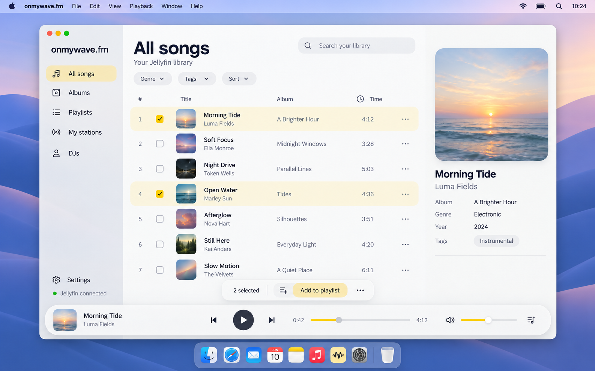

# onmywave.fm macOS app requirements

Current requirements, 17 October 2026. User behavior and acceptance scenarios are defined in [the radio experience PRD](docs/RADIO_EXPERIENCE.md).

Build a separate macOS music player for a listener’s existing Jellyfin library, with optional personal radio hosting. Music works without AI setup. A separately enabled local workflow collects selected news sources, assesses new stories, and saves short recordings. A separately enabled DJ plays eligible saved recordings at suitable song endings. Both switches default off. Mood-based music selection remains future work.

## Product scope

The app is a new project in `desktop-light/`, separate from the existing Feishin desktop fork in `desktop/`. Use the existing app as a reference for Jellyfin integration, metadata presentation, library browsing, and playlist behavior. Build the new app with the stack defined below.

Support macOS and Jellyfin only in the first version. Jellyfin remains the source of music files, library metadata, access permissions, and server playlists. The new app does not require uploading or importing another copy of the music collection.

The interface should expose the agreed functions directly, with sensible defaults and few customization settings.

## Visual design

Use Apple Music and Yandex Music as visual references for a light, simple macOS interface. Aim for a contemporary 2026 feel with more generous whitespace, softer rounded forms, light controls, and a continuous composition. Keep onmywave.fm's own identity. Avoid chopping the interface into dense rectangular panels.

### Color direction

- Use the soft off-white main background `#fbfbfc`.

- Use pale neutral gray for the sidebar `#f0f0f3`, secondary panels `#f7f7f9`, and subtle separators `#e6e6ea`.

- Use near-black primary text `#202024` and muted secondary text `#626674`.

- Use the rose-red primary accent `#c92843` consistently for selected navigation, primary actions, active controls and focus. Use `#b5223a` for primary hover and `#fbecef` for soft accent surfaces.

- Keep large surfaces neutral so album artwork provides most of the color.

- Disabled controls use neutral surfaces and readable muted text. These values record the implemented light palette; verify any future adjustment against the same contrast and state requirements.

### Layout and controls

- Use a compact sidebar with the agreed music and news categories and a spacious main content area.

- Present songs in a clean table and albums in an artwork grid.

- Keep the player persistent as an inset floating rounded surface, with circular transport controls and enough spacing to distinguish each action. Make secondary playback options available on demand.

- Use generous padding and row spacing, clear typography, softly rounded window corners and artwork, pill-shaped search and filter controls, and rounded selection states. Prefer whitespace and subtle surface changes to hard borders.

- Follow familiar macOS window and interaction conventions, including keyboard navigation and visible focus states. Command-F focuses the current music search. Additional modifiers and Control-F retain their native behavior instead of redirecting focus to library search.

- Keep common actions easy to find. Reveal secondary actions through row menus or contextual controls.

- Give news profile setup and DJs simple forms with clear labels.

- Use restrained motion and respect reduced-motion preferences.

### Typography and spacing

Use [Manrope from Google Fonts](https://fonts.google.com/specimen/Manrope) at weight 600 for the wordmark and headings, and [Inter from Google Fonts](https://fonts.google.com/specimen/Inter) at weights 400 and 500 for interface text. Keep the macOS system font for native operating-system chrome. Bundle the chosen app fonts rather than requiring a runtime network request.

Use these initial design targets in logical points, adjusting only where actual font metrics and window resizing require it:

| Element | Target |
| --- | --- |
| Page title | 28 pt, weight 600 |
| Song title and navigation | 14 pt with 20 pt line height |
| Secondary artist text | 12 pt with 18 pt line height |
| Column headers | 11 pt with 16 pt line height |
| Metadata values | 13 pt with 20 pt line height |
| Spacing scale | Multiples of 8 pt, with 4 pt optical adjustments |
| Main content padding | 24 to 32 pt |
| Control gaps | 12 to 16 pt |
| Sidebar width | Approximately 208 pt |
| Song rows | Approximately 52 pt high |
| Row artwork | 36 pt with 8 pt corner radius |
| Search and filter controls | 32 to 36 pt high |
| Floating player | Approximately 72 pt high |

Align text baselines, table columns, icons, control centers, and outer insets consistently. Keep icon stroke weights consistent, reserve adequate hit areas, and show hover, focus, pressed, selected, and disabled states. Holding an enabled button with the pointer or Space gives immediate pressed feedback while retaining its selected colors and keyboard focus. Release restores its resting position; disabled controls remain inactive and still. Avoid animating this pressed feedback. Long titles must truncate or wrap deliberately without moving adjacent controls. Keep compact music rows, tiles, queue and player labels bounded. Collection headings use a two-line title so Play, Queue and Add remain visible; when that title is clipped, offer a keyboard-accessible Show full title disclosure after the actions. Full inspector metadata, tags, story references, source labels and preparation notes wrap within their reading surface, including text without spaces. Long account names also wrap within the connection panel, keeping library choices and recovery actions reachable without horizontal scrolling. Saved DJ names, preview labels and recovery messages must also handle long text without spaces while keeping actions reachable.

### macOS presentation

Use normal macOS window proportions, traffic lights, titlebar behavior, window shadow, and system integration. Keep content legible over a translucent sidebar or playback surface. Screenshots and design reviews should show the app in desktop context with wallpaper, menu bar, and Dock, rather than only an isolated concept board.

Keep the app airy at realistic desktop text sizes. Verify spacing and typography using the actual bundled fonts at standard and Retina display scales. Check minimum window size, resized layouts, and long metadata so production screenshots reflect an implemented layout rather than generated-image approximations.

### Design acceptance

The first version must feel light and simple across library pages, playlists, forms, and playback. Use readable text and sufficient contrast, including selected, disabled, hover, and focus states. Keep disabled labels and pending form values legible with muted text and neutral control surfaces; do not fade entire forms or primary-action labels. Disabled controls retain native disabled behavior and a distinct appearance. Keep timing labels readable in the active transition stage as well as inactive stages. Current acceptance uses windows of at least 1280×720 at normal 100% app zoom. Anton deferred smaller-window and enlarged-zoom checks, including 200%, on 16 October 2026. Retain existing responsive behavior for later verification; do not add or repeat those deferred checks in this goal. Preserve essential controls and readable content at the current baseline. Keep volume from collapsing, make sidebar navigation scrollable in short windows, and retain access to setup Save. Existing smaller-window behavior is retained for later acceptance: at narrow widths, queue/details replace the main area above the player; covered page/notice controls must not remain keyboard-focusable, and closing the drawer restores them.

A setup save must keep its pending state and any failure feedback across page navigation. Keep music navigation available, prevent overlapping setup/profile writes, retain failed drafts for explicit retry, and reject a save whose intended profile is no longer active.

Keyboard focus must remain visible, leave filter popups and song action menus naturally with Tab, return after dialogs, and return to the relevant setup control after managing sources, DJs, or provider keys without losing the draft. Opening a playlist name, source name, or new listening-room name form puts focus in its name field so typing works immediately. The Add to playlist form initially focuses the new-playlist name, and choosing Create a new playlist again focuses its newly shown name field. Editing values, changing source type, or background refreshes must not move focus back. Help and confirmation dialogs start on a safe non-destructive target. Escape, Cancel, Close and backdrop dismissal return focus to the opening control when it remains available. If a dialog removes its opening control, focus the current page heading. Keep long dialog titles compact so Close and keyboard actions remain reachable at the current acceptance baseline. Preserve the full accessible title. For DJ and source deletion, show the complete target name in wrapping body text so similarly named items remain distinguishable before confirmation. Give related source checkboxes a group name and keep interactive recovery controls outside live status/error announcements.

Read-error actions that remain visible during recovery show Retrying and an accessible busy state while their reads run. Keep the error explanation and keyboard focus, ignore repeat activation, and keep unrelated recovery actions usable. A failed attempt restores Try again. A compound playlist refresh stays busy through both its detail and playlist-list reads. Changing the search or resource leaves the obsolete retry behind and keeps the new resource's retry usable. Retry starts only the stated read operation and cannot submit a form. Existing page-specific focus handoffs still apply when recovery removes an error.

A dark theme, elaborate animations, decorative gradients, and extensive appearance customization are outside the initial design scope.

### Interface concept

Concept v4 presents the All songs view as an app window on a macOS desktop, including wallpaper, system menu bar, Dock, and native window controls. The app retains the light palette, rounded controls, airy library rows, open metadata area, and floating player. The image is a generated visual target with illustrative music data; the actual application will implement and verify the font and layout specifications below.

### Pinterest inspiration

- [Airy desktop player reference](https://in.pinterest.com/pin/208010077668840252/) inspires the large artwork, generous spacing, and quiet track list.

- [Apple Music dashboard concept](https://kr.pinterest.com/pin/515732594846289618/) inspires the rounded application shell, small filter pills, and separate playback surface. Use those layout ideas with our light palette.

- [Music UI desktop design by Khandaker Rasel](https://in.pinterest.com/pin/644788871650256226/) offers a reference for artwork hierarchy and a quiet library sidebar.

These are visual references rather than current Apple product specifications. Use gentle translucency only where it keeps content readable, especially the sidebar and player. Apply the same spacing, corner shapes, and control treatment to every app page.

## Project folder and stack

The new app lives in `desktop-light/` at the workspace root, alongside the existing `desktop/` and `ios/` projects. Treat `desktop-light/` as the implementation destination for these requirements. Keep the existing desktop app available as a reference.

| Component | Choice and responsibility |
| --- | --- |
| Desktop runtime | Electron for the macOS app window and native integration |
| Development and build | Vite |
| Server data | TanStack Query for library queries, caching, loading and error states, and playlist mutations |
| Music server | The existing Jellyfin server for authentication, music catalog, artwork, streaming, and playlists |

Use the existing Jellyfin server directly as the music backend. The first version does not require a new music server or a separate custom backend service. Keep local player state, selection state, and editable form drafts separate from cached server data.

Keep Electron native capabilities behind a narrow preload interface, with context isolation and renderer Node integration disabled. Store authentication secrets through operating-system protected storage. Playlist mutations must refresh or update affected cached data and clearly report failed saves.

The workspace requirements copy is `desktop-light/REQUIREMENTS.md`. The approved visual direction is the macOS desktop concept v4, saved under `desktop-light/docs/design/`.

## Navigation

Open on All songs. Provide All songs, Albums, Playlists, and News bucket, with Settings separately accessible. News bucket is the Listening Room destination for saved news and radio setup. Shared source and DJ management belong in Settings. Keep the player, DJ controls, and expandable queue available across pages.

Search and metadata filters belong within library pages. A separate full music discovery homepage is not required.

## Jellyfin connection

- Accept a server address and authenticate the listener. Initial library selection always offers Use another account or server, including while discovery is loading, empty or failed. Open a sign-in form with the current server filled and username/password cleared; preserve library checkbox choices for Back. Failed authentication retains the current account. Replace it only after successful authentication, refresh available libraries and return to selection even for the same account. Successful authentication resets the checkbox draft and requires a fresh explicit library choice; only Back or a failed sign-in retains earlier checkbox edits. Back returns keyboard focus to the account-switch action.

- Let the listener select the music libraries accessible to their account. Count and submit only libraries in the current accessible list. If a prior selection becomes unavailable, explain it and let the listener explicitly save an available replacement. When no music libraries are available, offer keyboard-accessible Try again after access changes, keep the selected count at zero and prevent an empty save. An empty-list retry keeps its focused button visible as Checking libraries while pending. Repeated activation cannot restart an empty or failed list request. When libraries return, move focus from the retry action to the first available checkbox without changing selections. If access remains empty or fails, keep the retry action reachable. Leave focus alone if the listener moves elsewhere while the request is pending. Apply this recovery in initial library selection and General settings.

- Remember the connection securely across launches. Signing into another installation of this app must not invalidate this one. Use one independently generated identity for each local installation across API, artwork, direct and converted audio, and keep it across account changes, sign-out and restart. If local identity storage cannot be used, keep listening available with a temporary identity, explain that the connection may need sign-in after quitting, and do not save a new session as restorable. Keep a readable older account available until a replacement can safely clear its saved credentials. An older pending sign-in cannot replace a newer account, override recovery or undo sign-out. Confirming sign-out supersedes pending sign-ins immediately, before asynchronous preparation-pause or credential writes. If sign-out later fails, keep the originally committed account; the older pending sign-in remains superseded. A failed newer sign-in keeps the previously committed account while superseding older pending attempts. Persist connection changes in order so an older credential write cannot undo a later change or deletion. Persist the exact accepted account/library snapshot. Keep a replacement pending until its saved or explicitly session-only connection commits. Sign-out invalidates an uncommitted replacement before saving the preparation pause, so neither its credential nor its account can become active afterward. A replacement committed before sign-out becomes the account being signed out. A failed save restores the latest successfully committed account and choices only if that failed change is still current, and cannot cancel a newer pending sign-in. When an accepted account is session-only because protected storage or its persistent local identity is unavailable, remove any older restorable account record; restarting must require sign-in rather than reopen that older account. Do not overlap library saves with another library submission, account switching, sign-in or sign-out. Keep the submitted checkbox choices and Saving indicator across ordinary music navigation. A failed save keeps its choices and error after returning, allowing an explicit Save libraries retry; editing clears the prior error without saving. Successful authentication resets those drafts and errors and fetches current access, including for the same account. If expiry opens sign-in during a save, explain the wait and enable sign-in after it settles. A library save completing successfully must not dismiss the expired-session screen. Late results from an old account/authentication screen must not reopen that session; a valid Settings save must still update the collection after ordinary music navigation.

- Load catalog information and artwork from Jellyfin. Concurrent sort/filter reads for an unchanged selection must not report that the library changed merely because another view was read or cached results were evicted. Changing the actual account or selected libraries still rejects obsolete reads; a later explicit refresh reads the server again. Refresh library updates current songs and genre/tag choices, and marks cached song details, album views and playlists for a fresh read when used. Keep search, filters, selection and the listening queue during refresh. Show read failures with Retry while retaining available data. An open album reads its current title, artist, year and artwork by ID, even if it has no tracks; a metadata-only failure must leave available tracks playable. Use Jellyfin’s image revision tags for current artwork, including a song’s album-art fallback. Refreshing the collection never prepares news or enables radio.

- Respect account permissions for every read and playlist change.

- Distinguish an unreachable server, expired authentication, an empty library, and a failed operation. Offer an appropriate retry or sign-in action. Keep each Jellyfin JSON request within a 20-second deadline through the complete response body, so slow sign-in and library loads return to usable controls. A failed sign-in can be retried without suggesting a playlist change was saved. If a playlist creation loses its JSON confirmation, retain uncertain-change recovery without replay. Successful status-only playlist changes are confirmed by their response status, even if an unused body stalls. Music streaming uses its separate playback recovery.

- Keep credentials and authentication tokens out of logs.

## All songs

- Show all songs in the selected music libraries. A song or album shared by overlapping libraries appears once. Counts describe unique items, and page boundaries preserve the displayed order. Refresh library rereads current server contents.

- Search by song title, artist, and album.

- Sort the list and filter by available metadata, including genre and tags.

- Select one song or multiple songs.

- Play a song or the selected songs, add them to the queue, or add them to a playlist. Bulk actions preserve the displayed row order, regardless of selection click order.

- Display useful columns such as title, artist, album, and duration.

- Open a details panel for additional metadata.

- Keep browsing responsive for the listener's actual library size.

Metadata includes artwork, title, artist, album artist, album, duration, year, genre, tags, track number, and other fields available from Jellyfin. Missing fields must not prevent browsing or playback. Music tables and the queue identify unavailable durations explicitly. Use Untitled and Unknown artist when those details are absent. When the catalog duration is missing or invalid, use a finite positive duration reported by the current audio resource, including the offset of a converted stream. Conversion must begin at the requested song position, including when the source is already MP3. Keep this fallback local to that queue occurrence; preserve valid catalog durations and do not rewrite Jellyfin metadata. Until a finite total is available, show advancing elapsed time and an unavailable total, with seeking disabled. Apply the same availability to system seek actions while keeping Play/Pause and song changes available. Metadata display and filtering are included. Editing tags, metadata, and artwork is outside this version.

## Albums

- Browse albums with their artwork, title, and artist.

- Search albums by title or album artist within the selected libraries. Combine overlapping matches once and keep paging and ordering consistent. Open an album to see its metadata and ordered track list.

- Play an album, add its tracks to the queue, or add all its tracks to a playlist.

- Allow selecting individual tracks within an album. Keep that selection while the same album stays open through music, news or Settings navigation. Back closes the album, clears its track selection and returns keyboard focus to its tile, including after a page detour. Opening an album from the list starts a fresh selection. Library/account changes and app restart clear this temporary selection; it is not part of the saved listening queue.

## Playlists

- Show the connected account's accessible playlists.

- Create a playlist, rename an editable playlist, and open its track list.

- Add one song, multiple selected songs, or all tracks from an album.

- During an add operation, choose an existing playlist or create a new one.

- Remove tracks from editable playlists and reorder them.

- Each repeated song position is independently selectable and remains in the intended order when playing or queueing a playlist or selection. If Jellyfin returns missing, invalid, or reused entry identifiers, explain why Move and Remove are unavailable for those positions while keeping listening, selection, additions, renaming, and safely identified entries usable. Recheck current entries before an entry mutation; reject an absent or ambiguous target before reserving or dispatching. Never replace the whole playlist to guess which occurrence was meant. When the fetched entries change, clear selections that cannot be matched reliably; preserve uniquely identified selections. This fallback does not establish support for editing an ambiguous occurrence on a server without a safe occurrence API.

- Play a playlist or selected tracks within it.

- Save playlist changes to Jellyfin so other clients can access them.

- Explain permission restrictions and report failed saves accurately. Confirmed read-only permission disables editing; when the permission lookup is unavailable, explain that permission is unknown and let Jellyfin authorize each edit attempt. Missing, malformed or non-boolean permission data does not establish read-only access. Failure of this optional lookup must not hide otherwise available tracks. Expired authentication, an account change, or a failed metadata/track read still surfaces its own error. A denied edit remains visible without an automatic retry.

- If Jellyfin may have saved a change but the response is lost or invalid, prevent resubmission in that dialog, refresh the playlist data, and provide Close and check playlists. Never automatically repeat an uncertain creation or addition. For inline reorder or removal, keep editing unavailable until the playlist refresh succeeds and the user acknowledges checking the saved order. Keep the affected playlist’s pending state, failure and review requirement across page changes, playlist switches, library-selection saves and same-account sign-in. Other playlists and music navigation remain available. Before dispatching creation, addition, reorder or removal, durably save an account-specific recovery intent. For an addition, finish duplicate checking first and reserve only if songs remain, retaining one intent across every write batch. A failed read or empty selection must not leave a false uncertain-write lock. An unresolved creation requires a fresh complete playlist-list read and explicit acknowledgement before another creation, including creation from selected songs. Keep existing playlists usable unless their own edit is unresolved. Mark affected known playlists Review needed in the list and disable affected Add to playlist destinations, so recovery is discoverable after restart. When an Add destination is unavailable for recovery, explain why and offer Review playlists directly in the Add dialog. Creation recovery does not claim which playlist was created when Jellyfin did not return its ID. If the app quits or the outcome is uncertain, reopening still requires a fresh playlist read and explicit acknowledgement; never replay the mutation. A read begun while the write was pending cannot authorize acknowledgement. Guard rename and additions against the affected lock as well. If recovery storage is unavailable, reject edits before dispatch and keep listening available. Signing out or changing account hides the prior account’s feedback; returning to that account still requires review of its unresolved change. A late old-account result must not refresh or alter the new account.

- Handle duplicate additions consistently, with an option to skip tracks already present.

Playlist deletion, sharing, and smart playlist editing are not part of the agreed first version.

## Playback

- Provide play, pause, previous, next, seeking, volume, shuffle, and repeat. Command-Left/Right invokes Previous/Next from ordinary page content, buttons and configuration tabs, preserving play/pause intent. Plain Left/Right arrows navigate configuration tabs. Space toggles playback from page content and retains native activation on focused controls. Editable fields, checkboxes, selects, sliders and menus keep their own key behavior; open dialogs and popovers suppress global playback shortcuts. Command-Up/Down adjusts volume only from non-interactive page content. Natural continuation after a DJ break follows the selected repeat mode, including repeating the same queue occurrence for repeat-one after completion, failure or Stop once the song has ended. Keep converted playback mode, shuffle history and pause intent; do not count a completion twice or replay heard news. Manual Next still skips the repeated song. Manual Next and Previous retain the current play/pause intent. Selecting another song while paused must not unexpectedly start playback; explicit Play actions start it.

- Show the current track, artist, artwork, playback position, and duration.

- Provide an expandable queue showing upcoming music.

- Keep playback running while the listener navigates and when the app is in the background.

- Support macOS media controls.

- Automatically restore the last queue, song, position, volume, shuffle and repeat after relaunch, paused and ready to play, without a resume prompt. Preserve queue order and the selected occurrence of duplicate songs. Keep volume, shuffle and repeat when the queue becomes empty, and persist changes to those controls with an empty queue. Startup must not save an empty placeholder over a pending or failed restoration; explicit Play or enqueue may replace it. Keep control changes made while startup data loads, including when queue restoration fails. Explain that the queue is still saved and offer explicit Retry. If player options cannot be saved, give them a separate retry that does not start music or retry queue restoration. Opening another account without starting or queueing music must not overwrite a saved session belonging to the previous account. Keep volume, shuffle and repeat separately for each Jellyfin server/account, including while its player is empty and another account owns the last saved queue. Returning to the queue owner restores its own options. Keep one last listening queue; explicit Play or enqueue may replace it.

- Handle unavailable tracks and interrupted connections without endless retries or silently losing the listening session. After the supported conversion attempt fails, keep a plain-language explanation with Retry and Skip track available. A late old load success or failure cannot replace a newer song or queue occurrence, change its playing/paused intent or show a stale error. Offline catalog errors retain the connection and offer Try again. Session expiry prefills server/username for sign-in and restores saved music paused. In the running app, same-account reauthentication preserves unsaved radio setup, edited scripts and manual preparation state through library selection, without saving or redispatch. Different account/server or explicit sign-out clears those unsaved drafts; quitting does not preserve them.

The exact recovery and queue persistence behavior must be verified with the connected server during implementation.

## Personal radio behavior

[The radio experience PRD](docs/RADIO_EXPERIENCE.md) defines the current listening, setup, preparation, review, and recovery contract. It supersedes the earlier manual-only station placeholder and planned-only workflow requirements. [News bucket workflows](docs/LISTENING_ROOM_WORKFLOW.md) describes service behavior and future extensions.

- Keep music browsing and playback as the default flow. AI setup is optional.

- Explicit sign-out pauses automatic preparation across all profiles before leaving the account. Retain saved enabled choices, setup, counters and history; require explicit Resume after sign-in. Close the generation gate immediately and cancel active manual/automatic text, speech and voice-preview work, including work waiting for keys or async review reads. No new provider dispatch may follow the sign-out boundary or an old callback after a quick new sign-in. Preserve completed recording publication and count it once. Persist the pause through restart and completed-run reconciliation. A delayed setup save or Resume cannot clear a newer sign-out pause. No automatic check starts on a signed-out launch. A pause-state save failure keeps the account connected and explains that preparation could not be paused, the listener is still signed in and sign-out can be retried; a credential-removal failure restores the prior connected session and says sign-out did not finish. A successful sign-out shows ordinary sign-in rather than a stale session-expiry message. The confirmation explains discarded unsaved radio edits, retained local data, paused preparation, cancellation and possible charges for already sent requests. Session expiry remains the existing same-account recovery flow.

- Manual preparation keeps its request, pending state, progress and recovery feedback across music navigation. Cancel before provider dispatch prevents that dispatch even if setup is still saving; after dispatch it targets the exact request. A saved-result check may only reconcile an existing request and must never start generation for an unknown ID. Its pending progress and disabled action must say Checking saved text or Checking saved audio, retain the original profile and explain that no new provider request is sent. Do not label a lookup as preparing or generating. Name the original profile in retained recovery feedback, including after a profile switch. An explicit new attempt uses a new request ID. After a full restart, show the latest unlinked interrupted request in News bucket with a direct keyboard-accessible route to expanded preparation history. Persist whether each new request is manual or automatic, its start time, and its original profile identity and name when available, before provider dispatch. Manual requests retain the profile chosen when the action began; automatic requests use the reserved profile snapshot, including for a non-active profile. Preserve this context through rename, restart and saved-result checks. Show it in the restart summary and preparation history. Older or malformed metadata must remain explicitly unknown; do not guess a profile or time. A newer request supersedes this compact summary; full history remains available. If earlier unfinished attempts are hidden, offer Show older preparations and move keyboard focus to the newly revealed history. Suppress the summary when status cannot be refreshed or when the live manual error/profile status already represents the request.
- During an identified automatic check, allow editing and saving future setup while keeping profile switching and manual generation unavailable. Capture the current run’s sources, host and profile settings with its reservation; later edits cannot change its provider input or provenance. A cadence saved during that run is measured from its start time, including when the save finishes after the run. Missing or failed preparation status keeps editing locked until refreshed.
- Save named news profiles containing sources, host, mood, interests, and preparation preferences. The profile being edited can differ from the one chosen for DJ playback. Label that difference explicitly. Copies use the current setup draft without saving changes to the original. Start the copy unavailable and preparation off, clear its run history and counters, and leave editing/playback selections unchanged. Making the copy available does not enable preparation; require a separate explicit opt-in.
- Support named RSS/Atom feeds, Hacker News lists, and X recent-search queries. Show source-specific requirements and preserve article links, dates, and partial-failure warnings.
- Provide reusable DJs with name, personality, language, instructions, music preferences, exclusions, and ElevenLabs voice. Send complete saved host instructions, music preferences, and exclusions in text preparation, bounded to 20,000 characters per field. Reject unsupported over-limit stored values before source assessment or provider dispatch with an actionable field-specific message; never silently truncate or rewrite saved preferences. Explain beside the editor fields that full values are sent to OpenAI and longer text can increase input usage and cost. Exclusions guide both article selection and spoken wording; music preferences guide delivery style and do not choose songs. These prose preferences rely on model interpretation, not deterministic topic filtering. Presets offer a setup path without generation. Saving a DJ or testing its cached preview never enables automation. The editor exposes working host settings and directs frequency changes to Settings → General → DJ playback. Its empty state explains that the listener chooses the music queue.
- Separate preparation from playback. Preparation may use paid text and voice providers while the app runs and the Mac is awake. Playback consumes complete local recordings and never invokes providers.
- Enabling or resuming preparation uses confirmed saved keys. A completed required-key removal prevents activation; a key edit requested during an enabled setup save waits for that save to finish. A later key removal keeps the saved preparation choice but setup identifies the missing requirements. Incomplete setup and OFF saves remain available without keys, including while a key edit is pending.
- Preparation defaults to off, every three hours, major developments only, and at most three automatic recordings per local day. Bound daily scheduled check attempts as well. These limits govern scheduled preparation, not total provider spending. Label the counters and maximum as automatic/scheduled. Manual text/audio and voice-preview generation remain separately authorized actions outside those limits, with visible provider/cost disclosure beside the controls; cached replay makes no request. Explicitly explain that an assessment can cost money without producing audio.
- Playback defaults to off and every three songs. Natural completions advance cadence; skips do not. Explain what happens when there is no eligible recording. Music continues. Eligible saved audio must be complete, unheard and match the selected profile’s current host, mood, interests and sources. Require at least one reference published within the last 24 hours, using preparation time only for a reference without a usable publication date; a future reference does not qualify by itself. An over-music ending that is too short or late retains the unheard recording for a later suitable song. Late results for an earlier playback profile release their reservation without placing speech. These checks never generate new text or voice.
- Save an attributed last preparation result, its timestamp, and the next check. Distinguish checking, recording saved, no qualifying story, incomplete source coverage, daily limit, interruption, and failure. When readable stories were assessed but none was selected and some sources failed, retain a distinct incomplete-coverage result with named warnings and the next scheduled check. Preparation stays enabled without voice generation or an immediate paid retry. If no fresh story can be assessed because sources failed, retain the existing failure and explicit Resume requirement. A paused failure keeps its cause and explicitly directs the listener to resume in News settings. Missing or rejected provider keys point to Settings → Provider keys without implying that saved DJ playback needs credentials. Retain source warnings with saved scripts and recordings. Show these preparation notes beside ready, draft and scheduled/current stories in News bucket and beside stories in the player’s DJ controls, without requiring the detailed Saved audio view. Label missing or invalid publication dates as Date unavailable in story references and article history, including saved audio provenance and the manual draft loaded from that recording. Preserve valid publication dates and source links. These notes do not block saved playback or initiate generation. Status is based on persisted data.
- Show compact preparation context from the player’s DJ controls and detailed activity in News bucket. Never imply the edited profile controls a different playback profile.
- Identify automatic preparation separately from manual preparation activity. When preparation activity cannot be checked, retain setup edits, lock unsafe editing and profile switching, and offer a status retry. Keep independently confirmed automatic settings and scheduled counters visible. Mark cached recordings as last loaded. If automatic status itself cannot be refreshed, show only the last saved automatic setting and hide current-looking counters and last-run claims until the read succeeds. The player’s preparation line describes the named profile’s automatic workflow.
- Keep manual text preparation, script editing, finite audio generation, audition, comparison, explicit selection, and manual scheduling available as advanced tools. Configuration edits and completed preparation never replace the selected take or start music. Audition pauses music. Its own Pause/Resume retains position, while a later music transport command, including paused Next/Previous, seek or media Pause, stops and resets the audition. A late playback result or error cannot restart it or show an obsolete failure. Volume, shuffle and repeat changes keep the audition. Stopping an audition never changes the selected take or enables preparation. After manual audio completes, show whether a take was saved or a matching recording reused, name the original profile, and offer Review saved take. Keep the result through music navigation and profile switching until another manual attempt begins. A different Jellyfin account/server or confirmed sign-out clears this unsaved completion feedback; the saved recording stays available on this Mac. Review refreshes saved data and focuses that exact take, including an unavailable file with retained script guidance. A failed refresh or missing result ID keeps a clear retry action. Reveal completion above the player without moving focus. Protect edited manual scripts before loading another saved draft, reviewing a bucket draft, loading a saved take script, or preparing new text. Ask only if unsaved wording would be replaced. Keep editing retains and focuses the current script; closing the confirmation keeps the current view and restores its opener. Confirmed text preparation explains its provider cost and replaces the script only on success. Failure keeps the edit. Clean or identical drafts load without an extra prompt.
- Retain immutable script, source, mood, and rendering-DJ provenance. Missing recordings keep their provenance and need explicit recovery. Saved audio can play without provider keys. After a missing or damaged recording is repaired, Refresh and an explicit Listen or Schedule DJ break attempt must reopen the current local file without restarting the app or contacting a provider. Pause/Resume keeps the current recording and position.
- Persist request IDs before dispatch, reconcile completed artifacts, and avoid automatic retries of uncertain paid requests. Completed audio survives late cancellation and interrupted manifest publication.
- Pausing preparation prevents new dispatch and requests cancellation. Pausing music does not pause preparation. Disabling DJ breaks does not disable preparation. Make those effects visible before activation.
- Retain the existing configurable talkover/bulletin transitions. Their optional Preview transition demo uses synthesized sample music and a bundled saved voice without provider calls or a required music queue. It previews current draft timings, pauses existing music without canceling itself, and leaves music paused after Stop or completion. Later music transport commands stop it, including paused song changes, seek and media Pause; volume, shuffle and repeat do not. Leaving the preview settings or changing its timing/style stops the demo without saving or restarting it. Late startup/media callbacks cannot restart a canceled demo, show obsolete errors or stop its replacement. A current failure remains visible for explicit retry. Pause controls music and active speech. Seeking follows Keep the DJ when seeking, enabled by default. Rewinding a speaking break pauses the same recording at its current position and restores the music level. Resume its remaining speech only at the next suitable ending; Play after a paused rewind resumes music first. Explain that speech is waiting, and never replay an already-finished recording. Explicit track changes cancel the old placement. An unplayed automatic recording can wait for another suitable ending.
- Keep speech outside music playlists, music favorites, and music history. Host mood styles speech; it does not select songs.

## Settings and data

Jellyfin owns the music catalog, permissions, and server playlists. The app stores encrypted connection/provider credentials, local preferences, listening context, opaque playlist recovery markers, news profiles, review history, scripts, and complete audio recordings. Provider keys remain behind the preload boundary; only configuration status reaches the renderer. After a key is successfully replaced or removed, earlier in-flight local reads must return the latest committed value. An older read cannot restore the previous key or make it available to new preparation. Keep credentials out of returned errors, preparation history, diagnostic logs, media URLs and externally opened links. Persist only safe application guidance for failures. After upgrading, ambiguous older failure details may be replaced with a notice that they are unavailable; preserve their request identity, status, counters, pause state and saved recordings. Keep known no-story and incomplete-coverage reasons. A failed cleanup write must preserve the existing history and allow retry, rather than presenting an empty library.

Open the music shell before recovering local news data. A failed settings read, prepared-library read or recovery write must keep music browsing and playback available, preserve existing files, and show one persistent recovery notice with an explicit Retry action outside its live announcement. News generation, automatic checks and new DJ claims stay blocked until recovery succeeds. Retry only repairs local data; it never repeats a provider request. Before declaring recovery ready after a detected failure, durably pause enabled preparation across profiles and require the existing explicit Resume action. Retain saved opt-ins, history, counts, recordings and listening choices. A waiting break is released; already-started speaking or paused audio remains controllable. An ordinary missing recording remains a local missing-file state, and provider failure keeps its own preparation guidance. A healthy startup retains its normal due-now automatic check.

Settings contains account/libraries, DJ playback and transitions, provider keys, shared sources, and reusable DJs. Saving or removing a provider key keeps its confirmed status authoritative over older status reads, including checks started while saving. Check only that provider again after a failed save, retain its entered draft and error while checking, and keep editing available. A status check never prepares text or audio. News bucket → Settings edits the chosen profile and its preparation schedule. Keep one combined draft for sources, host, mood, interests, and preparation preferences. Preserve it through music navigation and shared-management visits. Distinguish draft activation from saved running state, and offer save/discard/cancel for all fields before switching profiles. Save setup and workflow choices atomically. Gate enabled preparation on current sources, saved host, mood, and required key status; allow incomplete setup and disabling preparation without keys.

Before deleting a shared DJ, name every profile that will lose that host and explain that those profiles need a replacement for future preparation. If the selected playback profile uses that DJ and DJ breaks are enabled, say that its breaks will turn off and require explicit re-enabling after repair. Cancel preserves the host and profile choices. Saved scripts and recordings retain their original DJ information. Long profile names must wrap within the confirmation while Cancel and Delete remain reachable at the supported window sizes and zoom.

Text preparation sends bounded source excerpts, news interests, and host instructions to OpenAI. Voice generation sends the script and delivery settings to ElevenLabs. Do not send music files, Jellyfin credentials, provider keys, or the entire music catalog as model context. Treat source text as untrusted input.

## Outside current scope

AI music selection, continuous free-form hosting, weather, calendar, reminders, music metadata editing, offline downloads, other music servers/platforms, public hosting, remote control, playlist sharing, custom themes, and distribution/notarization are separate milestones. News preparation and saved-news automatic playback are current scope, not future placeholders.

## Acceptance criteria

The [observable acceptance checklist](docs/ACCEPTANCE_CHECKLIST.md) breaks these parent criteria and the current contract into individually reviewable results. Its evidence dispositions are not a usability score. Keep source requirements and STAR results authoritative when reconciling the checklist.

1. Connect to Jellyfin, choose accessible libraries, and restore the encrypted connection.
2. Browse, search, filter, select, and play music; manage allowed server playlists with honest permission and failure states.
3. Keep playback through navigation; restore queue, song, position, volume, shuffle, and repeat paused after relaunch.
4. Complete the [radio user stories and STAR scenarios](docs/RADIO_EXPERIENCE.md), including independent preparation/playback opt-ins, profile attribution, no-story outcomes, limits, and recovery.
5. Retain scripts, recordings, selected take, and provider-free playback across restart.
6. Check keyboard access, focus return, loading/error/empty states, and a minimum window of 1280×720 at normal zoom and ordinary larger desktop windows. After an explicit keyboard retry in All songs or Albums, return focus to recovered results, or the page heading for an empty result. Keep the retry action focused after another failure. A recovered page of results starts at its first new item and stays visible above the player. Later focus changes, navigation, dialogs and window changes take priority; background refreshes do not move focus.
7. Distinguish fixture-backed flow checks from live provider output and subjective listening quality. Do not claim user validation from an engineering review.

## Release verification still needed

Supported macOS versions/architectures, hardware media controls, converted-audio seeking, and subjective audible transition quality need release-level verification. These do not change the interaction contract or authorize packaging/publishing.

## Local verification

Use Electron development or production-preview mode for testing. Do not package, sign, notarize, or publish the app as part of routine verification.

### Per-DJ voice previews

- Disclose possible ElevenLabs credits/charges beside custom voice-sample and saved-DJ preview generation controls, including that these are outside automatic news limits and cached/bundled replay makes no request.
- Keep neutral voice samples in the editor separate from the saved DJ delivery preview. Offer voice preview and explicit regeneration for each saved DJ. First generation uses a fixed short sample with ElevenLabs only and persists the recording locally.
- Replay cached previews across restarts without provider requests or keys. Changes to the saved voice or delivery tags mark the cached DJ recording as outdated without automatic regeneration. Keep the old recording replayable while it is outdated.
- Deduplicate concurrent generation for the same DJ. Persist an attempt marker before dispatch and require explicit regeneration after missing audio, failure, or interruption. Preserve the last successful recording if regeneration fails.
- Keep preview playback exclusive with other previews and music. A delayed generation result must not interrupt a newer playback choice, including a paused song selection, seek or explicit Pause. Save the result for explicit replay without another provider request. Preview playback itself pauses music; volume, repeat, shuffle and removal of another queued song do not cancel the preview. Use the current volume when delayed audio starts.
