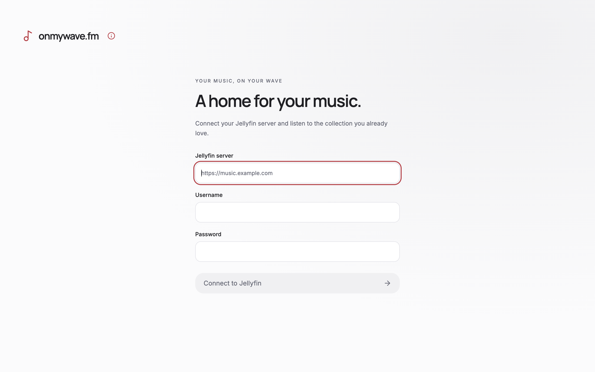

# Close-to-tray verification

Run `pnpm run build`, then `node docs/verification/close-to-tray/verify.mjs` on macOS or Windows. Set `WAVE_VERIFICATION_OUTPUT` to retain the screenshot and log. The Quality workflow runs this check on both systems.

The check launches the built Electron main, preload, and renderer with an isolated temporary app-data directory. It uses the bundled demo MP3 with Chromium's `--disable-audio-output` fake OS output stream, with no Jellyfin connection or live provider requests. Instrumentation is confined to a disposable copy of the main bundle.

It verifies that closing hides the same window, keeps the renderer alive and audio advancing, and does not begin shutdown. It invokes the actual native Show and Quit menu callbacks, checks minimized-window restoration and activation handlers, and checks the Windows tray click handler. Quit must checkpoint playback and exit successfully. This does not automate physical mouse interaction with the native tray, OS shutdown, or update installation.

## Visual evidence

Before and after use the same disconnected login screen at 1280 × 800 logical pixels, captured at 2× on macOS. No renderer layout changes are expected. The menu adds Show onmywave.fm and Quit onmywave.fm. The monochrome menu-bar images are derived from the wave marks in the existing project-owned `resources/icon.png`, at 16 and 32 pixels; Windows reuses the full-color app icon. Both are explicitly included in the packaged app.

| Before | After |
| --- | --- |
|  |  |
