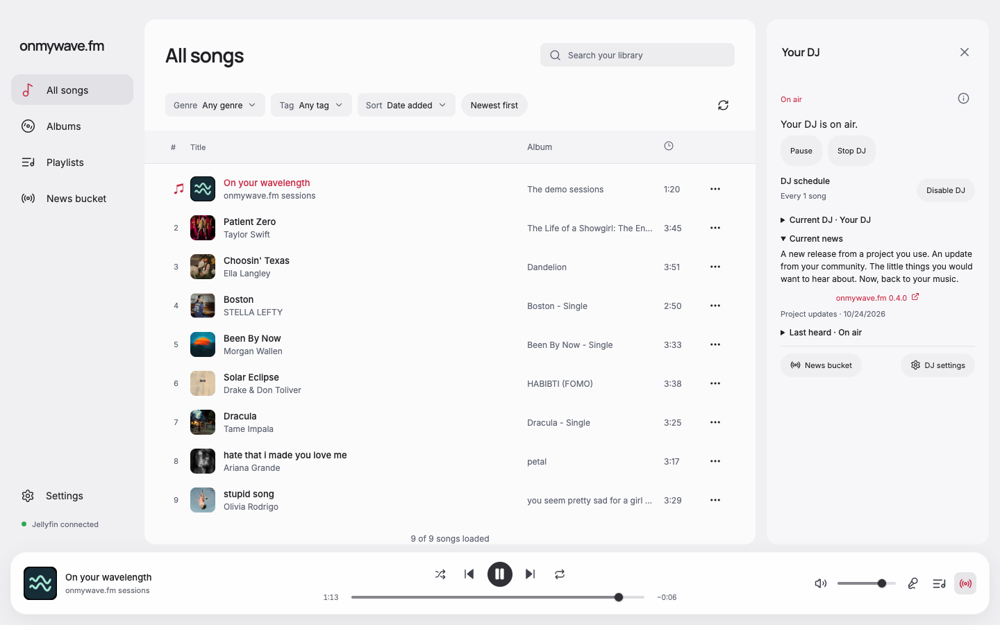
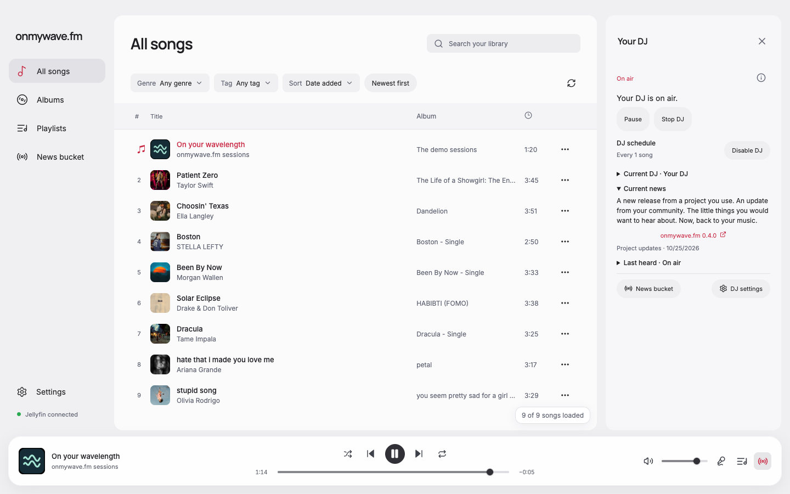
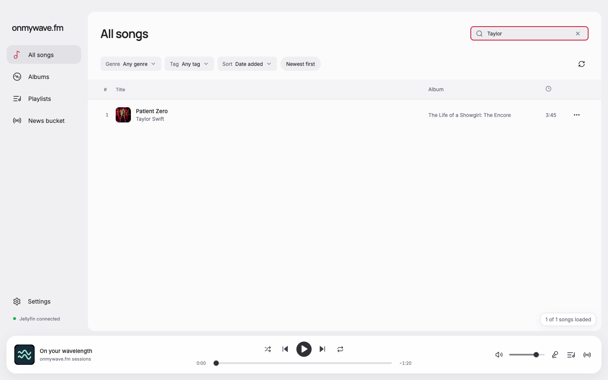
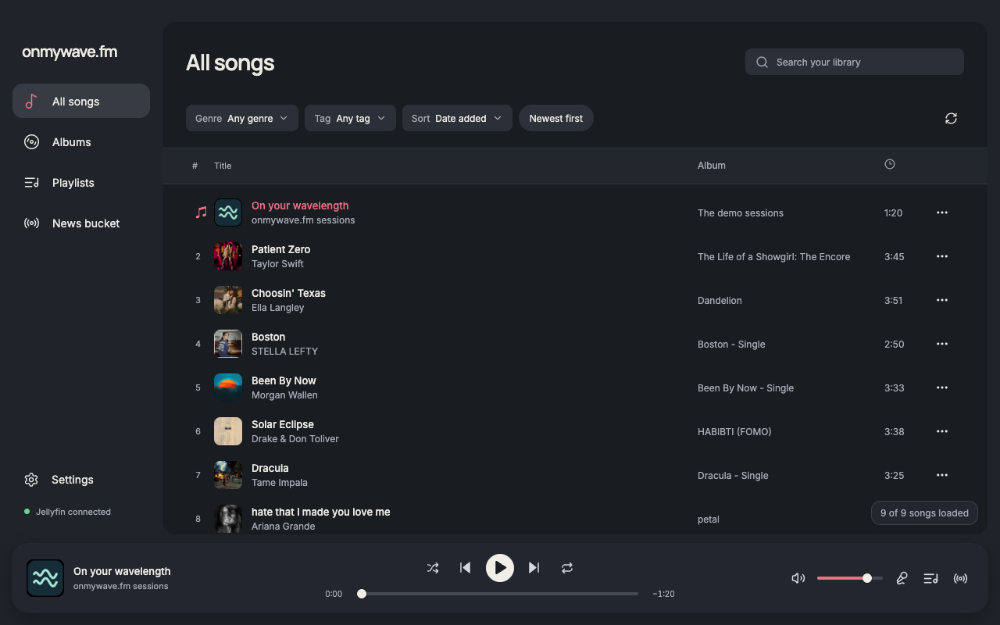
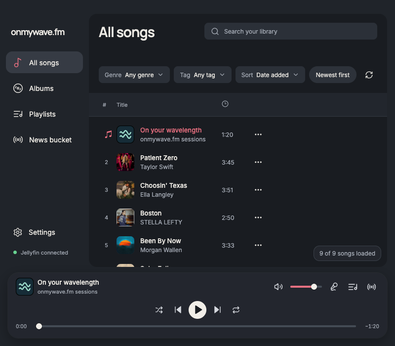

# DJ sliding transitions and floating song count

The DJ sidebar slides in from the right over 220 ms and slides out over 180 ms. Exit restores focus immediately, makes the departing panel inert, and removes it after the animation. Switching to another drawer cancels a pending exit so it cannot close the newly opened panel. Reduced-motion preferences skip both transitions.

Only the loaded-song count moves into a floating label. It anchors 12 px inside the library's bottom-right corner, following sidebar resizing and remaining fixed through search and long-list scrolling. Loading, pagination and retry controls retain their existing layout and handlers.

The before/after pair uses the same 1440 × 900 demo catalog and DJ-on-air state. Additional actual renderer screenshots cover one search result, 1280 × 800 dark and 800 × 700 dark. The fixture bridge and local audio make no account/provider calls.

Validation: formatting, type-aware lint, TypeScript and production build passed with `pnpm run format` followed by `pnpm run check`. All 11 motion/count checks and the existing 15 DJ-sidebar checks passed, with no page errors. Native animation evidence is in motion-report.json. It records the entrance animation and captures inertness, restored focus and the exit animation at its start. Browser verification covered reduced motion, interrupted exit, search, a 120-song scrolling library and all three viewport sizes.

