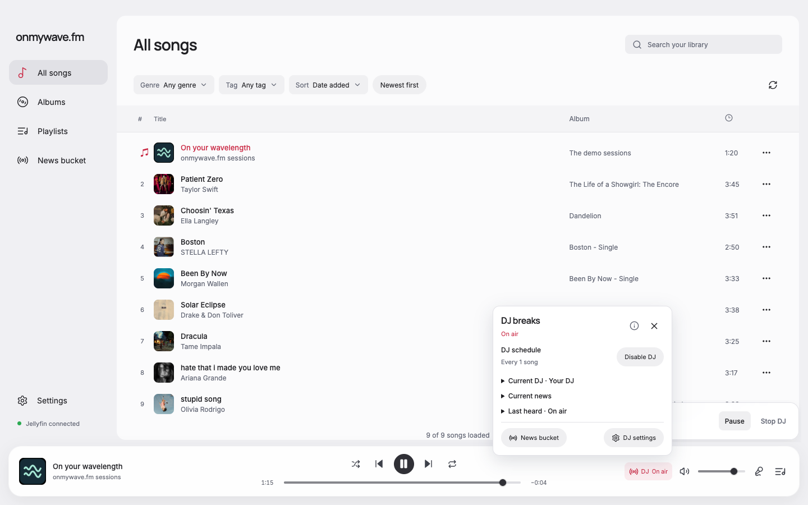
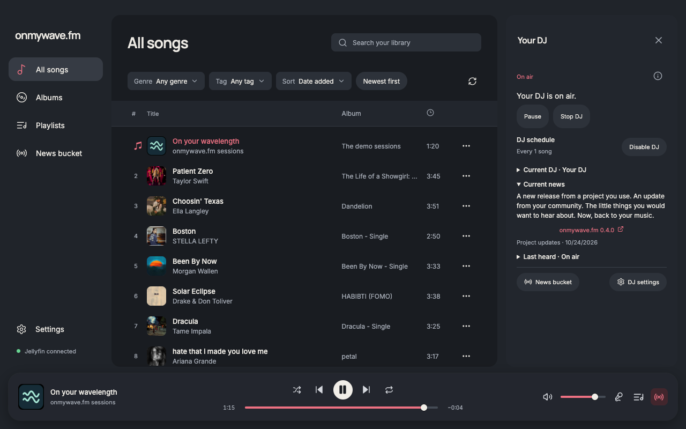
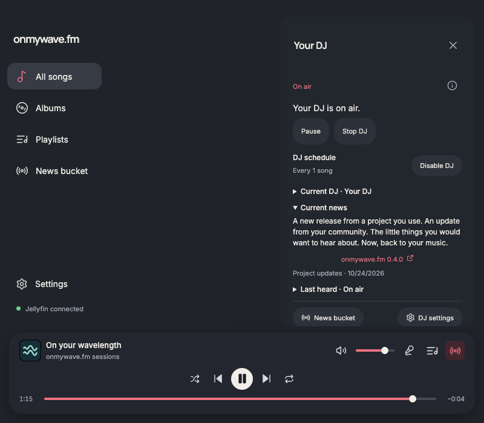
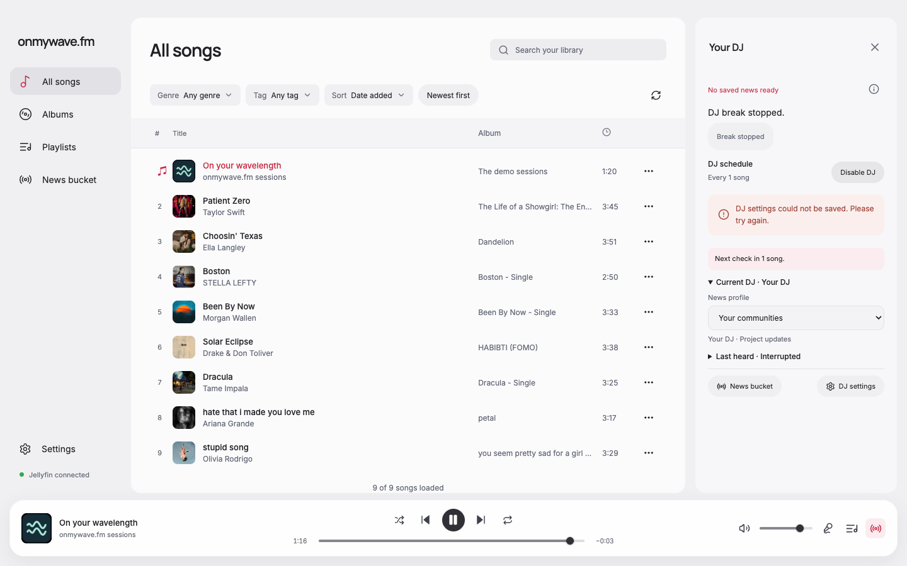

# DJ sidebar

DJ controls now open in an app-level right sidebar from the radio icon at the far right of the bottom tools. Queue, lyrics, song details and DJ share the existing drawer state and focus/close behavior, so only one is open. The inset DJ panel uses the same top/bottom offsets as the library and a 16 px gap.

The former popover content moved into DJSidebar. Schedule, profile selection, preparation and recovery state, saved-pool retry, source links, history and settings destinations remain in their original domain owners. Current/upcoming news opens by default; history stays collapsed. One DJBreakNotice instance stays mounted and portals into the sidebar while open, returning to the floating notice stack when closed. This preserves per-run identity and avoids duplicate actions or live status. Ended-run feedback stays in the open sidebar until a new run or close, preventing a blur-driven layout shift from swallowing the next section click. Floating notices retain their existing focus behavior.

Steve and Elena independently proposed the integration, challenged separate panel state versus the existing drawer union, and supported using the drawer union. Steve's implementation review found no actionable code issue. Elena's visual review found no blocker at 1440 and 800 px and supported retaining terminal feedback to prevent the reproduced click failure. The coordinator performed integration and verification.

## Verification

Controlled browser verification of the built renderer used the existing disposable bridge, demo catalog and local audio. No accounts or provider calls were used. The before/after pair uses 1440 × 900, the same library content and DJ-on-air state. Additional views cover 1280 × 800 and 800 × 700 in dark theme. These are actual renderer screenshots, not the generated concept images.

All 15 checks in report.json passed, with no page errors:

- One active DJ controller, moved between the floating stack and sidebar.
- Initial close-button focus, Escape return to the opener, unchanged player geometry.
- Sidebar/library top and bottom alignment, 16 px gutter and outer inset.
- Pause retains focus on Resume; Stop retains terminal feedback.
- Pointer and keyboard activation of Current DJ after Stop succeed without layout shift.
- Closing and reopening clears the ended-run feedback.
- DJ replaces queue and lyrics; narrow controls fit above the player without horizontal overflow.
- Failed schedule save shows the error and retains the focused action; a subsequent save recovers.
- News bucket navigation dismisses the sidebar.

`pnpm run format` and `pnpm run check` passed, including formatting, type-aware lint, TypeScript and the production build. Native Electron, VoiceOver and live-provider behavior were not exercised in this focused UI pass.

