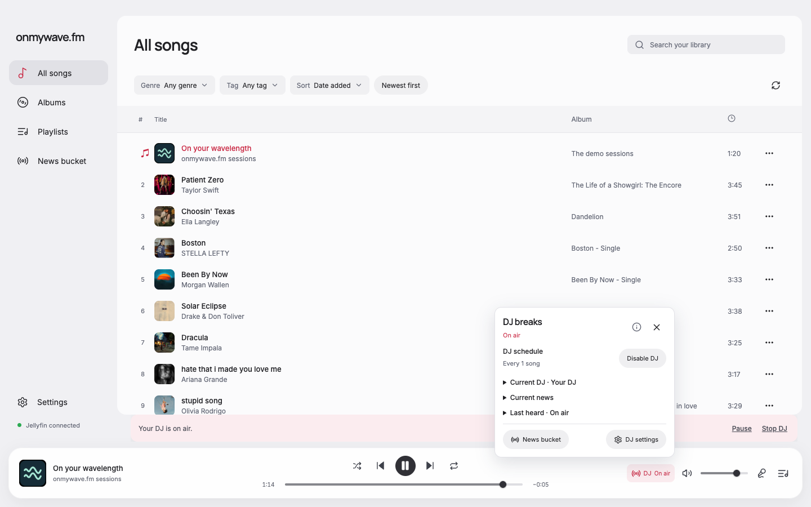
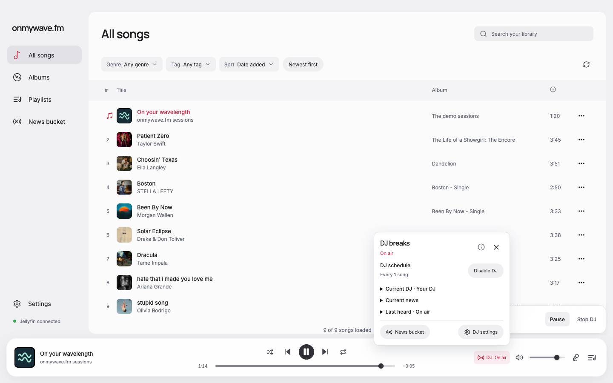
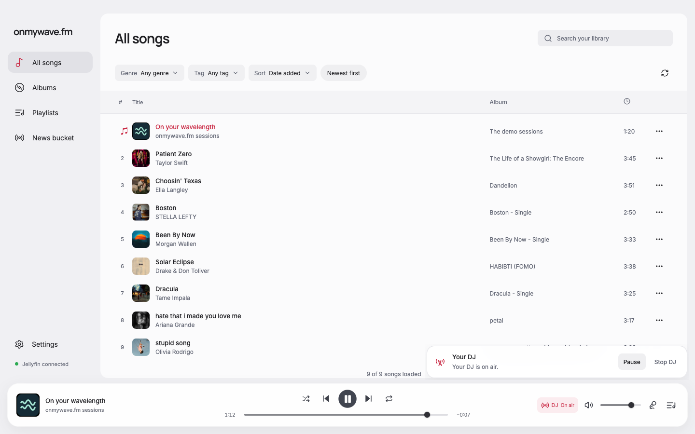
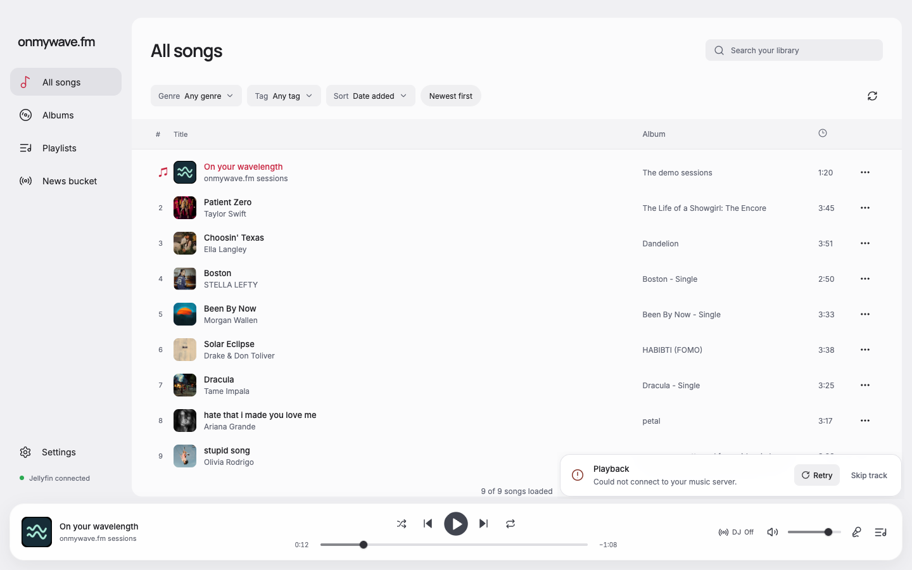
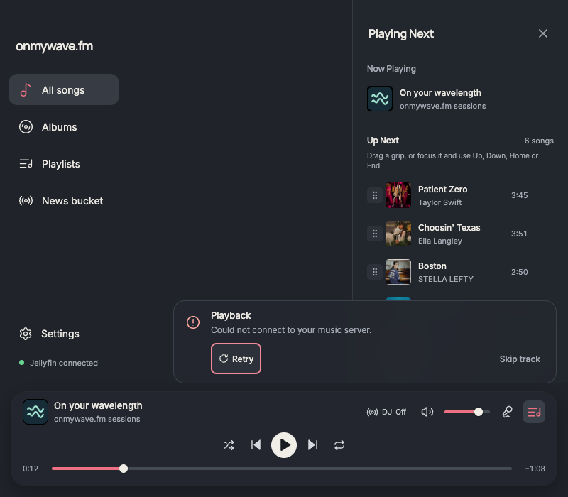

# Floating player notices

DJ controls now use the [DJ sidebar](../dj-sidebar/README.md). The screenshots below record the earlier floating-notice change.

Option A, selected by Anton. Notice cards float above the player at its right edge. All existing player notice categories share the treatment. The library, player, DJ controls popover, and drawer retain their existing internal structure and handlers.

Before/after screenshots use the same 1440 × 900 viewport, demo catalog, DJ-on-air state, and open DJ controls popover. The popover itself intentionally retains its current design. Additional screenshots show the unobstructed notice, playback recovery, and an 800 × 700 dark-theme window with the queue open and Retry focused.

Verified in the built renderer with a disposable window.wave bridge and local audio:

- Main content stays at 1216 × 756 before and after notices appear. Previously it shrank by 48 px.
- DJ Pause changes to Resume; Stop retains focus on its terminal action.
- Playback failure displays Retry and Skip track.
- Recovery controls remain visible with the narrow queue open. Buttons are 44 px tall and the keyboard focus outline is visible. No horizontal overflow or page errors.
- Notice height measurement remains available to the updater overlay.

Formatting, type-aware lint, type checking, and production build passed through `pnpm run format` followed by `pnpm run check`.

