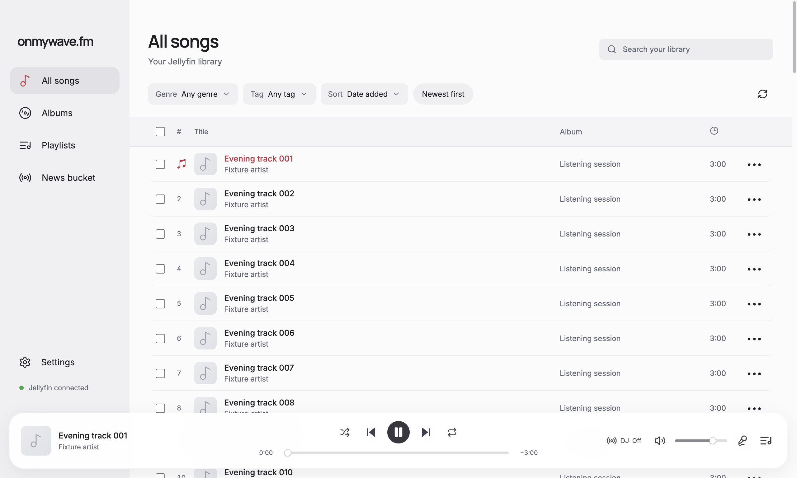
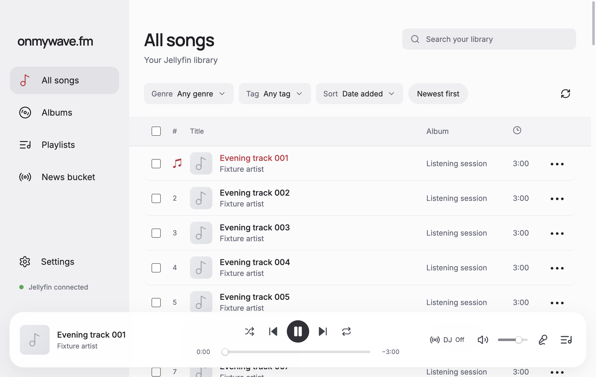
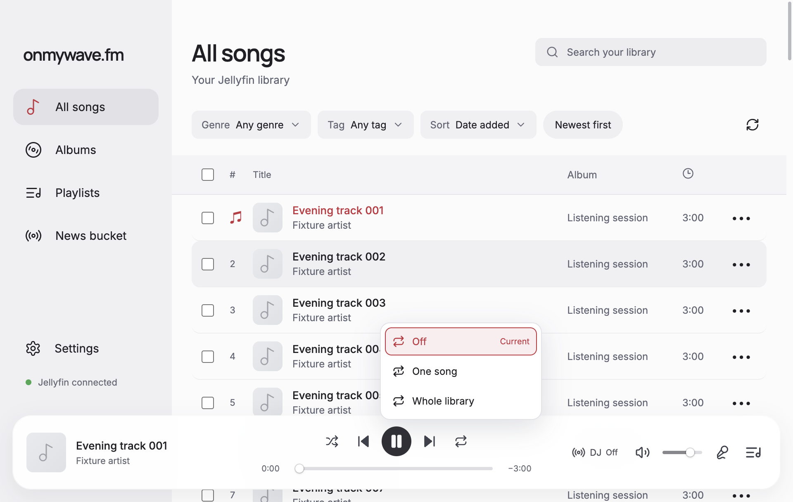
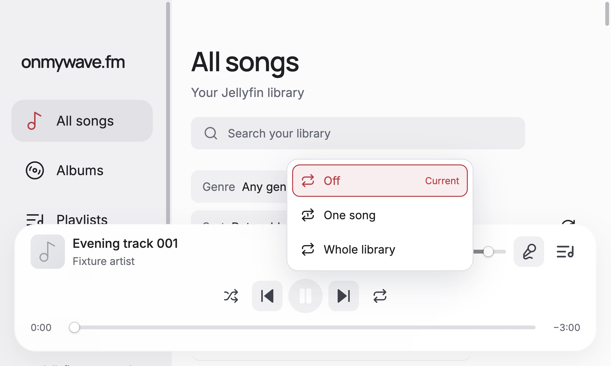
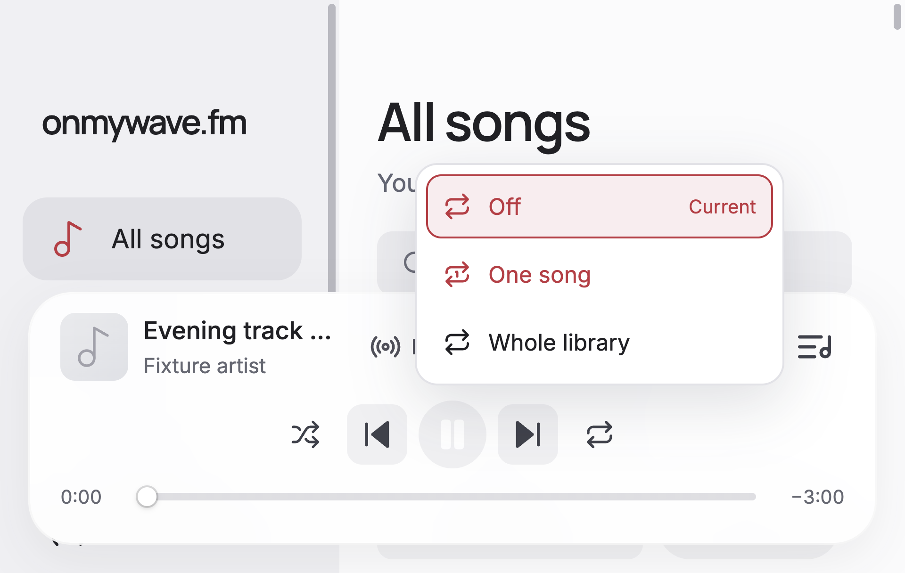

# Library repeat verification

Issue #190, 2026-10-21. Desktop base `add11a9`.

The repeat trigger now offers Off, One song, and Whole library. The persisted `all` value intentionally means Whole library, replacing finite queue repeat. Only that mode discovers additional library songs. Existing queue entries, duplicate occurrences, the current track, and already planned shuffle order remain in place. Catalog additions are deduplicated by song ID. Shuffle keeps its 50-track window and refills at 10 remaining from unvisited songs. Each repeat cycle includes every queued occurrence, including the last song from the prior cycle, while avoiding an immediate boundary repeat when alternatives exist.

Library discovery runs in the background and shares its pending request with a queue boundary. It fetches unfiltered 500-song pages once per mode/account/library-scope session, up to the existing 100,000-track saved-queue limit. Failed discovery keeps current audio and the existing queue intact, shows Retry library, and can resume a waiting boundary. Removed songs are excluded from later catalog additions for that queue session.

## Checks

[report.json](report.json) records the focused scenarios and review decisions. Verification used the actual React renderer inside isolated Electron, with synthetic catalog responses, audio events and a disposable profile. Full cycles, refill order, sequential playback, finite Off, One, saved-session rehydration, failed/slow discovery, mode changes, account/library changes, queue replacement and removal passed. Keyboard checks covered arrow/End selection, Enter, Escape, light dismissal and retry focus return.

`pnpm run format`, `pnpm run check`, and `git diff --check` passed. `pnpm audit` reported no known vulnerabilities. No unit framework or unit tests were added.

Live Jellyfin, decoded media completion, encrypted main-process persistence, audible DJ transitions and very large catalog performance were not verified. This change uses the existing bridge and checkpoint contracts.

## Screenshots

All images contain synthetic songs. Before/after pairs use the same three-song playback state, repeat Off, at 100% app zoom. Window sizes are 1280×800 and 960×640, with content viewports 1280×768 and 960×608 at device scale 2. Baseline images were captured before editing; the final baseline pair was recaptured from base source after an intermediate debug capture overwrote one file.

| Window | Before | After |
| --- | --- | --- |
| 1280×800 |  |  |
| 960×640 |  |  |

The new selector at 960×640:

The selector also remains within the viewport at 200% app zoom at both window sizes:

