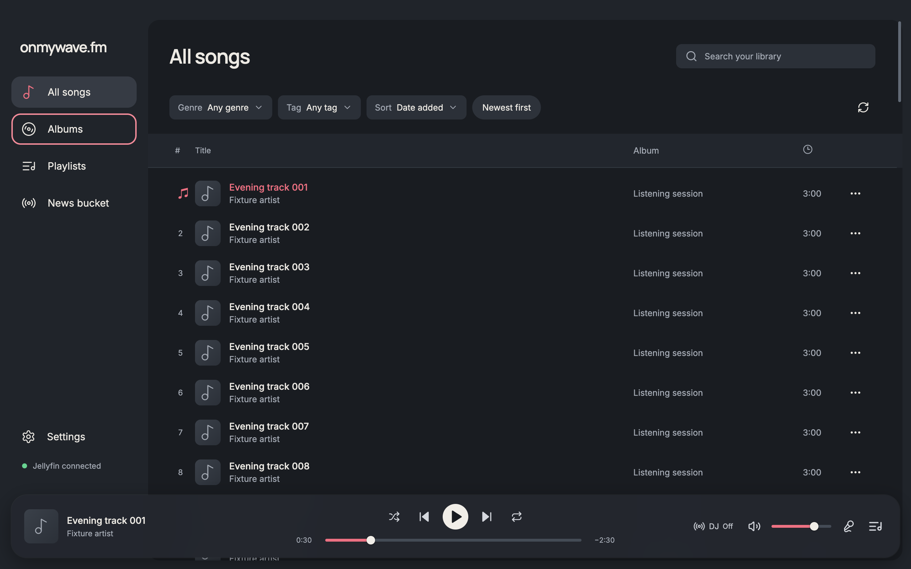

# Sidebar focus, row spacing, and scrollbar gutter

Corrects the remaining issues shown in the follow-up screenshots. The earlier verification covered filter and queue focus but missed clipping in the sidebar's own scroll container.

- Sidebar buttons now use an inset focus outline, visible on all four sides.
- Main content uses `overflow-y: scroll` and `overflow-x: hidden`. Filtering no longer removes the scrollbar slot.
- The table measures its header position and paints the matching background and separator beneath the transparent native scrollbar gutter. Resize and scroll updates keep the band aligned when the header becomes sticky. Cleanup removes it when the table unmounts, including empty search results.
- Song cells have equal 2px transparent top and bottom borders. Hover and selection use `background-color` so they preserve `background-clip: padding-box`. The earlier `background` shorthand reset that clipping. Total row height stays 56px.
- Song row focus draws inside the cells, including the first and last cell edges, avoiding Chromium's incomplete outline around a table row.

## Visual evidence

The matched 1280×800 Dark screenshots use the same synthetic songs, playback paused at 30 seconds, initial scroll position, and keyboard focus on Albums. Before is commit `115b24c`; after includes these corrections.

| Before | After |
| --- | --- |
|  |  |

Also visually inspected [row focus and selection](after-row-focus-1280.png), [one search result](after-search-1280.png), and [the sticky header](after-sticky-header-1280.png).

## Checks

Used the existing queue-editing fixture and actual renderer. At 1280×800, filtering from 80 loaded songs to one result retained a main client width of 1052px, heading bounds of x=238 to 1230, and search-field bounds of x=950 to 1230. The short results' scrollHeight and clientHeight both measured 760px while overflow-y remained scroll. Empty results removed both header background properties. At 960×700, main clientWidth and scrollWidth both measured 732px.

At scrollTop 400, the header was at y=28 to 76 and the gutter background at 0px to 48px relative to the main container. The row borders measured 2px above and below, with padding-box background clipping and 56px total height. Loading all 120 songs and using ArrowUp from the last row focused index 118 with 15 rows mounted at 960×700; the last cell retained its right, top, and bottom focus lines.

Formatting, type-aware lint, TypeScript, and the production build passed. No dependencies changed. These checks use Chromium and synthetic library data; native Electron scrollbar rendering and VoiceOver were not exercised.
