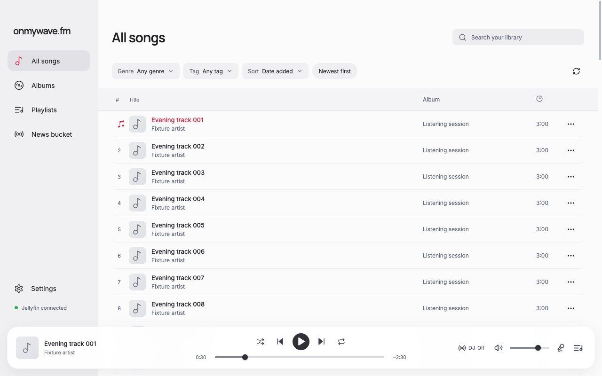
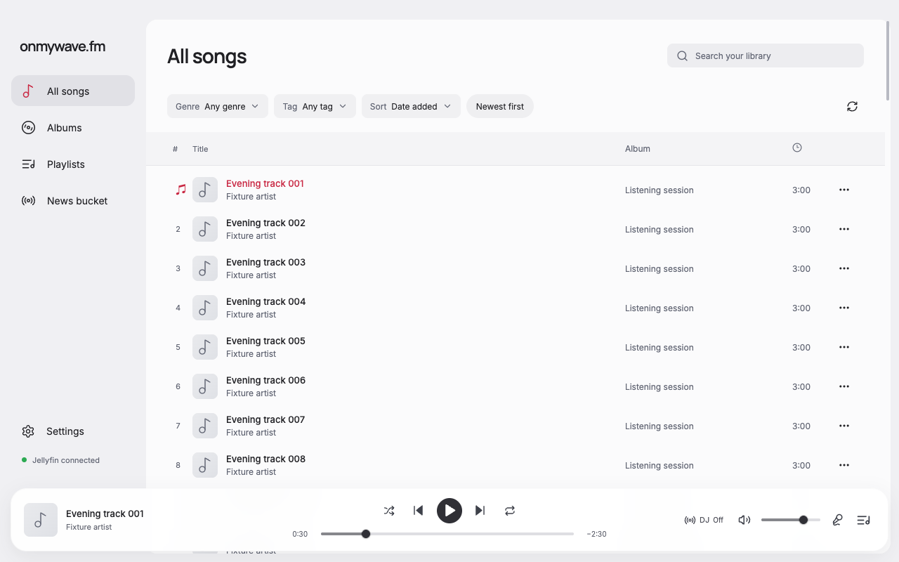
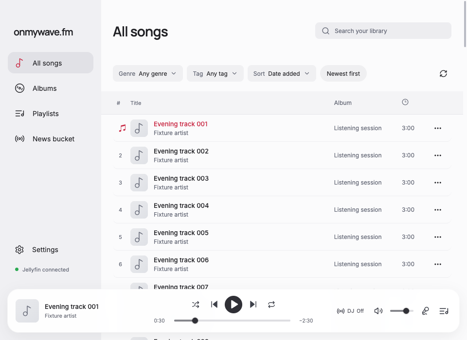
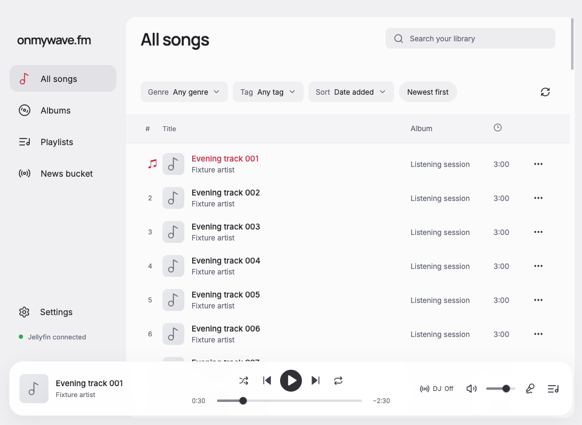
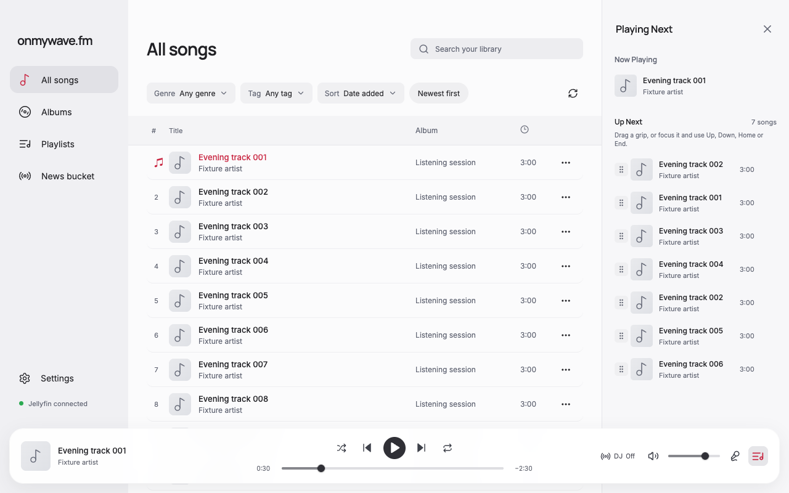
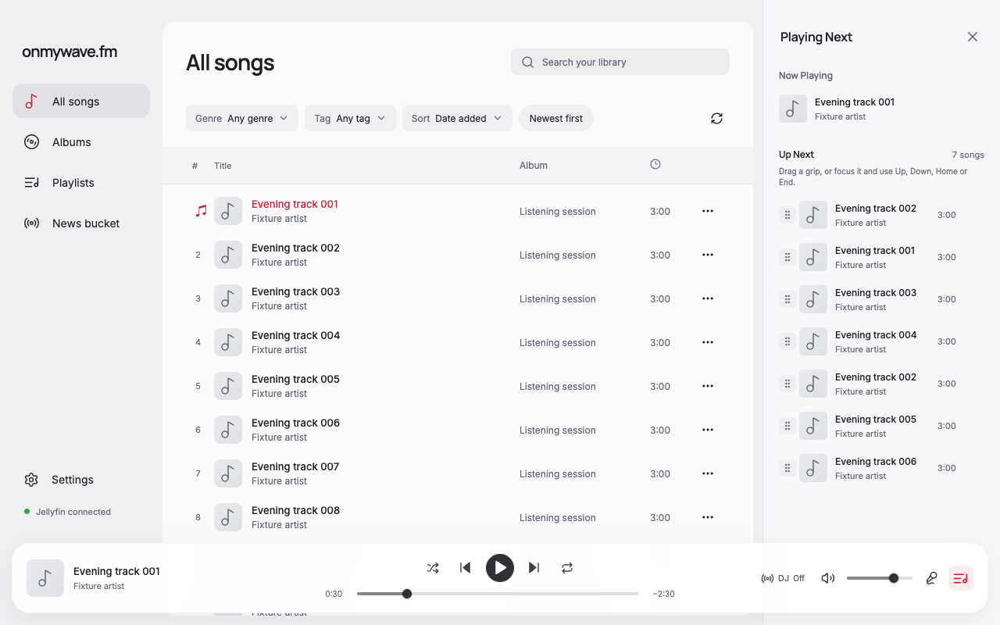

# Library spacing and keyboard focus

The main content now sits in an inset, theme-aware frame inspired by the supplied Yandex Music reference. Song rows have square edges, an 8px gap below the table header, and 4px of transparent spacing between row backgrounds. Their total height remains 56px so virtual scrolling retains its existing density. The scrollbar itself and its track have transparent backgrounds; a short table fills the frame through its right edge without reserving a scrollbar gutter.

The library search has a labeled Clear search button that clears both the input and applied query, clears selection, and restores input focus. Typing retains the existing 300ms debounce. Empty searches apply without that delay, and clearing cancels a pending search. Filter options and drawer buttons draw their focus rings inside their bounds, including at scroll-container edges.

## Matched screenshots

Before captures use `a75d081`. Each pair uses the same viewport, synthetic songs, initial scroll position, no selection, and song 1 paused at 30 seconds. Run the existing fixture with `node docs/verification/queue-editing/server.mjs`, then open `http://127.0.0.1:5205/?case=library-spacing`.

| View | Before | After |
| --- | --- | --- |
| All songs, 1280×800 |  |  |
| All songs, 960×700 |  |  |
| Queue open, 1280×800 |  |  |

Additional visually inspected captures show the [first focused filter option](after-filter-first-1280.png), [last focused filter option](after-filter-last-1280.png), and [Dark theme at 1600×900](after-dark-1600.png).

## Focused verification

- Measured an 8px header-to-first-row gap, 56px row height, 4px transparent row border, and square row corners. Main scrollWidth equals clientWidth at 960, 1280, and 1600px viewport widths.
- Wrapped the disposable fixture's catalog bridge to record and filter search requests. Four input changes 45ms apart issued no requests during typing and one request for the final value after the debounce. A search for `track 120` displayed one result with no vertical scrollbar or trailing header gap. An unmatched query displayed the existing empty state.
- Clear search restored the full results and input focus. Clearing 80ms after typing prevented the pending query from being sent even after another 400ms. Cached results remained available.
- Sort Home/End and keyboard focus showed complete 2px inset outlines on the first and last options. Tab reached the queue remove action with the same inset outline; inspected its visible ring.
- Scrolled to load all 120 songs, focused the final row, and used ArrowUp to reach row index 118. The focused row stayed below the sticky header and above the player, with 16 rows mounted. No horizontal overflow appeared.
- Visually inspected Light at 960×700 and 1280×800, Dark at 1600×900, and Coffee with the existing queue overlay at 800×700. The narrow overlay remained 304px wide, the main content hid as before, and body width remained 800px.
- `pnpm run format` and `pnpm run check` passed, including formatting, type-aware lint, TypeScript, and the production build. `pnpm audit` reported 10 existing dependency advisories: 3 high, 5 moderate, and 2 low. Package manifests and lockfile are unchanged.

Verification used the actual renderer with the existing synthetic catalog/audio bridge. Native Electron chrome, VoiceOver, and a connected Jellyfin library were not exercised.
