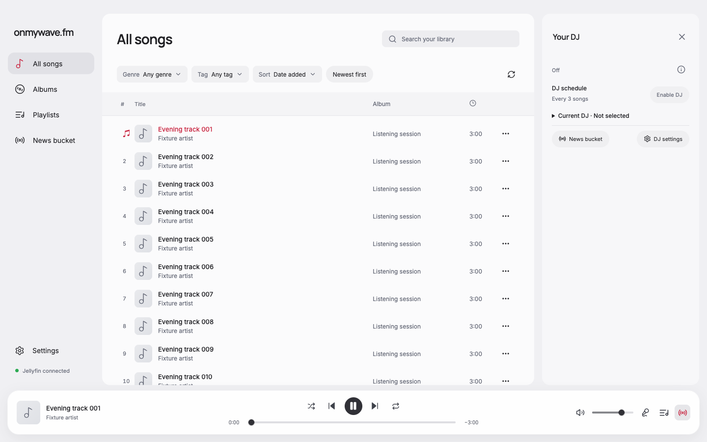
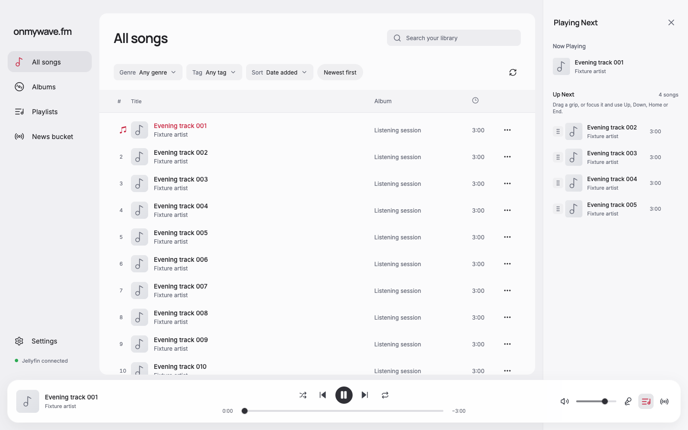
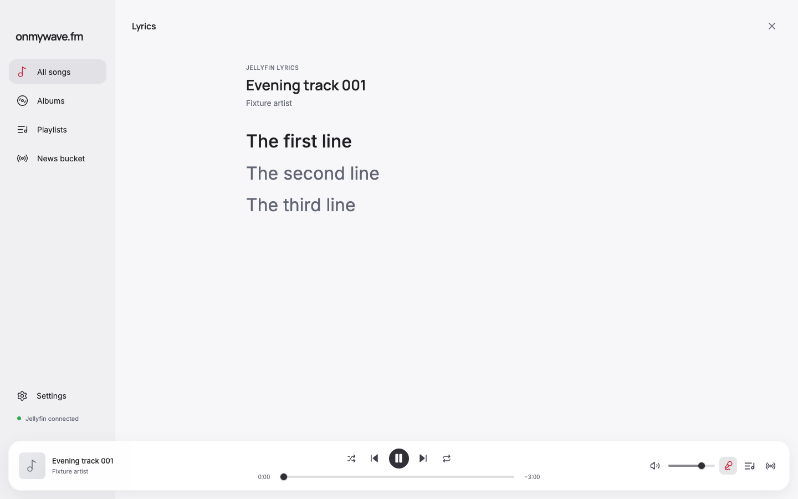
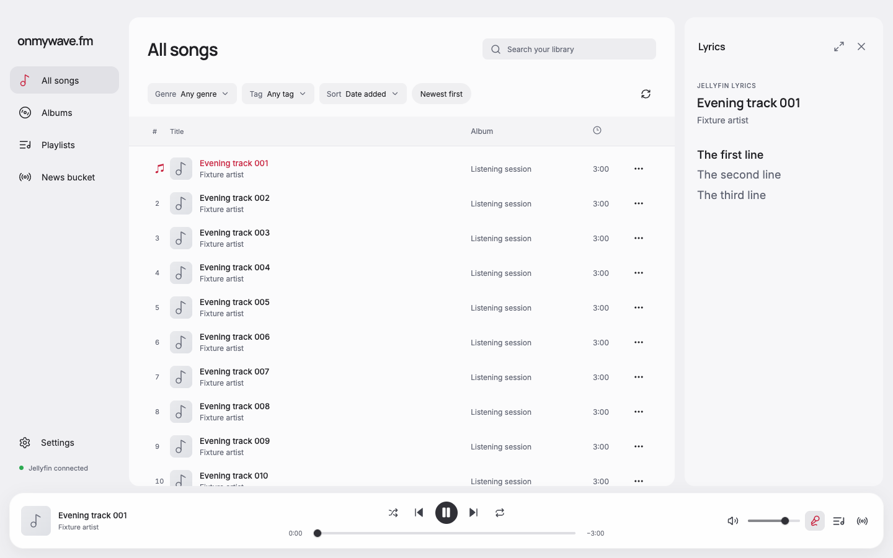
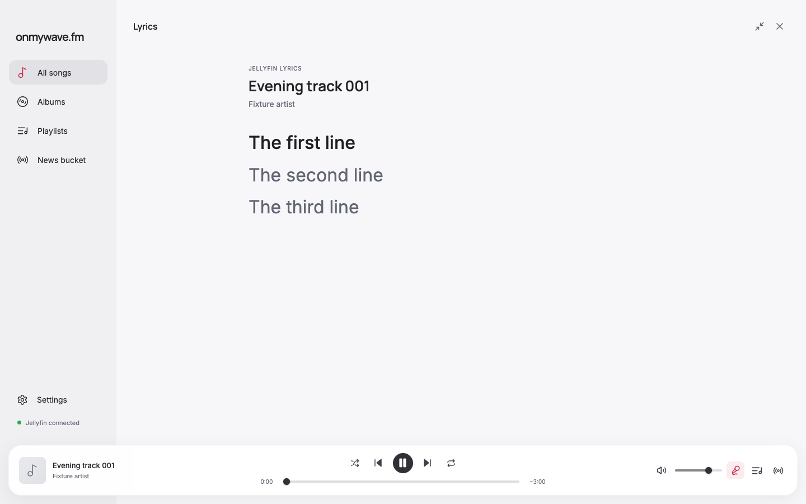
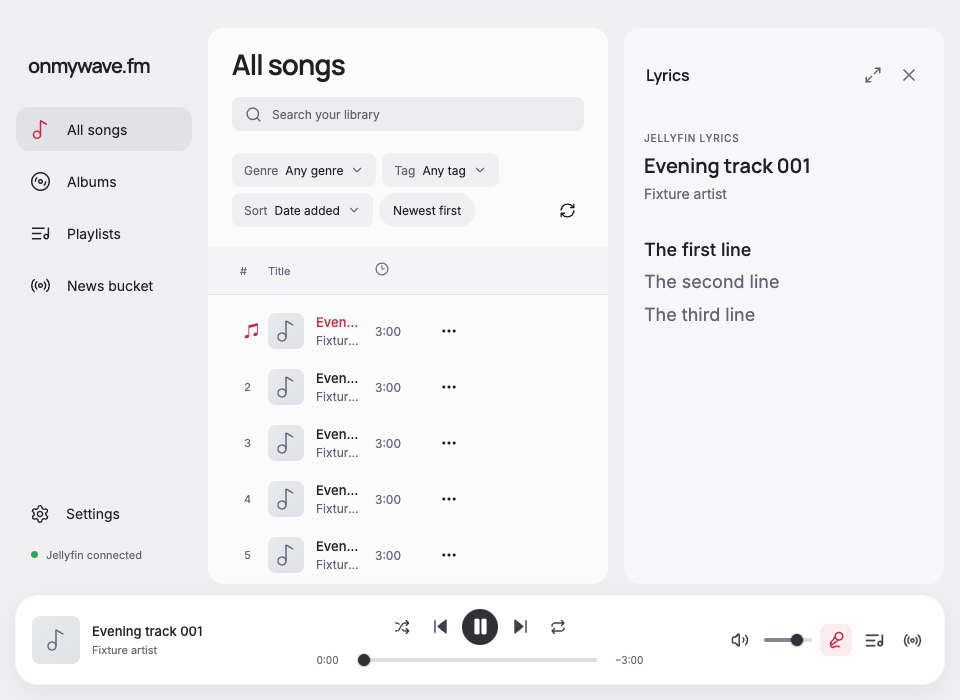
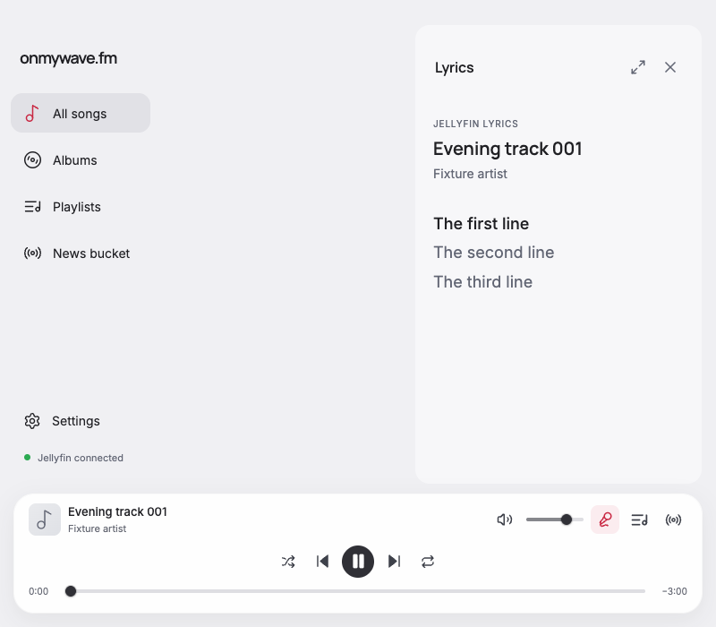
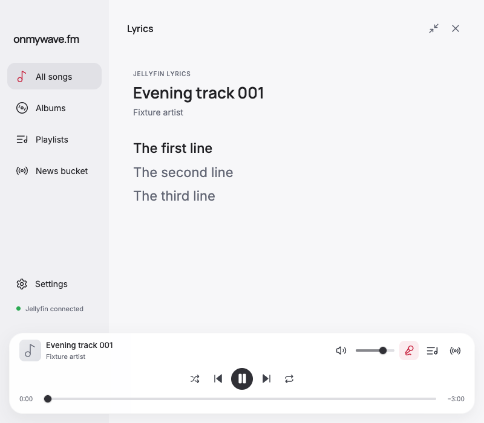

# Consistent listening sidebars

DJ, queue, and lyrics share the existing DJ panel geometry: a 320 px panel, 16 px outer inset, 28 px top inset, rounded corners, and clearance above the player. The shared CSS variable controls the grid column and narrow-window panel width. Song details retain their existing layout.

Lyrics open in the sidebar. The heading has a size toggle and Close button. Expand covers the content area using the previous lyrics layout; Return lyrics to sidebar restores the shared panel. Opening lyrics again starts in the sidebar. The lyrics component stays mounted through resizing, and automatic following recenters the current line after either size change. Covered library content is inert only while lyrics are expanded.

## Verification

Before and after screenshots use the real development renderer with the existing playback-progress fixture bridge, fictional catalog, first song at 0:00, light theme, and a 1440 × 900 viewport. No account or provider services were used. All matched captures were visually inspected, along with expanded lyrics and the 800 px sidebar. Browser measurements and behavior results are recorded in [report.json](report.json).

Focused browser checks passed at 1440 × 900, 1600 × 1000, 960 × 700, 800 × 700, and 640 × 480:

- DJ, queue, and lyrics have identical panel rectangles and no horizontal document overflow.
- Lyrics begin in the sidebar, expand across the content area, and return to the sidebar without remounting.
- Expand/collapse retains button focus. Escape closes each panel and restores focus to its opener.
- The library is inert only for expanded lyrics.
- Timed lyrics remain visible through expansion and collapse; line seeking and resuming automatic following work with a long lyrics fixture.
- Switching panels leaves one drawer open, and returning to lyrics starts in the sidebar.

`pnpm run format`, `pnpm run check`, and `pnpm audit` passed. Native Electron, VoiceOver, and live Jellyfin were not exercised in this focused UI pass.

| Panel | Before at 1440 × 900 | After at 1440 × 900 |
| --- | --- | --- |
| DJ |  |  |
| Queue |  |  |
| Lyrics |  |  |

