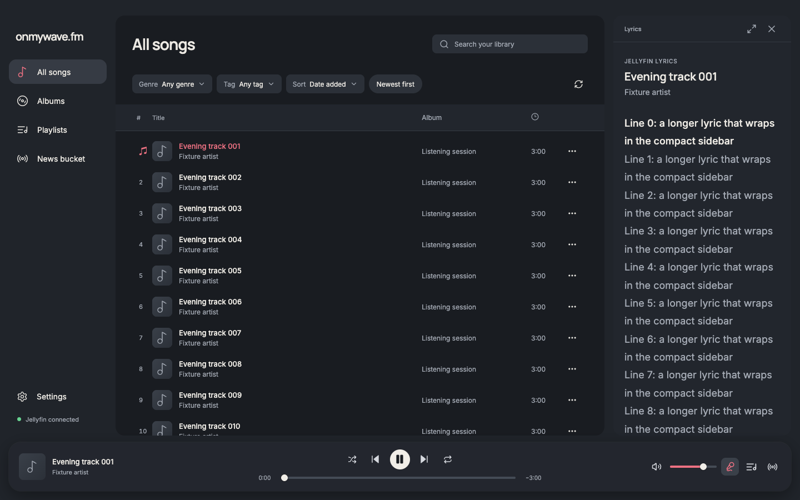
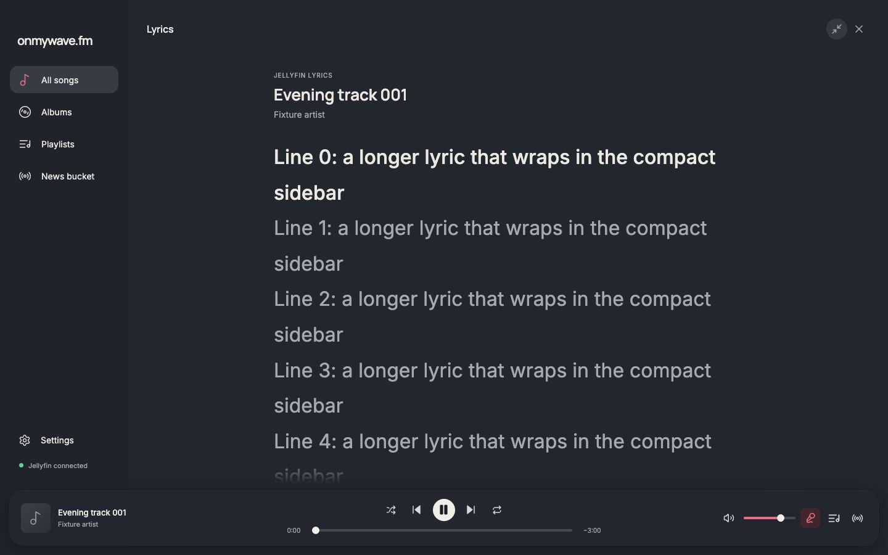
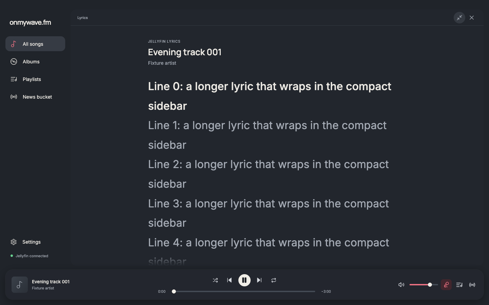
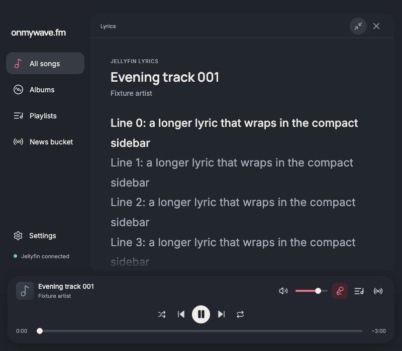

# Stable lyrics controls and live resize

Lyrics retain the same 28 px top inset, 16 px right inset, player clearance, rounded card, and 48 px header in both sizes. The expand/collapse and close controls consequently occupy identical screen rectangles. The expanded card grows leftward across the library; the app keeps the covered library's grid reservation, so its geometry does not jump underneath the animation.

Width, body padding, and lyric typography interpolate over 220 ms with the existing sidebar easing. These are live layout transitions, so text reflows rather than scaling a raster snapshot. Rapid toggles reverse the current CSS transition. The existing Lyrics component and button nodes stay mounted, retaining data, focus, and manual-follow state. Reduced motion skips the transitions.

The following effect observes body and content dimensions while following synchronized lyrics. It recenters instantly during reflow, including narrow windows where only padding and typography can change. Browser scroll anchoring is disabled for the lyrics scroll region. A stale scroll-end event only completes the current programmatic scroll when the expected target has actually been reached, preventing a previous scroll from canceling a newer follow request.

Steve and Elena independently compared snapshot resizing and live CSS geometry. Both supported live resizing to avoid stretched text, with a reservation about following during reflow. Review caught the content-size-only reflow case. Focused verification also reproduced stale scroll-end events stopping following; the target check addresses that race. Both reviews reported no remaining actionable issues after the relevant corrections.

## Verification

Before captures reproduce the original mismatch at 1440 × 900, 960 × 700, and 800 × 700. After checks cover those sizes plus 480 × 640, with a fictional long-lyrics fixture and dark theme. Matched 1440 px before/after captures were visually inspected, along with the expanded 800 px capture. The same source controls had identical x, y, width, and height at both endpoints and throughout every sampled resize frame. Header, player, and library geometry stayed stable; actual panel widths changed across multiple intermediate frames. At 480 px, the test verified typography interpolation where available panel width was already fully used.

Focused checks passed for one mounted Lyrics node, retained toggle focus, visible active lyrics through reflow, rapid reversal, Escape/opener focus, and reduced motion. Separate interruption checks passed manual scrolling remaining paused during resize, resuming follow, switching to Queue during collapse, and closing during expansion. The narrow-window scroll-follow race was rerun in isolation and in the full four-viewport flow after correction.

Native Electron 43.8.1 checked the anchored controls and live resize at desktop size and the final narrow-window reflow/follow behavior. No renderer page errors occurred. Fixture checks use the real renderer with the existing disposable bridge and synthetic catalog; no accounts or providers were called.

`pnpm run format`, `pnpm run check`, and `pnpm audit` passed. VoiceOver and live Jellyfin were not exercised.

Reports: [before](before-report.json), [after](after-report.json), [Electron desktop](electron-report.json), [Electron narrow](electron-narrow-report.json), [interruptions](interruptions-report.json).

| Mode at 1440 × 900 | Before | After |
| --- | --- | --- |
| Sidebar |  |  |
| Expanded |  |  |

