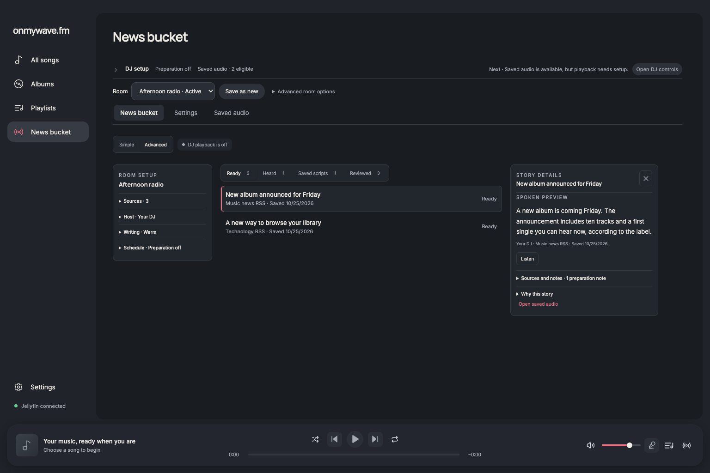
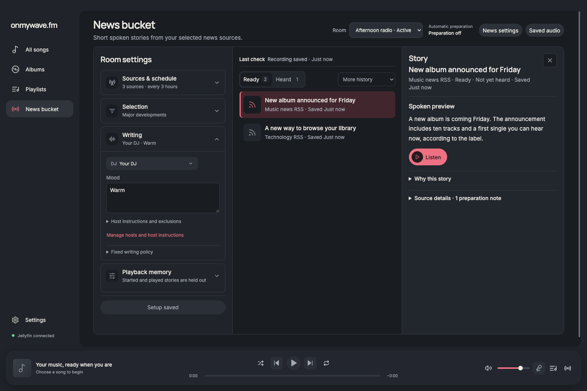
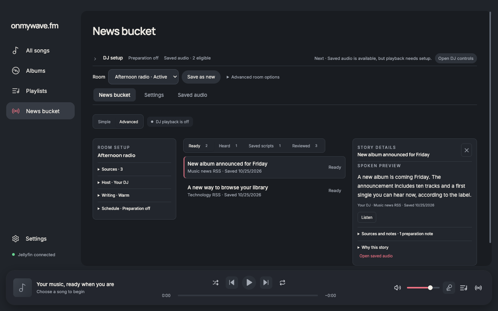
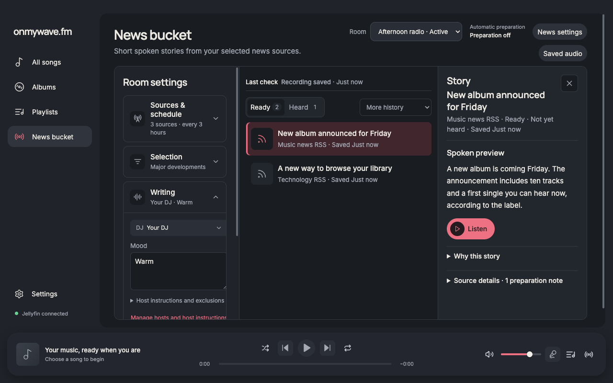

# News bucket element review

The user's attached Advanced design is the visual reference. Advanced is the standard workspace; there is no mode selector. The acceptance question for each element is: does it help the listener configure preparation, understand a decision, or inspect what will play?

## Calibration decisions

| Element | Decision | Why the listener needs it, and acceptance condition |
| --- | --- | --- |
| Page title and short description | Keep once | Identify the destination and explain that these are short spoken stories. No repeated page title or concept label. |
| Simple / Advanced selector | Remove | The user chose Advanced as the standard. A second mode adds a decision with no current value. |
| Room selector | Keep in the header | Defines whose configuration and ready pool are being shown. Changing rooms must retain the unsaved-change confirmation. |
| Unlabelled On switch | Reject | Preparation, profile availability and playback are separate states. A generic switch would hide which action it performs. Use explicit preparation status and labelled settings instead. |
| News settings entry | Keep | Opens the complete settings and recovery controls, including provider requirements. It must remain reachable from the compact workspace. |
| Saved audio entry | Keep, secondary | Provides access to retained recordings and preparation history without filling the workspace with another toolbar. |
| DJ readiness toolbar | Move into setup details | Useful when configuration is incomplete. Routine browsing should start immediately below the main header. Errors and actionable interruptions remain visible. |
| Save as new room | Move to room management | Copying profiles is occasional work, not the primary task when choosing a story. Preserve the existing copy and naming flow. |
| Room availability | Move to room management | This controls eligibility for both playback and preparation; it must not masquerade as the preparation switch. |
| Compact settings on small windows | Accept | Keep settings collapsed by default below the desktop column breakpoint so the story list is visible. Its button must expose expanded state, and desktop settings must scroll independently. |
| Save setup | Accept | One save commits all room edits through the existing guarded mutation. Unsaved and failed-save feedback stays beside it. Invalid numeric values must reopen their disclosure and receive focus. |
| Three-column workspace | Accept | Settings on the left, stories in the middle, the selected story on the right. Columns start together, extend toward the player and use readable text. |
| Sources and schedule disclosure | Accept | Answers where stories come from and when checks run. Collapsed summary must show selected-source count and actual interval. Expanded controls must use the existing room draft and save path. |
| Source attention notice | Conditional | Show actual collection warnings or missing-source problems. Do not fabricate a failing source to match an illustration. |
| Selection disclosure | Accept | Lets the listener choose major or relevant stories and include/skip topics. These are real editorial inputs. |
| Freshness window | Explain as a rule | Freshness and duplicate prevention are server rules. Do not offer a selector unless it changes the actual policy. |
| Writing disclosure | Accept, initially open | The original request concerns unnatural writing. Put the real host and mood controls here and explain the writing policy. |
| Style presets from the mock | Reject as decorative controls | There is no saved style-preset field. Use the existing editable room mood and host instructions rather than a dropdown that cannot change generation. |
| Length dropdown from the mock | Replace with policy copy | The writer targets 25–45 words with a hard 55-word limit. A pretend dropdown would misrepresent the enforced contract. |
| Mention source toggle | Replace with policy copy | Attribution must follow the source evidence and uncertainty. It must not become a permission to remove necessary attribution. |
| Stock sign-offs toggle | Remove | The server already disallows stock sign-offs. Turning an enforced writing rule into an option undermines the requested natural tone. |
| Host instructions / voice notes | Keep through the real host editor | These are shared host settings. Clearly label that scope rather than silently making a room-only edit affect every room using the host. |
| Playback memory disclosure | Accept | Explains why stories disappear from Ready and why interrupted stories do not repeat. There is no reset or repeat toggle. |
| Assessed versus heard note | Keep concise | Editorial review must never imply playback. Only confirmed playback belongs in Heard. |
| Last check status | Keep above stories | Shows whether the source check is current and its actual outcome. Missing timestamps must say that no check is recorded. |
| Ready / Heard filters | Keep | These are the listener's main actions: choose upcoming audio or inspect confirmed playback. Counts must come from actual records for the selected room. |
| Collected / Qualified labels from mock | Adapt | Show Collected and Selected only when the latest room request contains the corresponding checkpoint. A collection is a per-request snapshot and selection is at most one story per run. Do not invent cumulative counts or relabel review history as qualification. |
| Saved scripts / Reviewed filters | Keep, secondary | Preserve access to unfinished audio and editorial decisions. Clearly disclose their cross-room history scope. |
| Story row | Accept | Title, source, relative saved time, selected state and chevron give a clear route to details. Avoid duplicate Ready labels on every Ready row. |
| Story artwork | Use a source icon | The stored articles do not include artwork. A clean source icon is honest; fabricated concert photos suggest source content that was never fetched. |
| Story inspector title and close | Keep | Selection should be obvious and reversible. Escape closes it and returns focus to its row, while global dialogs/drawers retain priority. |
| Story title, source and delivery state | Keep at the top | Establish what the listener selected and whether it has started or finished. Do not call a merely prepared story heard. |
| Spoken preview and Listen | Keep prominent | Lets the listener judge the actual generated language and saved audio. Pause, resume and stop must work; closing or leaving stops the preview. |
| Example label in mock | Remove | This is the actual saved script, not sample copy. |
| Why this story | Keep collapsed | Explains the recorded editorial selection. Old records without a reason must say so; do not generate a justification after the fact. |
| Source details | Keep collapsed | Gives source links and preparation notes without competing with the spoken text. Preserve source warnings. |
| Duplicate Open saved audio link in inspector | Remove if header already provides it | Avoid two routes to the same view beside every story. |
| Active or interrupted playback notice | Conditional | The listener needs the actual playback state to understand why a story is no longer available to repeat. |
| Recovery, stale-data and profile mismatch notices | Conditional | These change what the user can safely infer or do. Keep actionable messages visible, while removing routine diagnostic chrome. |
| Global navigation and player | Preserve | These belong to the shared application shell. The workspace must fit above the player and remain usable beside the DJ drawer. |

## Verification

Before screenshots were captured before editing at 1536×1024 and 1280×800 with the same fixture stories, room and theme used for the after screenshots. These fixtures contain no credentials or private source content. The page uses the real renderer and typed bridge boundary; provider calls are mocked.

Behavior and visual results are recorded after implementation. A successful build alone does not establish visual fidelity.

## Paired review and decision

Steve and Elena independently reviewed the screenshot, current renderer and persisted domain data before implementation. Both supported the three-column workspace and replacing the stacked page toolbars with one header. Both accepted a compact editable sidebar with the reservation that it must share the existing room draft, guarded save mutation and failure handling. Both rejected unsupported moderation actions and decorative controls for fixed server rules.

The challenge round considered moving the complete existing settings forms into the sidebar. This would preserve their behavior directly but recreate a long settings page inside a narrow column. The decision was to reuse their state and persistence path for a small set of inline controls, while keeping provider readiness, automatic activation, stop, resume and profile management in the complete settings view. There was no unresolved objection. Steve owned page integration and inline room controls; Elena owned the story workspace and inspector; the coordinator owned integration verification and this element review.

## Results

The final renderer checks passed at 1536×1024 and 1280×800 in dark mode, 1280×800 in light mode, and 800×700 in dark mode. At 1536, the three columns begin at y=123 with measured widths of 363, 444 and 423 pixels. Story titles are 15px. At 1280, all three columns remain available and the settings column scrolls independently. At 800, settings start collapsed and stories appear immediately below their disclosure.

The focused browser check verified:

- Advanced-only rendering, room-scoped Ready and Heard counts, and started playback remaining separate from Heard.
- Inspector selection, Escape and focus return, reclaimed column width, and global drawer priority.
- Saved-audio preview pause, resume, stop, error/retry, and cleanup on navigation, music playback and room changes.
- Shared mood drafts between inline controls and full settings; failed saves retain edits; successful saves use the existing `saveWorkflowDraft` bridge and expected room identity.
- An invalid daily limit inside a collapsed disclosure reopens the section and focuses the input without sending a save.
- Saved scripts without audio, reviewed history, the history placeholder's Ready fallback and cached history during a fetch failure.
- Actual checkpoint Collected/Selected counts, cross-room scope, stored selection reasons, candidates without Listen actions and stage controls that remain visible without horizontal scrolling.

`report.json` contains measured layout and interaction results. There were no page errors or horizontal page/workspace overflows. `pnpm run format`, `pnpm run check` and `pnpm audit` passed. No dependencies or unit-test frameworks were added. Browser audio is simulated; native Electron audio devices, VoiceOver and live-provider editorial quality were not exercised by this UI verification.

### Matching before and after captures

1536×1024, dark:




1280×800, dark:




Additional captures: [light theme](after-1280-light.png), [narrow window](after-800-dark.png), [checkpoint selection reason](after-editorial-1536-dark.png), [stale data](after-stale-1440-dark.png).

## Reproduce

Start the existing renderer fixture server from the project root with `node docs/verification/playback-progress/server.mjs`. Connect an isolated headless Chromium instance with remote debugging on port 9337, then run:

```sh
WAVE_PLAYWRIGHT_MODULE=/absolute/path/to/playwright \
WAVE_DEBUG_URL=http://127.0.0.1:9337 \
node docs/verification/news-bucket-calibration/verify.cjs
```

Use a disposable browser profile. `WAVE_PLAYWRIGHT_MODULE` can point to the available runtime package; no project dependency is required.
