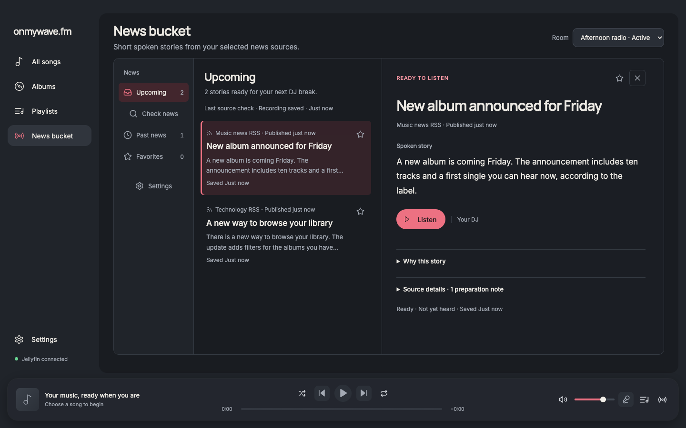
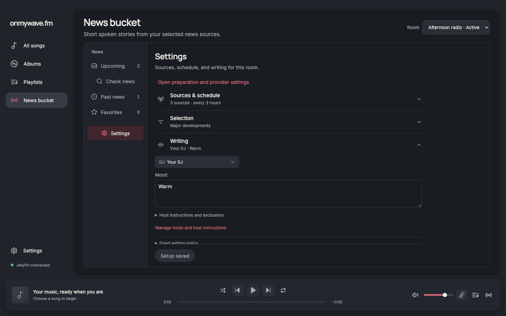
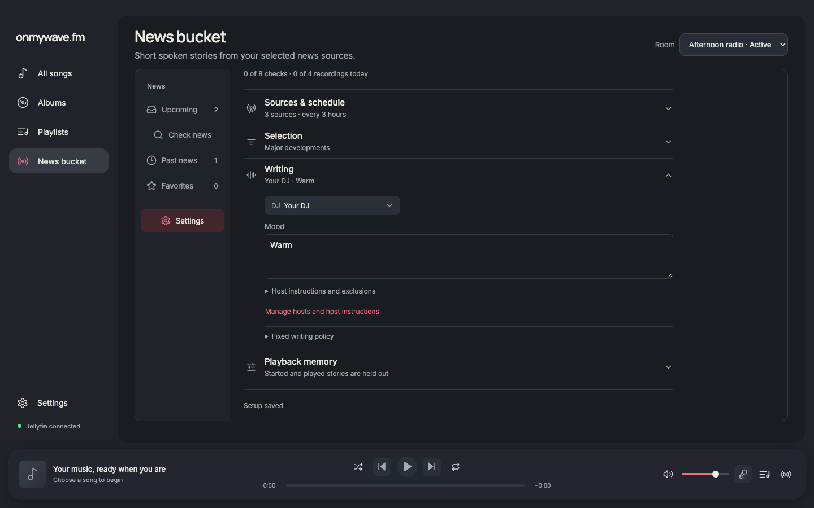
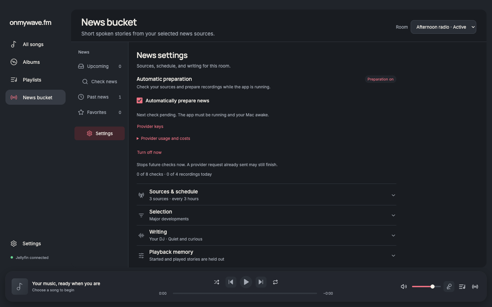
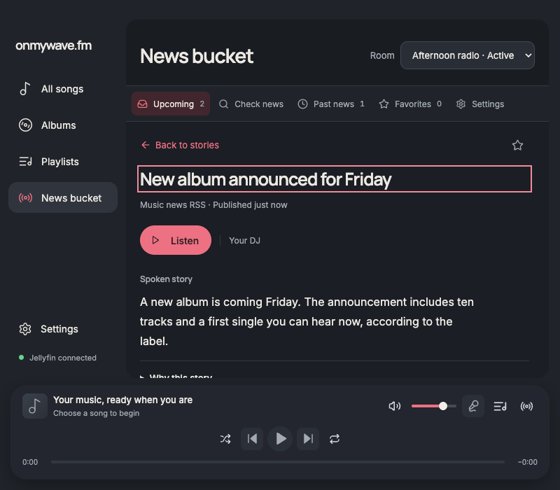

# News Bucket reading and setup refinement

The subsequent [header and category navigation refinement](../news-bucket-navigation/README.md) replaces the inner sidebar with a compact horizontal navigation row and a narrow-pane category selector. The screenshots below document the earlier reading/setup pass.

News Bucket now behaves like a focused reading and listening workspace. The sidebar retains Upcoming, Check news, Past news, Favorites, and Settings. A roomy desktop opens the first eligible story once, while compact windows show a focused reader with Back to stories. Real publication dates and short saved-script excerpts make the list useful before opening each item.

The workspace meets the app surface edges, without an inset rounded frame or an extra surrounding gutter. The visual direction is a calm editorial reader within the existing app: one accent, stronger title/script hierarchy, a quieter selected row, thin pane separators, and readable metadata. The reader uses real saved content; no article artwork, durations, provider activity, or unsupported actions are invented. Subtle selection/favorite transitions and the reader entrance respond to user actions and respect reduced motion.

Settings now includes automatic preparation, provider readiness, source selection, schedule, writing, pause/resume, immediate turn-off, and room availability. It uses the existing parent-owned drafts and mutations. Credential entry remains in the existing protected Provider keys screen, and managing sources, DJs, or providers returns to the same News Bucket Settings destination with drafts and meaningful focus retained. Unique control IDs keep legacy setup navigation working too. The cost notice is fully visible before an enabled save; saved settings retain it in a compact disclosure.

## Design evidence

The original source and fresh renderer screenshots were inspected before editing. A new ImageGen concept based on those captures guided the reading-layout refinement. Elena and Steve independently critiqued the earlier implementation, challenged the default-reader/compact-navigation choices, and reviewed the integrated result. Their strongest findings—unused desktop space, missing freshness/excerpts, lost compact navigation, and incomplete inline setup—were addressed and verified. The final independent review found no actionable UX or contract blockers in the reviewed scope.

The implementation was checked against Apple's [sidebar](https://developer.apple.com/design/human-interface-guidelines/sidebars), [split-view](https://developer.apple.com/design/human-interface-guidelines/split-views), and [list](https://developer.apple.com/design/human-interface-guidelines/lists-and-tables) guidance: concise collection navigation, persistent selection feedback, balanced readable panes, and a compact alternative when space is limited. It remains the app's Electron renderer and existing visual system.

## Acceptance evidence

| Requirement | Current evidence |
| --- | --- |
| Understand and preview upcoming news quickly | Actual source/publication metadata, saved excerpts, one-time desktop reader, explicit Listen action; fixture assertions and screenshots |
| Keep categories and details easy to navigate | Desktop sidebar, compact single reader and Back, native category selector at the smallest widths; click/keyboard and resize checks |
| Configure news in one coherent destination | Inline activation/readiness/source/schedule/writing controls; save validation, failures, recovery, and source/provider round-trip checks |
| Retain real domain behavior | Existing eligibility, heard/review distinctions, named provider operations, consent-before-save, persistent article favorites; no new generation operation |
| Preserve focus and recovery | Reader close, favorite removal, save, Resume, Turn off, availability, unique IDs, and legacy management return checks |
| Remain readable and visually consistent | Dark, Light, Coffee; measured text contrast at least 4.5:1 for sampled reading/navigation/action text; reduced-motion and overflow checks |

`report.json` records full user-flow checks at 1440 × 900 Dark, 1280 × 800 Light and Coffee, 1024 × 768 Dark, 800 × 700 Dark, and 720 × 450 Light. All six check category mapping, keyboard reading/Back focus, audio preview cleanup, favorites/source links, history distinctions and an all-recordings library, latest source-check/partial coverage, inline setup/readiness/consent, source/provider return paths, validation/save failure/retry, and horizontal overflow. The 1440 case also proves that legacy/deleted-room recordings remain reachable without changing the current room’s heard count, that delayed favorite completion cannot steal focus from another task, and exercises Resume failure/retry, immediate stop failure/retry, room availability, their keyboard focus, and the legacy setup return path.

`review-report.json` separately records sampled contrast calculations against actual composited backgrounds, reduced motion, resizing without reopening a deliberately closed story, compact Listen visibility, long text/missing dates, audio error/retry/cleanup, empty states, and a 200%-equivalent layout (720 × 450 CSS pixels at DPR 2, yielding 1440 × 900 physical pixels). This is layout evidence, not a claim of OS display-zoom or native VoiceOver testing.

`pnpm run format`, `pnpm run check`, and `pnpm audit` passed. No new dependencies were added. The existing favorites storage integration remains available at `docs/verification/news-bucket-mail/verify-storage.cjs`. Renderer checks use synthetic stories, simulated audio, and a disposable bridge; no live provider generation, credentials, or native audio-device behavior were exercised.

## Reproduce

From the repository root with Node.js 24 and installed dependencies:

```sh
node docs/verification/playback-progress/server.mjs
```

Start a disposable Chrome instance exposing remote debugging at port 9339. With Playwright installed:

```sh
WAVE_PLAYWRIGHT_MODULE=/absolute/path/to/playwright node docs/verification/news-bucket-craft/verify.cjs
WAVE_PLAYWRIGHT_MODULE=/absolute/path/to/playwright node docs/verification/news-bucket-craft/review.cjs
node docs/verification/news-bucket-mail/verify-storage.cjs
```

Set `WAVE_DEBUG_URL` to override the browser's debug address. The older mail-pass verifier forwards to this current verifier.

## Before and after

These pairs use the same 1440 × 900 Dark viewport and synthetic room/library inputs. Upcoming's initial selection is the intended new behavior; opening the reader never starts audio. The Settings pair uses the same preparation-off/missing-provider state. The concept image is a separate AI-generated reference; all screenshots below are from the implemented renderer.








[Light](after-upcoming-1280-light.png) · [Coffee](after-upcoming-1280-coffee.png) · [200%-equivalent layout](after-200-percent-equivalent.png) · [ImageGen concept](concept.png)

The follow-up frame removal uses the same fixture state and viewport: [before the frame removal](before-frame-1440-dark.png) and [the current flush workspace](after-upcoming-1440-dark.png).

The alignment refinement keeps the flush workspace and gives the sidebar label, collection heading, and reader toolbar a shared header band. Every sidebar icon now aligns, including Check news and Settings without count badges. Collection headings, metadata, and story titles share a left edge; favorite controls align with source metadata. Reader typography, action padding, and disclosure spacing use a quieter, consistent rhythm. Settings headings and fields share one left edge, with source schedule controls paired on wider panes and stacked on narrow ones. The focused verifier asserts these alignment relationships in addition to the existing flows.

The same-state 1440 × 900 Dark comparisons for this refinement are [before reading](before-alignment-1440-dark.png) / [after reading](after-upcoming-1440-dark.png) and [before Settings](before-alignment-settings-1440-dark.png) / [after Settings](after-settings-missing-1440-dark.png).
