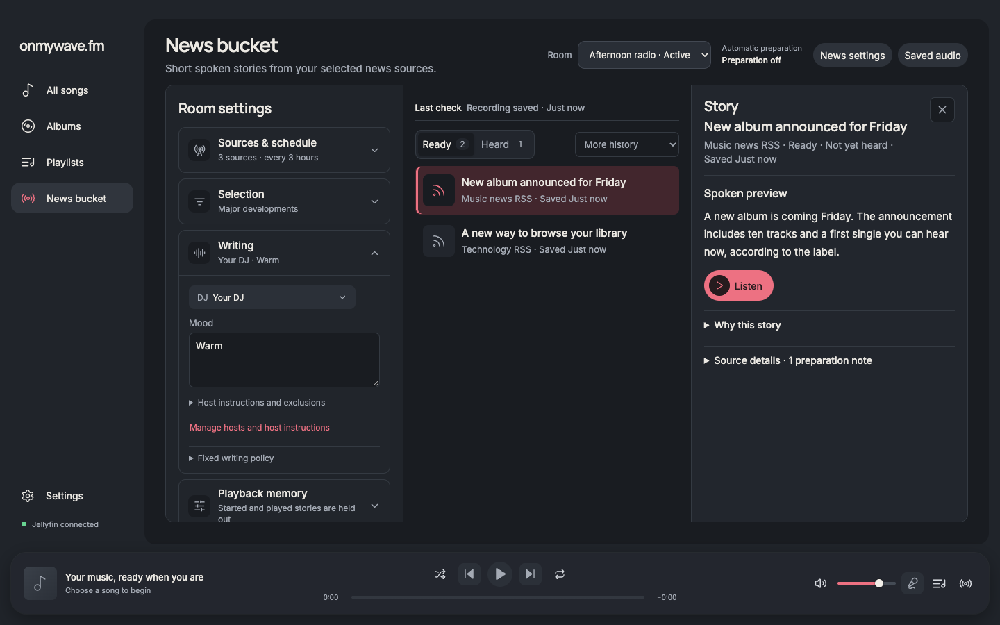
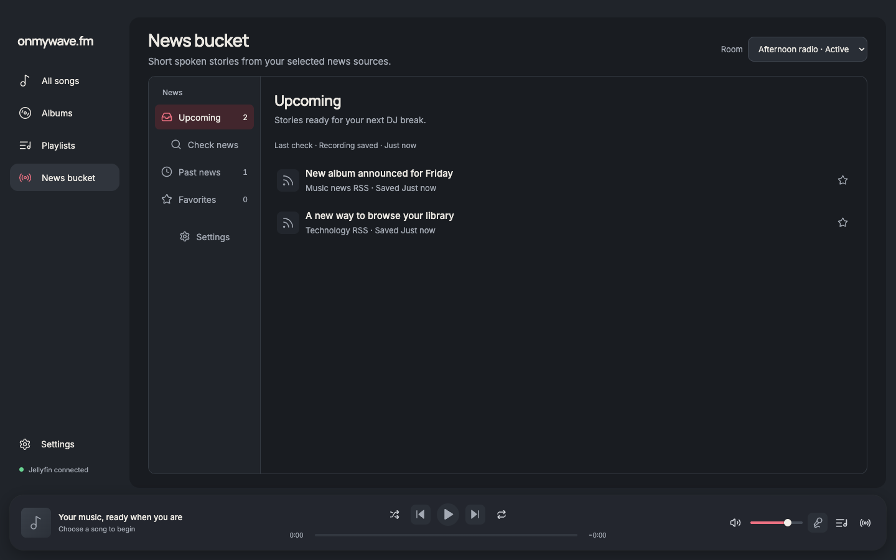
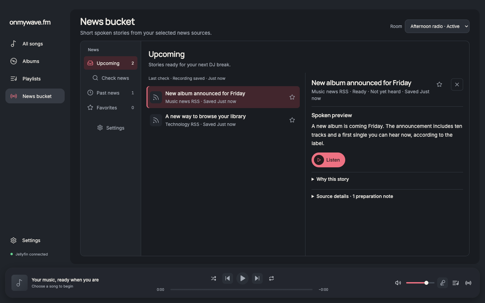
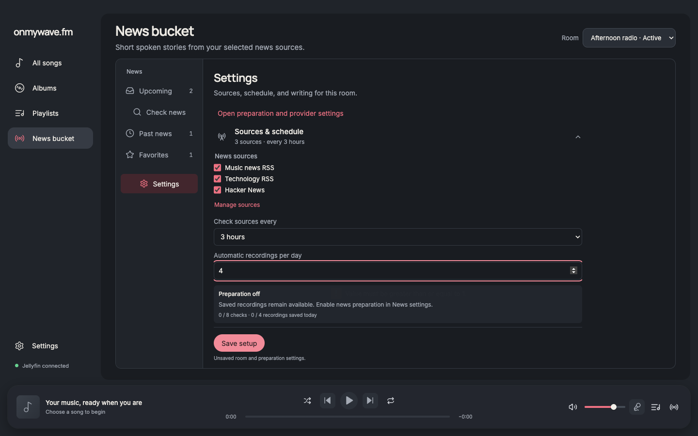
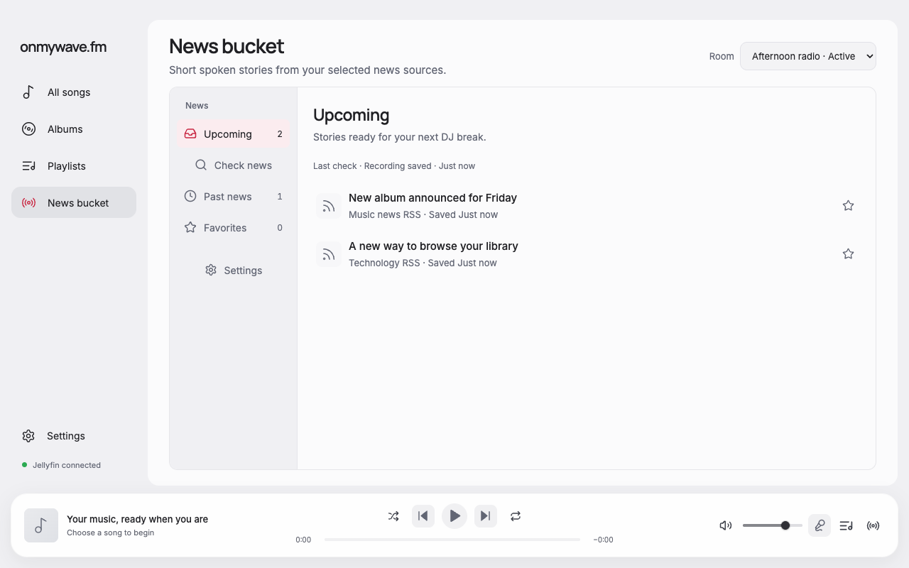
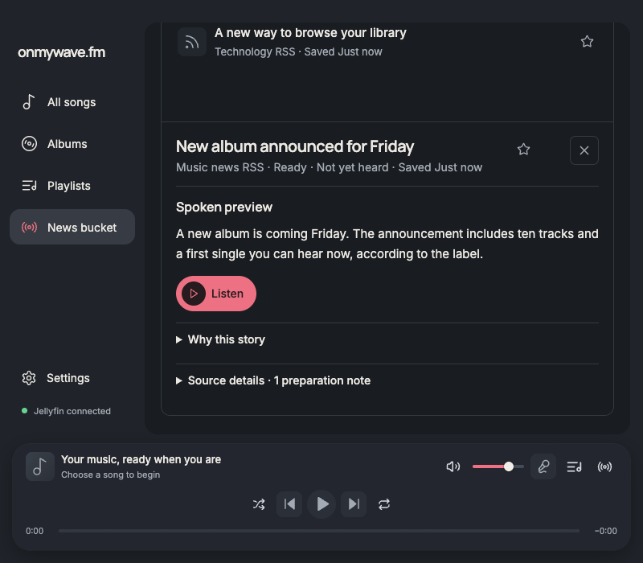

# News Bucket simplification

This is the first mail-style implementation, retained with its original screenshots. The current reading and Settings refinement is documented in [news-bucket-craft](../news-bucket-craft/README.md).

The News Bucket uses a mail-style category sidebar: Upcoming, Check news, Past news, Favorites, and Settings. The reading view starts with a full-width story list; selecting a story opens its reader. Source selection, schedule, and writing controls live in the Settings destination, using the existing parent-owned draft/save workflow. Settings disclosures and unsaved values remain intact when switching categories. Advanced preparation and provider configuration remain available through an explicit link.

Upcoming uses the existing room eligibility contract. Check news shows the latest source check for that room, including selected candidates and incomplete coverage; it does not start a provider request. Past news defaults to completed playback and separates saved scripts, editorial reviews, and other recordings with explicit labels. Reviews and incomplete playback are never counted as heard. Scripts and reviews retain their existing cross-room scope; that scope is stated in the UI. Older recordings without room identity remain accessible under Other recordings or the existing Saved audio view.

Favorites are article snapshots keyed by canonical URL, stored atomically in the existing prepared-news index through a named, validated Electron capability. They are independent of recordings and survive source record cleanup. Existing libraries migrate to an empty favorites collection. Invalid saved favorites preserve the file and surface the existing storage recovery path. Failed mutations keep the visible favorite and expose an error. No provider calls, dependencies, or playback scheduling rules were added.

## Design and review

An ImageGen concept based on the original renderer screenshot was created before implementation. The implementation retains the app's theme tokens, typography, icons, global navigation, room selector, and player. The left navigation becomes a compact labeled row at narrow widths; the reader stacks below the list when columns would become cramped.

The design was reviewed against [Apple's sidebar guidance](https://developer.apple.com/design/human-interface-guidelines/sidebars), particularly concise collection navigation, familiar icons, a shallow hierarchy, and adapting to reduced width. This is an Electron implementation using existing app controls, not a native AppKit sidebar. Elena independently reviewed the category mapping, UX, accessibility, and draft ownership. Boris implemented and verified the main-process favorites contract. The root integrated the result and inspected actual renderer screenshots.

## Verification

`report.json` records focused renderer checks at 1440 × 900 dark, 1280 × 800 light, 1024 × 768 dark, and 800 × 700 dark. These use synthetic content and simulated audio:

- Category counts, empty states, latest check candidates, and partial source coverage.
- Reader selection, Escape focus return, audition pause/resume and cleanup.
- Favorites add/remove, source link opening, and recoverable save errors.
- Distinct played recordings, scripts without audio, and editorial reviews.
- Settings draft retention, save, and recording-limit validation.
- No horizontal overflow and no browser page errors.

`verify-storage.cjs` exercises the real main-process storage API against a temporary directory, with Electron's userData path substituted. It checks migration, concurrent canonical deduplication, input validation, reload after originating records are removed, idempotent removal, malformed-file preservation, and failed atomic-write integrity.

`pnpm run format`, `pnpm run check`, and `pnpm audit` passed. No known dependency vulnerabilities were reported. Live provider generation, native audio devices, and VoiceOver were not exercised.

## Reproduce

Use Node.js 24 and installed dependencies. From the repository root:

```sh
node docs/verification/playback-progress/server.mjs
```

Run a disposable Chrome instance with remote debugging on port 9339. With Playwright available:

```sh
WAVE_PLAYWRIGHT_MODULE=/absolute/path/to/playwright node docs/verification/news-bucket-mail/verify.cjs
node docs/verification/news-bucket-mail/verify-storage.cjs
```

Set `WAVE_DEBUG_URL` to override the browser debug address. Before/after screenshots below use the same 1440 × 900 dark viewport and the same fixture data. The concept image is an AI-generated design reference; all after screenshots show the implemented renderer.







