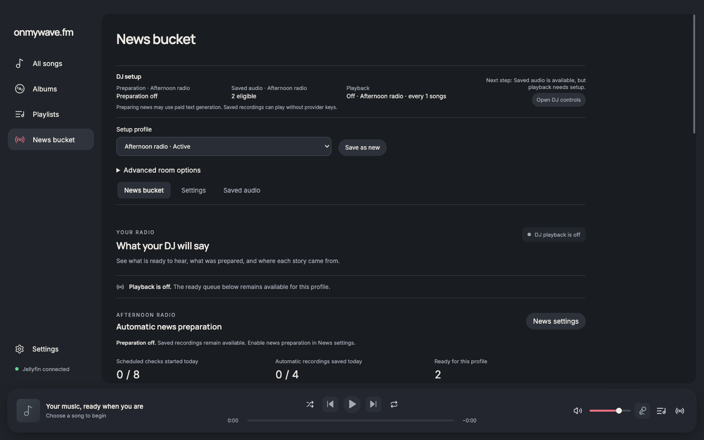
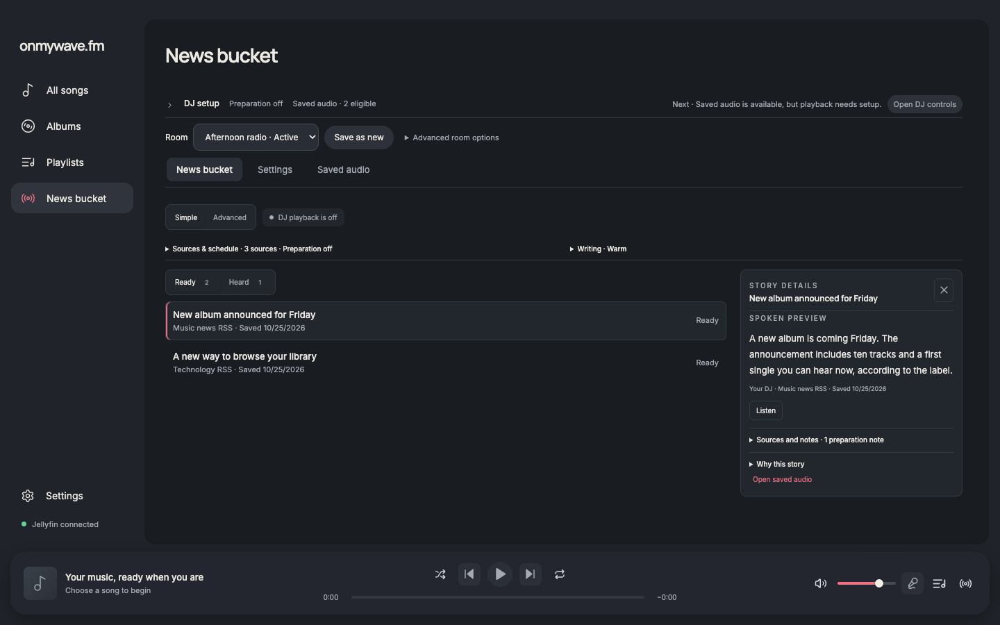
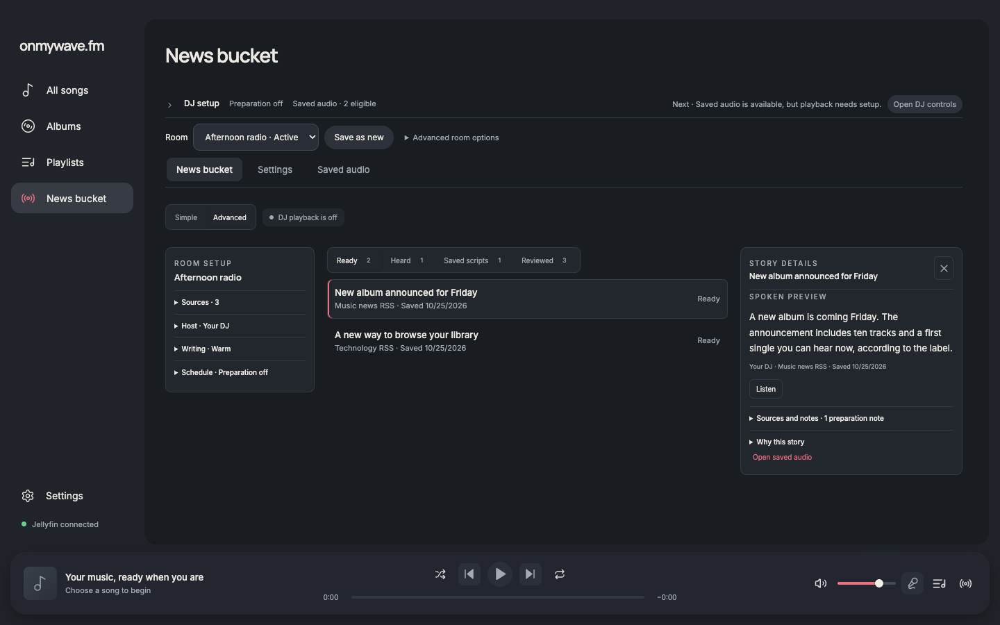
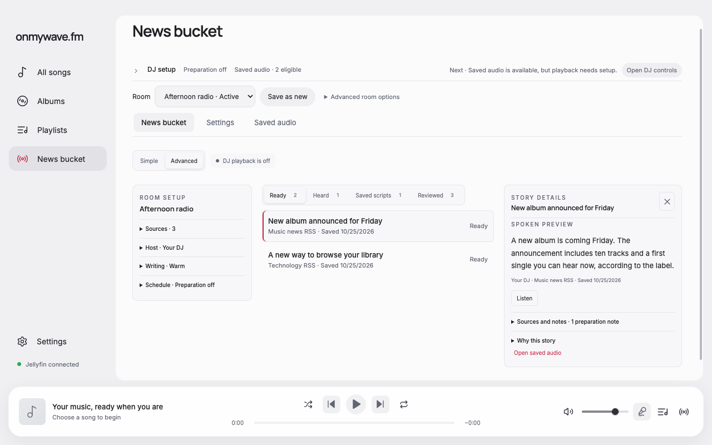
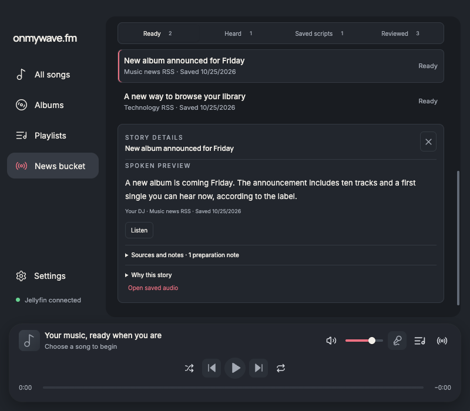

# News bucket redesign

The News bucket now has Simple and Advanced views. Simple shows compact source/writing summaries, ready recordings and confirmed playback for the selected room. Advanced adds collapsible room settings summaries, saved scripts and reviewed article history. Selecting a story opens a local inspector with spoken text, saved-audio audition, sources, warnings and the recorded selection outcome where available.

The inspector follows the existing playback sidebar's visual language, closes by button or Escape, and returns focus to its story row. Closing it gives its column back to the list. Narrow layouts follow DOM reading order, and selecting a story brings the inspector into view. The app's playback sidebar and modal controls take priority over the inspector's Escape handler.

Room settings links retain the existing draft/save workflow. There are no new persisted writing preferences, provider operations or backend state transitions. Reviewed articles retain the current global exclusion policy and are distinct from heard recordings. Heard and incomplete-playback records use their saved room identity, so editing a room's host or mood does not erase that room's playback history. Older recordings without a saved room identity remain available in Saved audio.

## Design decision and review

Steve and Elena independently proposed the integration and challenged global drawer ownership versus a local story inspector. Both supported keeping the inspector local and preserving the existing settings mutation owner. The coordinator extracted the existing saved-audio audition logic for use by both Saved audio and the inspector. Elena's review identified room-history scope, Escape priority, narrow reading order and a missing ARIA target; these were corrected and checked through the renderer.

## Verification

The before/after pair uses the real renderer at 1440 × 900 with the same fixture room, recordings, source references and scripts in dark theme. Additional screenshots cover 1280 × 800 in dark and light themes and 800 × 700 in dark theme. Narrow advanced captures are scrolled to the selected story. These are actual renderer screenshots, not ImageGen concepts.

`report.json` records focused browser checks at each viewport:

- Simple/Advanced view switching, ready/heard counts and actual history filters.
- Inspector selection, Escape close, focus return and reclaimed list width.
- Audition loading/play, pause, resume, stop and disposal on navigation.
- Script-only records without Listen actions and distinct reviewed history.
- Settings links, retained unsaved mood drafts and no horizontal overflow.
- Separate checks for app-sidebar Escape priority, audio failure/retry, music-command cleanup, cross-room history, started-but-unconfirmed playback, cached data on fetch failure and profile switching during audition.

All browser checks passed with no page errors. Formatting, type-aware lint, TypeScript and the production build passed through `pnpm run format` and `pnpm run check`. `pnpm audit` reported no known vulnerabilities. No unit tests or dependencies were added.

The fixture uses simulated audio and disposable bridge state. This does not establish native Electron audio/device behavior, VoiceOver behavior or live-provider output quality. News-generation prompts are unchanged in this UI pass.

## Reproduce

Use Node.js 24 and the installed project dependencies. Start the existing fixture server from the repository root:

```sh
node docs/verification/playback-progress/server.mjs
```

Start a disposable Chrome instance with remote debugging on port 9335. With Playwright available, run:

```sh
node docs/verification/news-bucket-redesign/verify.cjs
```

Set `WAVE_PLAYWRIGHT_MODULE` to an available Playwright module path if it is outside the normal module resolution path. The script does not use accounts, credentials or paid providers. `capture.cjs before` captures the original layout only when run against the original source revision.






