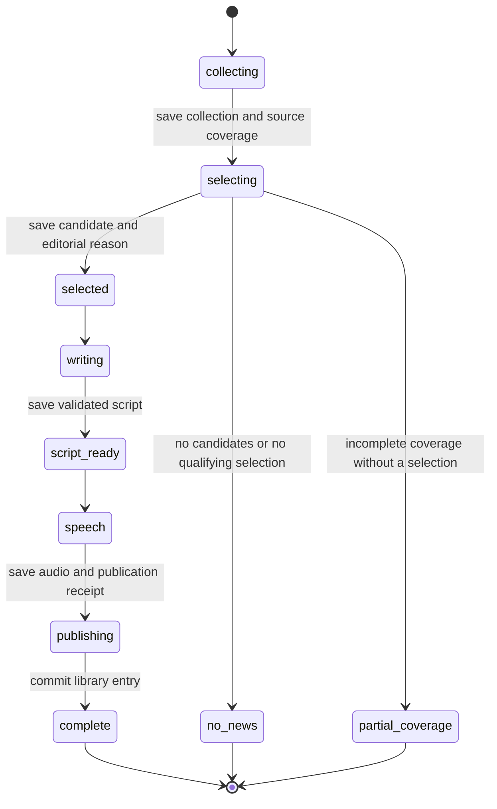
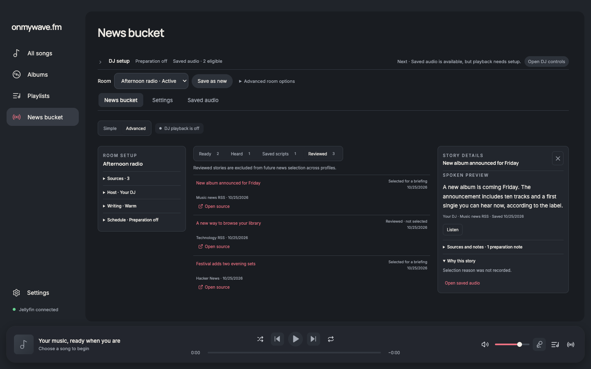
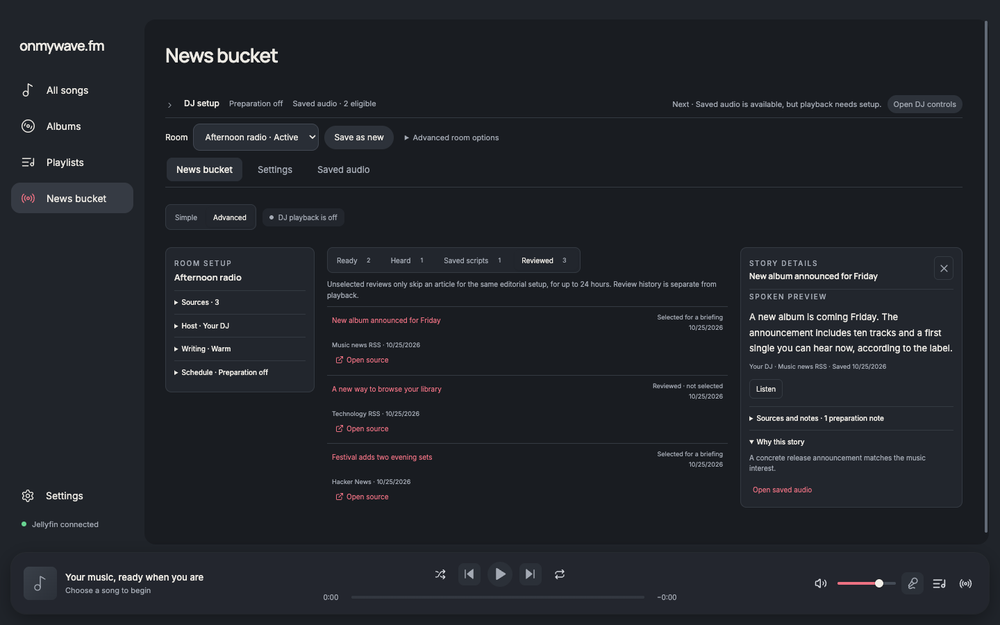

# News editorial state machine and prompt policy

News preparation runs in Electron main, the trusted application boundary. There is no new remote server. The application owns fixed selection and writing policies in `src/main/news-prompts.ts`; saved host instructions, personality, language, room mood, interests and exclusions remain adjustable user preferences. The writer defaults to 25–45 words and a plain spoken delivery, without compulsory hooks, jokes or closers. Users can request shorter text and a different tone or structure. The application still enforces one selected article, a valid structured response, at most 55 words and 700 characters, and no URLs or HTML in spoken text.

The two model operations use separate fixed instructions and structured context. The selector receives candidates, interests, exclusions and importance. The writer receives one already selected candidate and the user's delivery preferences. The system prompt cannot be replaced by a user field. This follows the [Responses instruction hierarchy](https://developers.openai.com/api/docs/guides/prompt-engineering#message-roles-and-instruction-following). Output validators enforce structure, identity and size; they do not prove factual entailment or that a script sounds natural.

News ending policy version 2 makes every new bulletin story-only: it ends on the final useful fact and leaves signoffs and music handoffs to playback, even when host preferences request a closing line. Scripts and published takes retain a `story-only` marker. This lets the occasional song introduction be the only closing transition, while legacy recordings without that contract remain news-only. Changed policy versions invalidate older resumable configuration hashes without deleting saved audio.

## Durable transitions



The phase and request status have distinct jobs. The phase identifies the last preparation boundary. Status records running, complete, skipped, partial coverage, failed or interrupted. Every persisted transition checks its expected phase and required artifacts. A collection cannot replace a selection; selection cannot replace a written script. Candidate IDs and canonical URLs must be unique. Malformed checkpoints remain preserved but cannot resume or reach a provider.

| Last durable input | Explicit Resume does |
| --- | --- |
| Original room configuration | Collect sources |
| Source collection | Select from the same candidates |
| Editorial selection | Write the same selected story |
| Saved script | Render the same text |
| Valid publication receipt and audio | Recover the completed recording without a provider call |

OpenAI selection/writing and speech dispatch intent are saved before the request. The matching selection or script and its received marker are committed together. Speech becomes received only after the audio and receipt are durable. A process stop, cancellation, invalid provider response or uncertain transport result retains its checkpoint and pauses preparation. A definitive provider rejection is recorded separately as failed. Neither path silently repeats a paid operation; the existing Resume action is required.

Resume requires the original configuration and prompt-policy version, a checkpoint younger than 24 hours, fresh selected material, and an intact saved script when present. Cosmetic avatar/room-name changes and source ordering do not invalidate editorial input. Changed editorial preferences or expired material start a new check rather than modifying the old request. Before resuming, the selected URL is checked against recordings and other reserved selections so a story consumed elsewhere cannot incur another paid generation. Repeated completed requests return the same artifact.

Audio publication keeps its existing recovery receipt. If the final index write fails after the recording is durable, recovery promotes that receipt to complete instead of classifying the recording as failed. If the separate room-status write fails, startup reconciles the completed recording and counts it once.

## Identity and exclusion scopes

- Collection deduplicates canonical URLs and retains every configured source ID that supplied an article. Each source has its own complete, partial or failed coverage result.
- Ready recordings and started/played articles remain globally excluded. A fresh selected checkpoint reserves its article while it can be resumed.
- An unselected article is excluded only for the same editorial configuration and for up to 24 hours. Other setups can consider it. Legacy unselected rows without an identified configuration do not become global exclusions.
- A review is not playback. Delivery keeps the existing atomic ready → claimed → started → played protocol; an unstarted claim can be released, while an uncertain start remains consumed.

This is canonical article identity, not a guarantee that differently worded reports at different URLs describe different events. Live model evaluation and story-level semantic deduplication are not established by these checks.

The file index assumes one main-process writer. The production entry now acquires Electron's [single-instance lock](https://www.electronjs.org/docs/latest/api/app#apprequestsingleinstancelockadditionaldata) before initializing services. A second launch focuses the existing window rather than creating a competing preparation runner.

## Verification

Run from the repository root:

```sh
node docs/verification/news-editorial-pipeline/verify.cjs
node docs/verification/news-editorial-pipeline/verify-single-instance.cjs
node docs/verification/prepared-news-delivery/verify.cjs
node docs/verification/prepared-news-recovery/verify.cjs
node docs/verification/room-profile-authority/verify.cjs
```

`verify.cjs` loads the actual NewsService, preparation storage and scheduler. HTTP/provider credentials and the room-state storage boundary are fixtures; news index, script and audio publication use real temporary files. Its 13 scenarios cover the normal path and provider boundaries, duplicate request IDs, empty/partial coverage, scoped rejection, cancellation and explicit Resume, restart during speech, output policy enforcement, selection-write failure, final publication failure, configuration/expiry/cosmetic changes, consumption elsewhere, malformed sources/duplicate IDs/contradictory phases, definitive provider rejection, and failed room-status persistence. `report.json` contains the results.

The singleton check runs two native Electron processes with isolated temporary user data and the guard extracted from the production entry. The first acquires the lock and the second exits without becoming a writer. It creates no window and contacts no provider.

The existing delivery and recovery integration checks passed. Their provider fixtures now emit the explicit durable callbacks; the final-index failure scenario expects successful receipt recovery rather than an error followed by a later scan. Profile-authority verification passed with the new resume lookup at its mocked preparation boundary. `pnpm run format`, `pnpm run check` and `pnpm audit` passed, including type-aware lint, TypeScript and the production build. No dependencies or unit-test framework were added.

The inspector now displays a saved selection reason and accurately describes scoped reviews. Before/after screenshots use the same 1440×900 dark-theme fixture with the same selection explanation. To reproduce them, run the existing playback-progress fixture server, start disposable Chrome with debugging on port 9336, and run `capture-ui.cjs before|after`, with `WAVE_PLAYWRIGHT_MODULE` pointing to an available Playwright installation if necessary.

No live provider calls or private credentials were used. These checks establish transition and persistence behavior; they do not establish real-model tone, topical judgment, factual grounding or speech quality. Provider-side exactly-once execution is not promised: explicitly retrying a response lost before persistence can incur a second charge.



