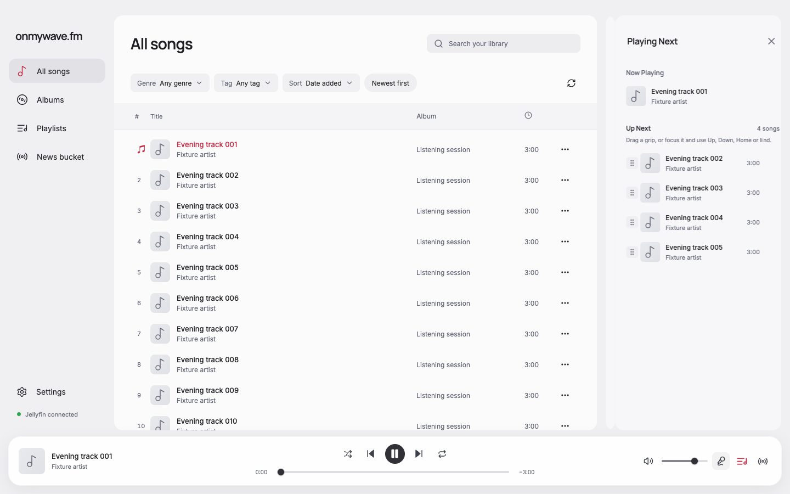
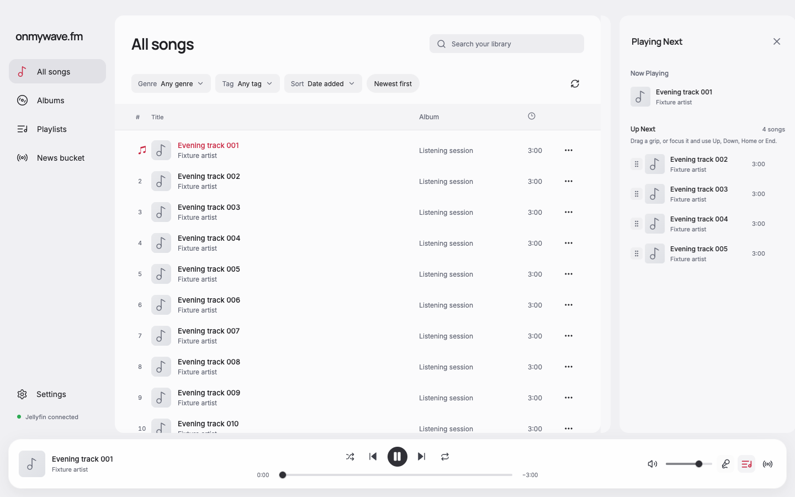
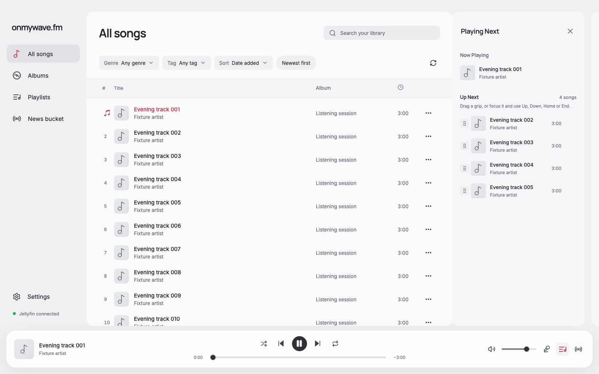
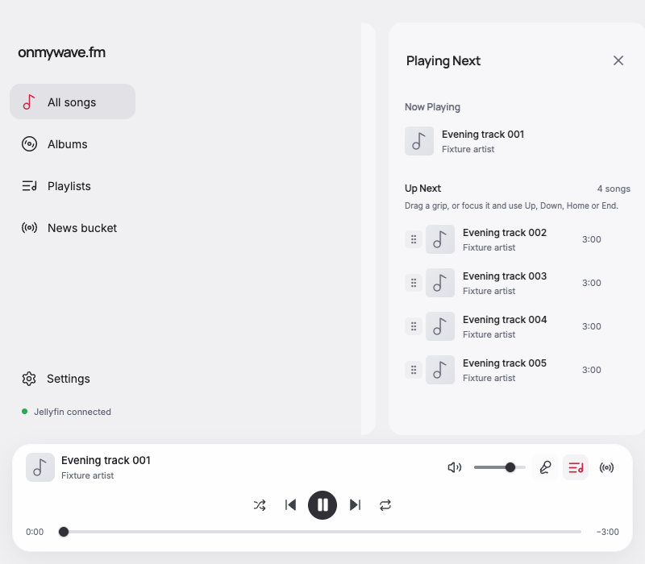
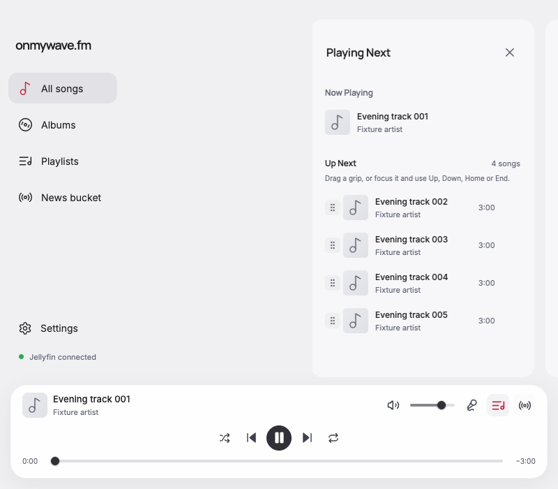

# Ordered sidebar switching

The panel order follows the bottom tools: Lyrics, Queue, DJ. Selecting a panel farther right moves the current panel left and brings the destination in from the right. Selecting a panel farther left reverses both movements. Direct Lyrics/DJ jumps follow the same ordering.

The snapshots travel one panel width plus the 16 px gutter. Leftward movement disappears at the main content's right edge; rightward movement continues to the window edge. Clipping belongs to the available region beside the main content, so a moving panel can cross the gutter without painting over the song list. Snapshot corners remain rounded. Initial opening and closing retain the existing shared DJ animation and easing.

## Apple reference

Apple's [iPhone gesture guide](https://support.apple.com/guide/iphone/learn-gestures-to-navigate-iphone-iphfdf164cac/ios) describes horizontal app switching in both directions. [Designing Fluid Interfaces, WWDC18](https://developer.apple.com/videos/play/wwdc2018/803/) explains responsive, redirectable, interruptible motion and recommends starting spring behavior without overshoot. The [motion guidelines](https://developer.apple.com/design/human-interface-guidelines/motion) also advise brief, predictable, cancelable motion.

This implementation adapts the horizontal continuity and reversibility to the requested fixed sidebar order. It retains the product's 220 ms easing; the cited Apple sources do not specify an exact timing curve for system quick switching. No gesture controls, app-switcher overview, or recency reordering were added.

## Verification

All six source/destination pairs passed in Chrome 155 at 1440 × 900 and 800 × 700, and in Electron 43.8.1 / Chromium 150 using the application's real renderer with the existing fictional fixture bridge. Checks measured the signs of the outgoing and incoming snapshot translations, transition direction type, clipping boundary, retained close-button focus, and one live drawer. Rapid reversal landed on the latest panel, reduced motion skipped the transition, and no renderer page errors occurred.

Before captures were taken before editing this correction. Matched 1440 × 900 screenshots pause the snapshot animations at 110 ms with identical fixture content, song position, and theme. Forward Lyrics-to-Queue and backward DJ-to-Queue pairs were visually inspected, along with Queue-to-Lyrics and the forward/backward 800 px frames. Pixel comparisons of the protected song-list region across all six corrected frames passed with a 1/255 channel tolerance. Five frames were identical; the remaining frame differed by one channel step at a single pixel. See [occlusion-report.json](occlusion-report.json).

Reports: [before](before-report.json), [Chrome](browser-report.json), [narrow Chrome](browser-narrow-report.json), [Electron](electron-report.json).

`pnpm run format` and `pnpm run check` passed, including type-aware lint, TypeScript, and production build. No dependencies or provider behavior changed. VoiceOver and live Jellyfin were not exercised.

| Transition | Before | After |
| --- | --- | --- |
| Lyrics → Queue |  |  |
| DJ → Queue |  |  |

