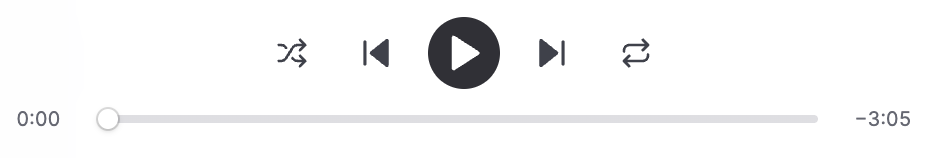
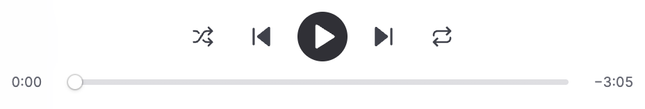

# Play icon alignment

Captured on 19 October 2026 from the production renderer in Electron 43.7.0 on macOS at 2× resolution. The baseline uses `origin/main` at `9e57113`; the after captures use the same code with the play icon CSS correction.

The temporary Electron harness used the existing preload, a fictional catalog and restored paused track, disposable app storage, and a generated silent WAV file. External HTTP(S) requests were blocked. No private media, credentials, or live provider requests were used.

## Screenshots

| Viewport | Before | After |
| --- | --- | --- |
| 1280 × 788 | [Full window](before-1280.png) | [Full window](after-1280.png) |
| 960 × 788 | [Full window](before-960.png) | [Full window](after-960.png) |
| 780 × 788 | [Full window](before-780.png) | [Full window](after-780.png) |
| 1280 × 788, player crop |  |  |

## Verification

Visually inspected the matched screenshots at all three widths. The 36 × 36 button and 21 × 21 SVG keep their dimensions; only the play SVG moves 1 CSS pixel right. Its vertical position is unchanged. The narrow layout still fits the controls.

Focused the play button and sent Space to start the local silent fixture, then Space to pause again. The accessible label changed Play → Pause → Play. The pause SVG had no translation and retained focus. [Pause state](after-pause.png) records the unshifted pause icon. Live Jellyfin streaming was not tested.

`pnpm run format`, `pnpm run check`, and `pnpm audit --prod` passed.
