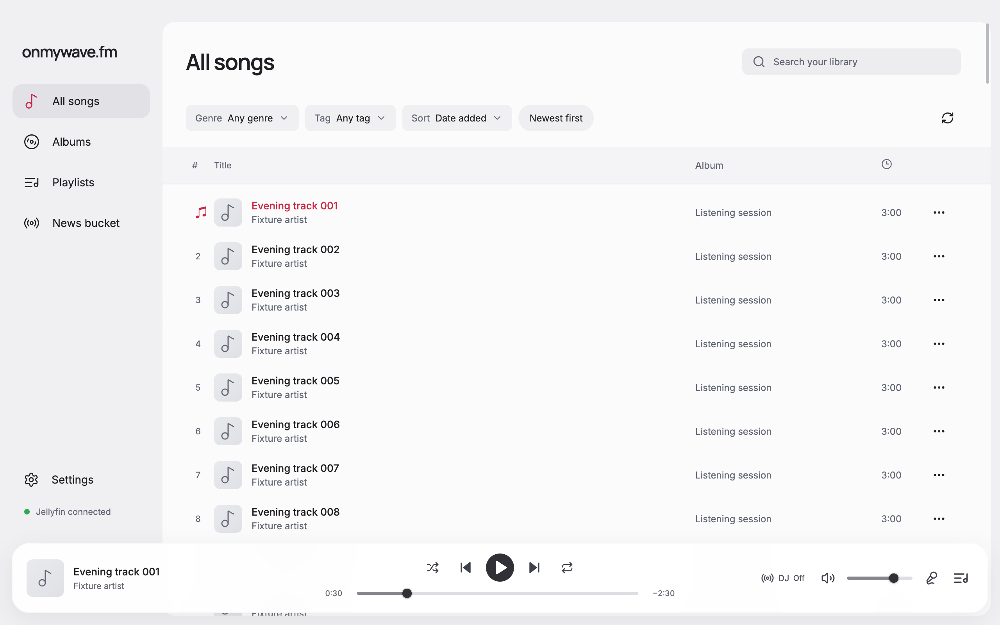
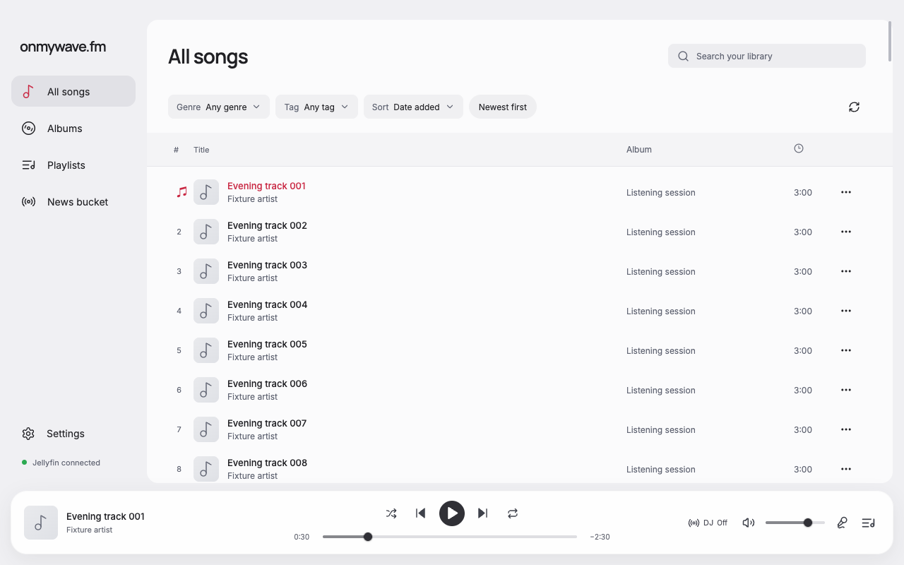

# Main panel above the floating player

The main panel now ends above the floating player with a 12px gap, following the supplied Yandex Music reference. Their right edges align. The bottom margin uses the existing responsive player clearance and measured player-notice height. Content padding, scroll padding, and the sticky selection toolbar now use the panel's own bottom edge instead of reserving the player height a second time.

Matched Light captures at 1280×800 use the same synthetic songs, no selection, initial scroll position, and song 1 paused at 30 seconds. Before is `d81a280`.

| Before | After |
| --- | --- |
|  |  |

Also inspected [800×700](after-800.png), where the player uses two rows. The measured panel-to-player gap was 12px at both viewport sizes; their right edges matched. There was no horizontal overflow. At 1280×800, focused song 120 ended at y=597, the selection toolbar started at y=619, the main panel ended at y=684, and the player started at y=696. All 120 songs loaded and the last row remained keyboard accessible. Formatting, lint, TypeScript, and production build passed through the normal commit hook. Verification used the existing Chromium fixture, not a connected Jellyfin library or native Electron.
