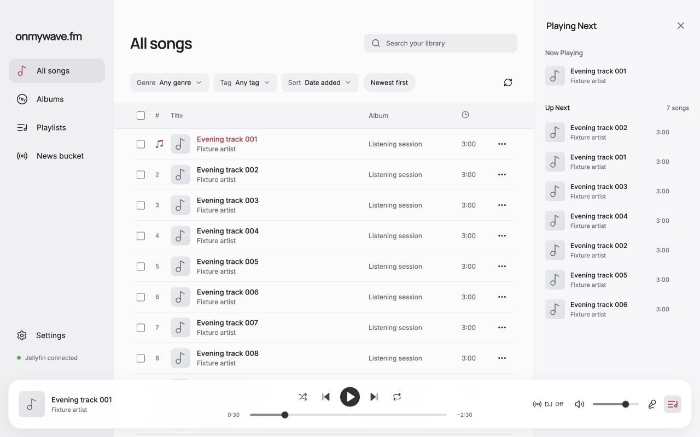
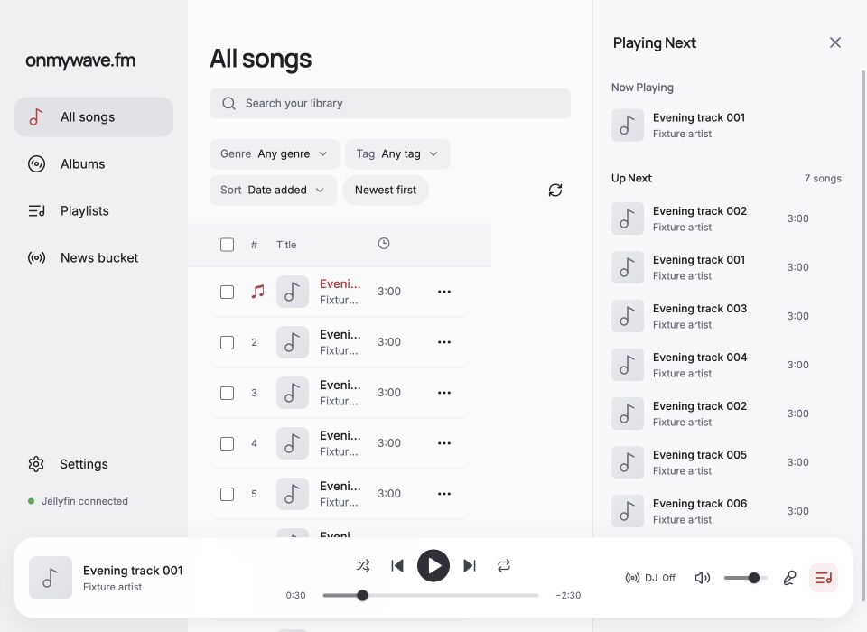
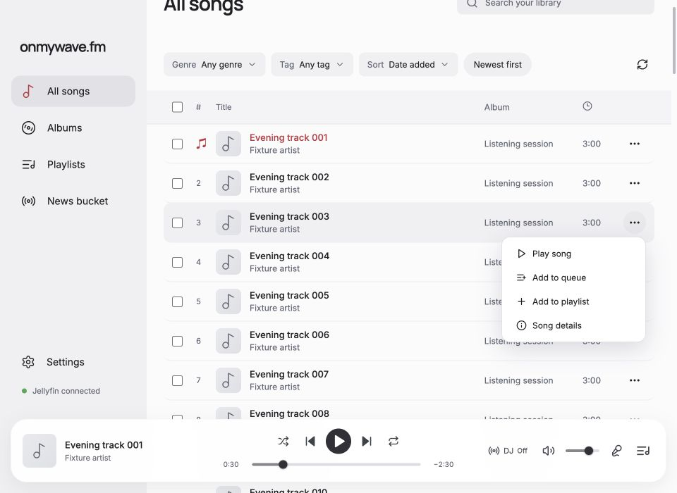
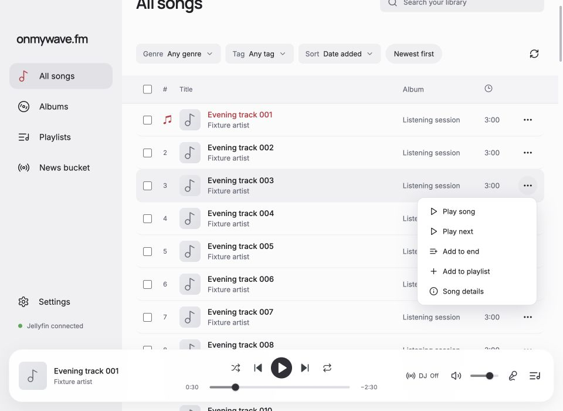
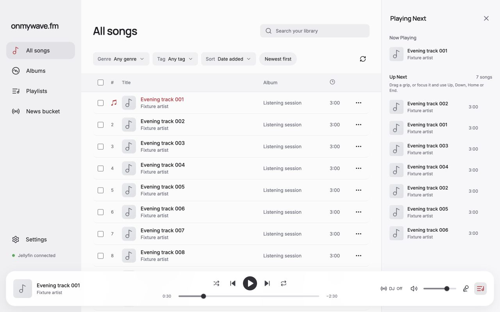
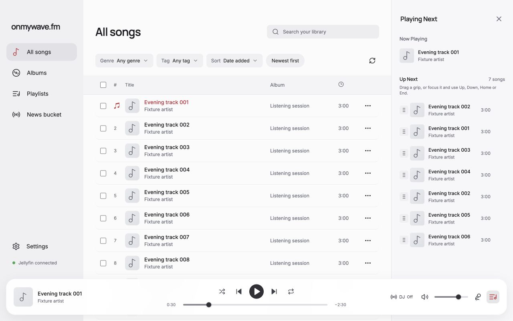
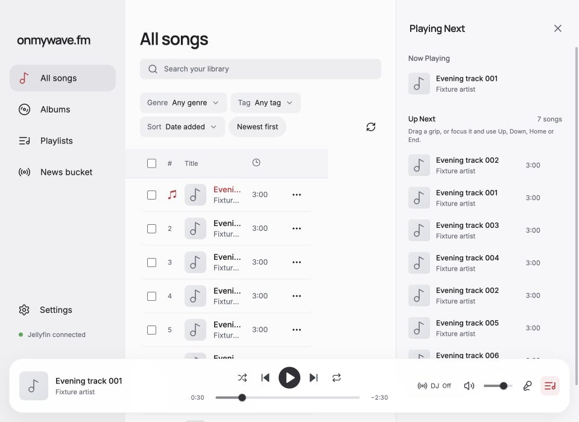
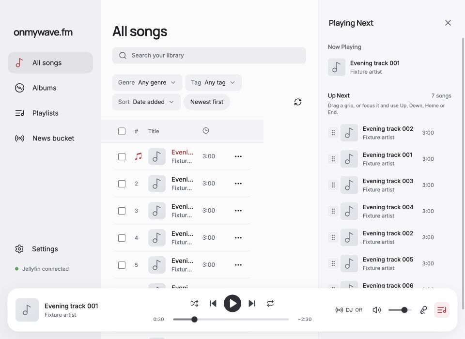

# Queue order and insertion — issue #200

Verified on 2026-10-22 against the actual renderer, player provider, and shuffle helpers. The local fixture supplies synthetic songs, bridge responses, and audio. CUA drove the visible menus, selection controls, keyboard, and native pointer drag. No live Jellyfin connection or real audio device was exercised.

## Reproduce

From `desktop-light`, run `node docs/verification/queue-editing/server.mjs` and open `http://127.0.0.1:5205/`. The server binds only to localhost and uses the existing playback-progress fixture. It does not enter the production bundle.

Each `case` query value gets independent session storage; reloading the same URL restores that case's saved snapshot. Add `tools` for synthetic audio-end, speech-end, and position controls. Useful cases:

- `?case=sequential&tools`: eight entries, including repeated song IDs, paused at 30 seconds.
- `?empty&case=empty`: no queue.
- `?shuffle&case=shuffle&tools`: shuffled eight-entry queue.
- `?large&shuffle&case=large`: 10,000 entries with repeated song IDs.
- `?forward-history&case=history`: repeated future visits to the same canonical queue entry.
- `?current-repeat&case=remove&tools`: future visits repeat the currently playing canonical entry.
- `?shuffle&repeat-all&case=all&tools` and `?shuffle&repeat-one&case=one&tools`: repeat policies.
- `?dj&case=dj&tools`: three prepared takes; schedule a break and finish the music to enter speech.

## Results

The compact observations are in [results.json](results.json).

- Single-song menus, selected-song toolbar, album headers, and playlist headers expose **Play next** and **Add to end**. Primary album/playlist Play remains available. Selecting song 4 before song 2 still inserts source order `[2,4]`; album `[6,3,6]` and playlist `[4,2,4]` retain duplicates and source order at both insertion positions.
- Edits retain the current occurrence, position, and play/pause intent. No added completion or extra playback preparation occurred during insertion/reorder. Both insertion choices populate an empty queue paused.
- Move buttons, grip Arrow keys, Home/End, and pointer drag change the actual future order. Moving the second song-2 occurrence leaves the first occurrence intact. Reload restores the sequential order at 40 seconds paused.
- An untouched shuffle preview can be moved immediately. Explicit insertion preserves its prior future order, places selected `[2,4]` first, and puts an appended song after the full cycle. Reload preserves this order paused at 30 seconds. Natural audio ends follow every displayed future entry; repeat off stops after 11 completions.
- Repeat all played the exact appended occurrence after the complete 122-entry future order, then restarted playback. Repeat one retains the current occurrence and explicit future order.
- Repeated forward-history visits move and select independently, even when they share a canonical entry key. Removing future repeats of the current entry in both ordinary history and the explicit order leaves the current song playing at 30 seconds with zero completions.
- A 10,000-entry shuffle queue accepts an append at the true end: 10,000 future entries, 10,001 total. Home/End moves across the full list, retains grip focus at index 9,999, and renders 16 rows. Initial open rendered 15 rows.
- Editing during speech preserves the on-air break and its existing start/heard calls. Speech completion advances once, with one completed music song and one delivery.
- The focused Electron playback verifier from PR #204 also passed against these production changes: seven behavior scenarios and detection of all six targeted regression mutations. Its temporary verifier files were removed afterward; they belong to PR #204.

Turning shuffle off intentionally returns to canonical queue order and discards the explicit shuffle schedule. Turning it on creates a fresh shuffled cycle. A queue edit itself never toggles shuffle or repeat. Autoscroll and Escape cancellation received code review; a held edge-drag/cancel sequence was not separately exercised by this fixture run.

## Visual verification

Matching queue views use the same eight songs, current entry, paused 30-second position, and open drawer at **1280×800** and **960×700**. All images were visually inspected. The final drawer keeps titles readable at rest and exposes grips/move buttons on hover or keyboard focus by replacing the duration area. The 960-pixel menu pair has the same song-3 menu open and scroll position.

| View | Before | After |
| --- | --- | --- |
| Queue, 1280×800 |  |  |
| Queue, 960×700 |  |  |
| Song menu, 960×700 |  |  |

This branch builds on PR #202's queue virtualization. Merge #202 first; the #200 PR targets `main` according to repository convention.

## Visible drag handle follow-up

The six-dot grip now stays visible before the artwork for every upcoming row. Move arrows remain available on hover and keyboard focus. The current song and played history have no drag handle. Matching paused 30-second views were captured and inspected before and after at 1280×800 and 960×700.

Native pointer dragging of the first upcoming occurrence after the third changed `[2,1,3,4,2,5,6]` to `[1,3,2,4,2,5,6]`. The current occurrence, 30-second position, and paused intent remained unchanged. Home on the moved grip returned that exact occurrence to the front and retained keyboard focus.

| View | Before | After |
| --- | --- | --- |
| 1280×800 |  |  |
| 960×700 |  |  |

The merge-time CI audit identified newly published Electron advisories in 43.7.0. The dependency and lockfile now pin 43.7.6, the patched version for [GHSA-x562-297c-g43g](https://github.com/advisories/GHSA-x562-297c-g43g). The full dependency audit passes with the patch; no audit exclusions were added.
