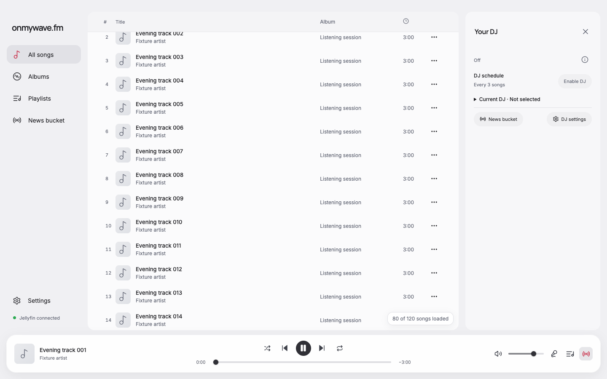
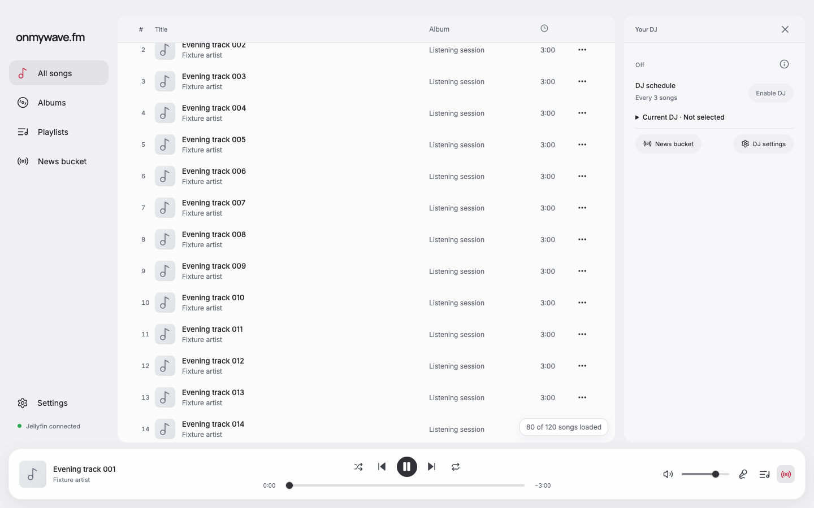
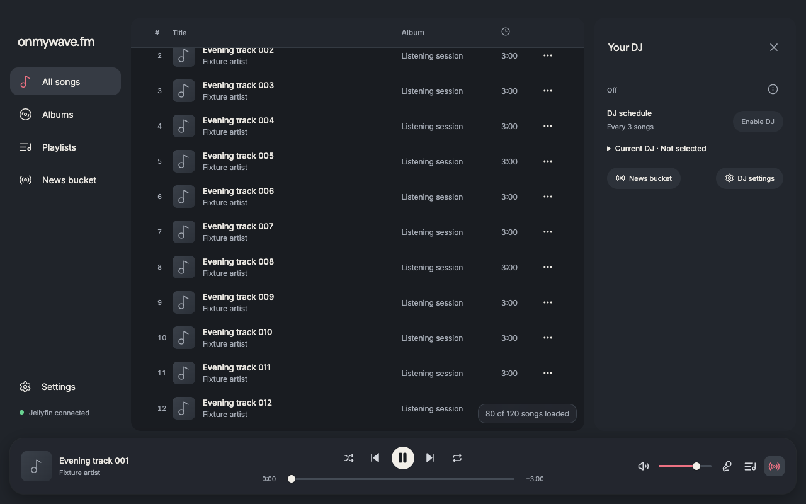
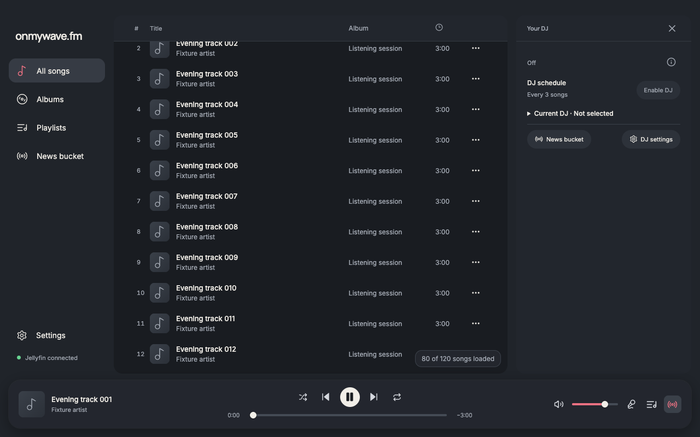
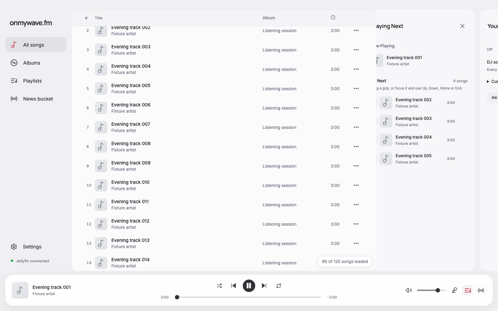
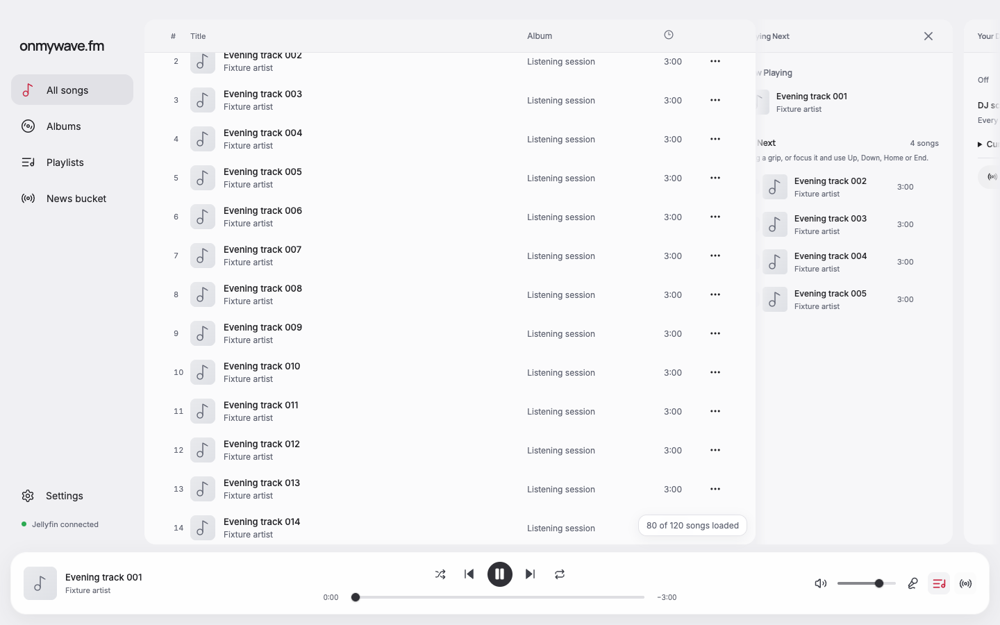
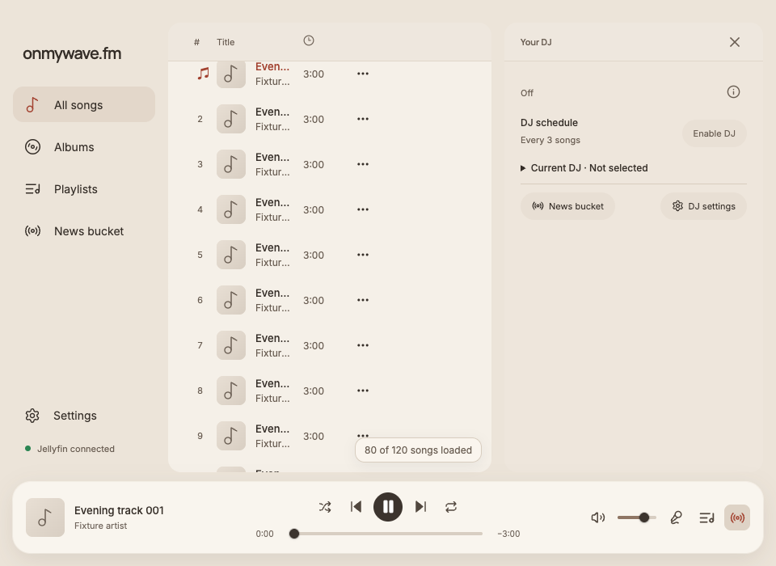
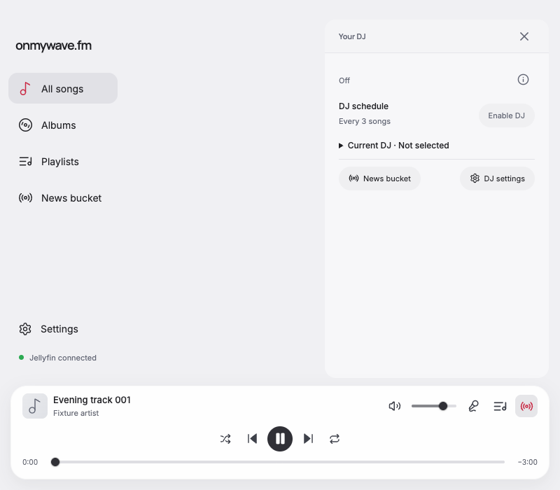
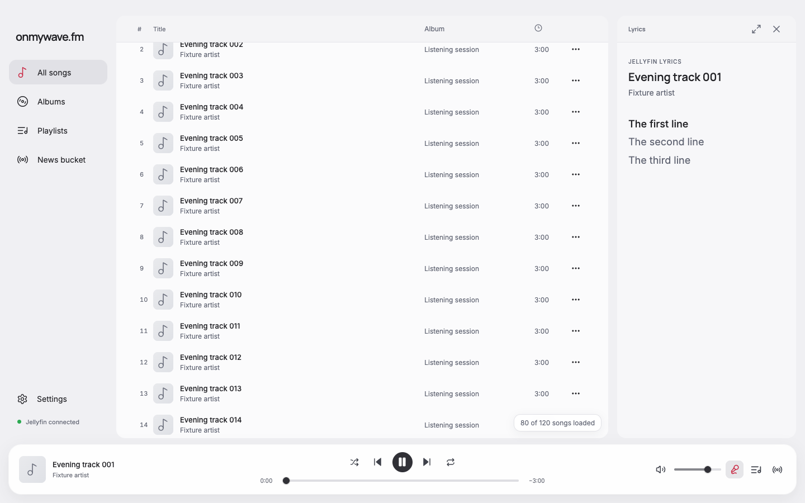

# Soft sidebar edges and aligned headers

Full-card sidebar switching now fades through the 16 px gutter beside the main content and the 16 px outer window inset. A gradient alpha mask on the transition overlay softens the clipping boundary while the existing clip prevents painting over the main content. The settled card lies inside the fully opaque area. Lyrics → Queue → DJ order, reverse direction, timing, and initial open/close motion remain unchanged.

DJ, Queue, and sidebar Lyrics headers now share the song-table header's height and font-size tokens, muted text color, table-header background, and separator. Their titles and controls are vertically centered in a 48 px strip. Song details and expanded lyrics retain their existing headers.

## Verification

The real renderer with the existing fictional playback-progress fixture passed twelve header comparisons: all three sidebars at 1440 × 900 light, 1280 × 800 dark, 960 × 700 coffee, and 800 × 700 light. Header height, font size, and text color match the table; at desktop widths their top edges also match the scrolled sticky table header. Captures use a scrolled library to reproduce the supplied screenshot.

Native Electron 43.8.1 checks passed all six directions with the gradient mask present, correct clipping boundary, one live drawer, retained focus, rapid reversal, and reduced motion. No renderer page errors occurred. Before/after boundary frames pause the same backward transition at 70 ms; the left edge fades instead of abruptly cutting text. The light and dark DJ header pairs, the boundary pair, and the coffee, narrow-window, and Lyrics after captures were visually inspected.

Reports: [headers before](before-report.json), [headers after](after-report.json), [native motion](native-motion/electron-report.json).

`pnpm run format` and `pnpm run check` passed, including type-aware lint, TypeScript, and production build. No dependencies changed. Live Jellyfin and VoiceOver were not exercised.

| View | Before | After |
| --- | --- | --- |
| Light, 1440 × 900 |  |  |
| Dark, 1280 × 800 |  |  |
| Sliding edge at 70 ms |  |  |

