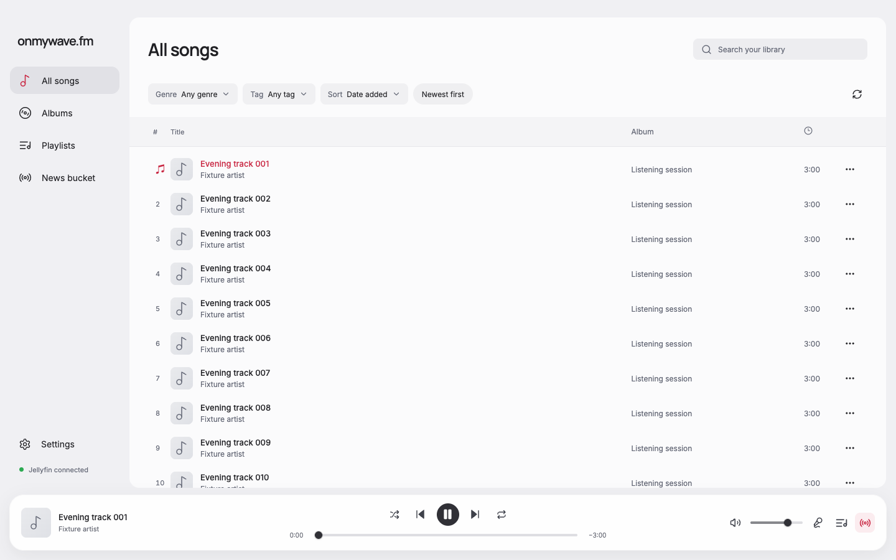
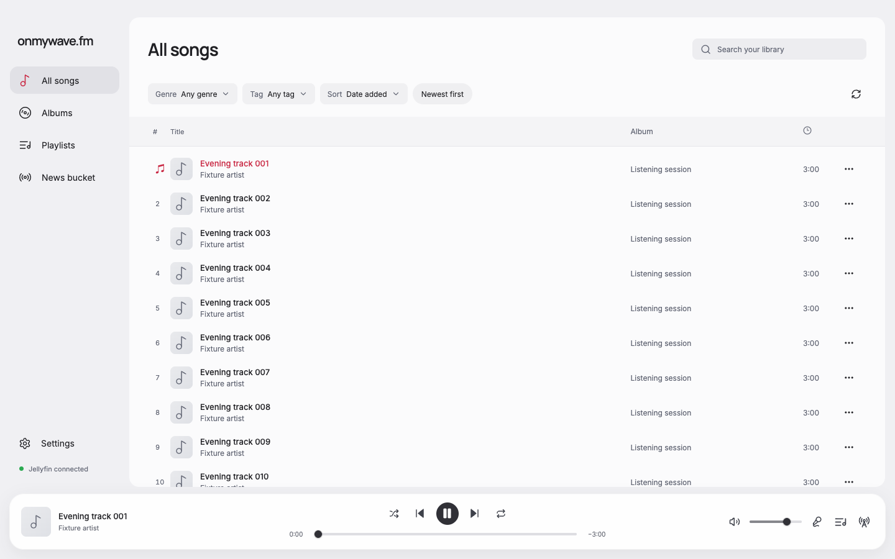
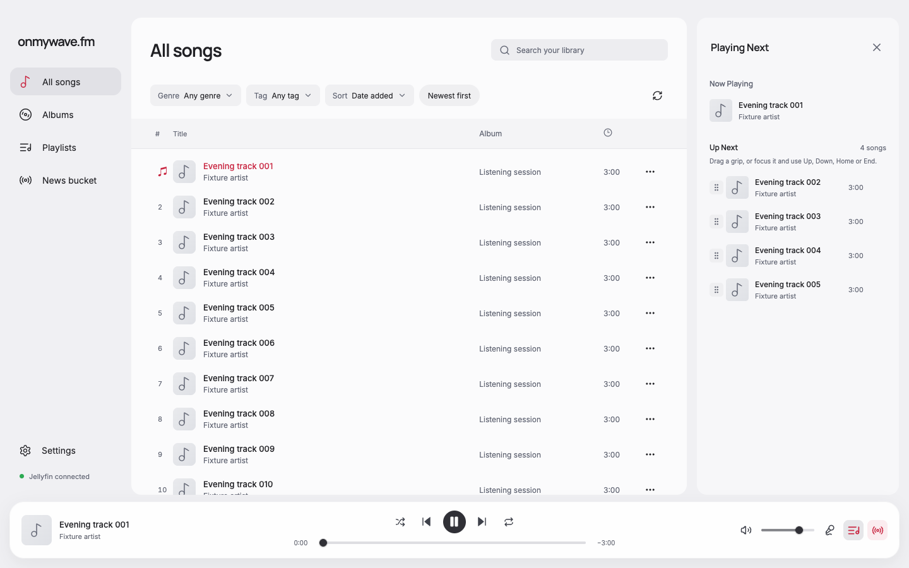
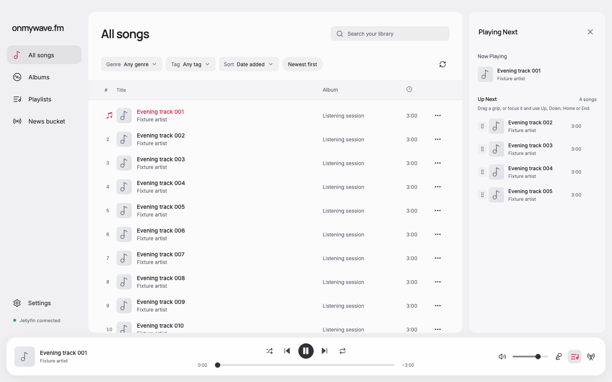

# Sidebar selection and DJ status

The bottom Lyrics, Queue, and DJ buttons use the accent color only when their sidebar is open. Closing all sidebars leaves all three neutral, even while the DJ schedule is enabled.

DJ status uses icon shape instead of selection color: RadioTower when the schedule is enabled or a news break is active, Radio otherwise. The tooltip and accessible description identify Active or Inactive status. The button's Show/Hide label and aria-expanded still describe the sidebar.

## Verification

Fixture browser checks passed at 1440 × 900 for eight states: DJ enabled/disabled, each combined with no sidebar, Lyrics, Queue, or DJ open. Each state has exactly one highlighted button matching aria-expanded, or none when all panels are closed. The DJ status icon stays consistent while opening and closing panels. No renderer page errors occurred.

Matched captures use identical fixture catalog, first-song playback position, theme, viewport, and schedule state before and after. Visually inspected the DJ-enabled before/after pairs below and the inactive icon. Reports: [before](before-report.json), [after](after-report.json).

Formatting, type-aware lint, TypeScript, and production build passed with `pnpm run format` and `pnpm run check`. No dependencies changed. Native Electron, live news playback, and VoiceOver were not exercised for this icon-only correction.

| DJ enabled | Before | After |
| --- | --- | --- |
| No sidebar open |  |  |
| Queue open |  |  |

