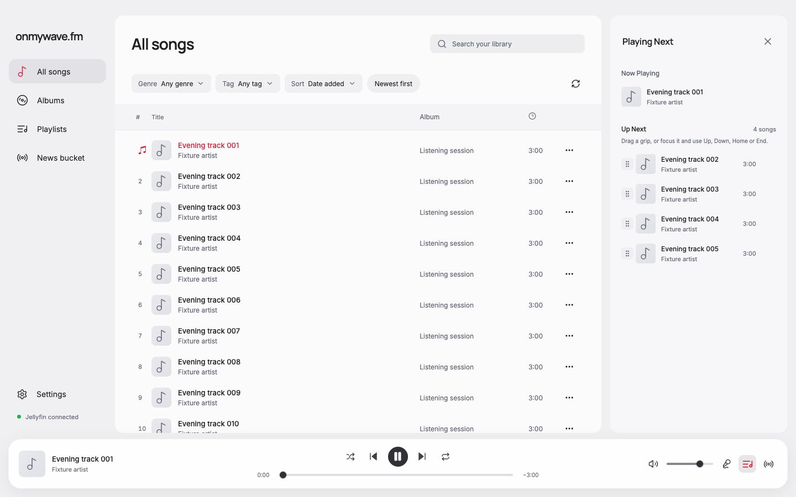
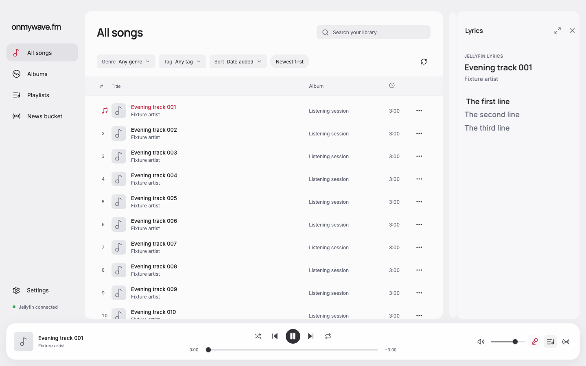
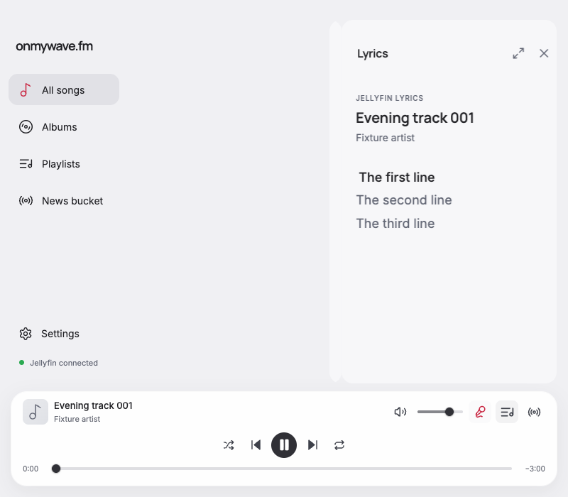

# Shared sidebar motion

DJ, queue, and lyrics now use the previous DJ entrance and exit motion: 220 ms from the right with a gentle fade, and 180 ms back to the right on close. A panel switch moves the outgoing snapshot left while the next panel slides in from the right over 220 ms with the same entrance easing. The handoff clips to the panel's rounded bounds and keeps one live drawer mounted.

The native View Transition API captures only the named drawer. WAAPI handles first entry and close, so the incoming snapshot cannot inherit an offscreen entrance animation. Pending transitions are skipped and guarded against stale updates on rapid switches, close, navigation, or unmount. Reduced motion switches immediately. Environments without the snapshot API use the shared entrance instead.

Steve and Elena proposed sequential single-shell movement and native snapshot handoff independently, then challenged the lifecycle and timing tradeoffs. Both supported snapshots for simultaneous replacement and found no actionable blockers in the implemented diff. The coordinator implemented and verified the change.

## Verification

Focused checks passed in Chrome 155 at 1440 × 900 and 800 × 700 and in the project's Electron 43.8.1 runtime with Chromium 150. The Electron fixture window used the same application renderer and existing fictional playback-progress fixture bridge, with sandboxing and context isolation enabled. No live accounts or providers were used.

- All three drawers have the same 220 ms entrance and an inert animated exit.
- Each switch creates matching old/new 220 ms animations and only one live drawer.
- Snapshot capture has no simultaneous entrance animation, and completing the handoff does not start another entrance.
- Rapid same-turn switches select the latest destination; closing during a pending switch leaves no panel or transition class behind.
- Reduced motion skips entrance, exit, and snapshot motion.
- Narrow-browser checks also passed navigation cancellation and the unsupported-API fallback.
- No renderer page errors occurred.

The existing shared-sidebar geometry, focus, lyrics expand/collapse, active-line visibility, seeking, and follow checks passed again at all five window sizes. Formatting, type-aware lint, TypeScript, and production build passed through `pnpm run check`. No dependencies changed. VoiceOver and live Jellyfin remain unverified.

Reports: [browser](browser-motion-report.json), [narrow browser](browser-narrow-motion-report.json), [Electron](electron-motion-report.json).

Matched before/after captures use the same catalog, playback position, light theme, and 1440 × 900 viewport with reduced motion so the settled layouts can be compared. All pairs were visually inspected. Midpoint frames pause the real snapshot animations at 110 ms; captures at 1440 and 800 px were visually inspected for clipping and layout.

| Panel | Before | After |
| --- | --- | --- |
| DJ |  |  |
| Queue |  |  |
| Lyrics |  |  |

Implementation reference: [MDN View Transition lifecycle and snapshots](https://developer.mozilla.org/en-US/docs/Web/API/View_Transition_API/Using).
