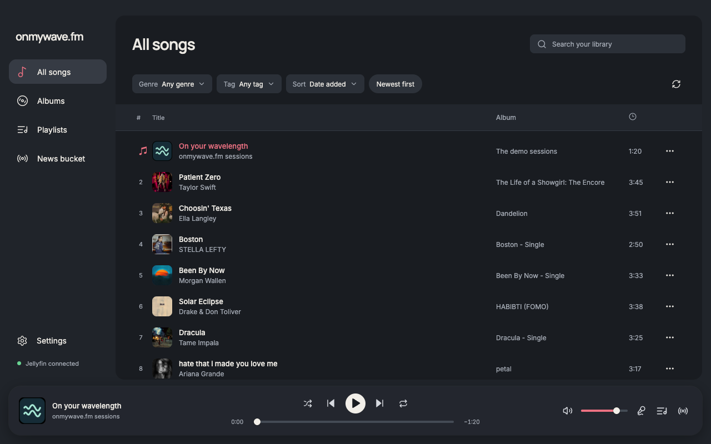
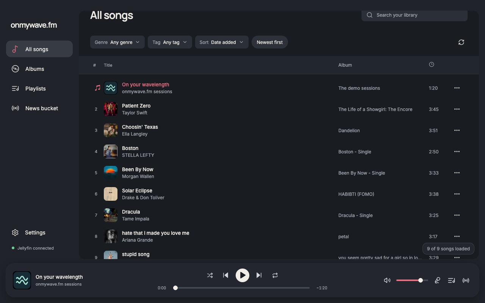

# Scroll-only song count

The floating song count starts hidden, fades in while the song list scrolls, and fades out after 800 ms without scrolling. It uses the virtualizer's existing scrolling state and a 180 ms opacity transition. Reduced motion removes the fade. The existing retry-success focus target stays visible while focused so focus is never returned to invisible text.

Six focused checks passed in the built renderer at 1280 × 800 with the same nine-song fixture and dark theme: initial hidden state, fade-in, visibility during continued scrolling, fade-out after idle, visible recovery-focus target, and immediate show/hide with reduced motion. report.json includes observed intermediate opacity values in both directions. No page errors. Formatting, type-aware lint, TypeScript and production build passed.

The before/after idle screenshots use the same viewport, catalog and playback state. The scrolling screenshot shows the count after the library has moved.

