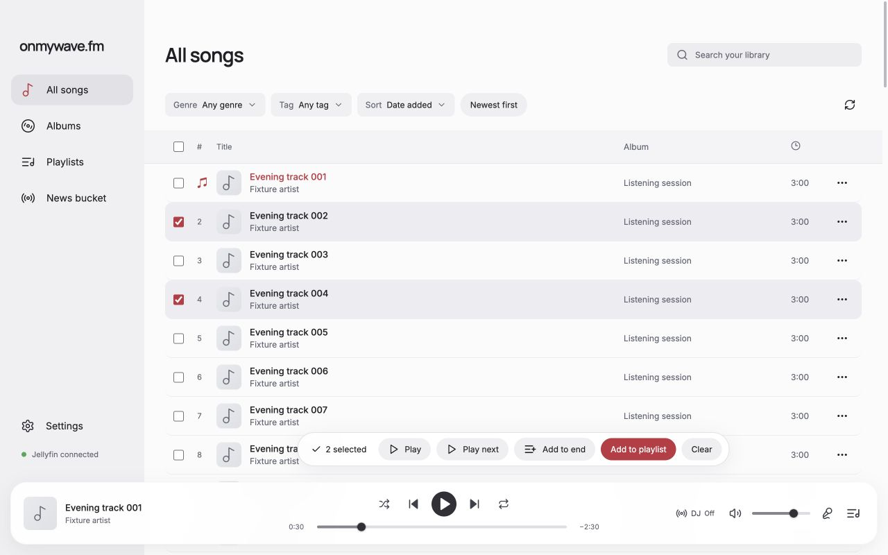
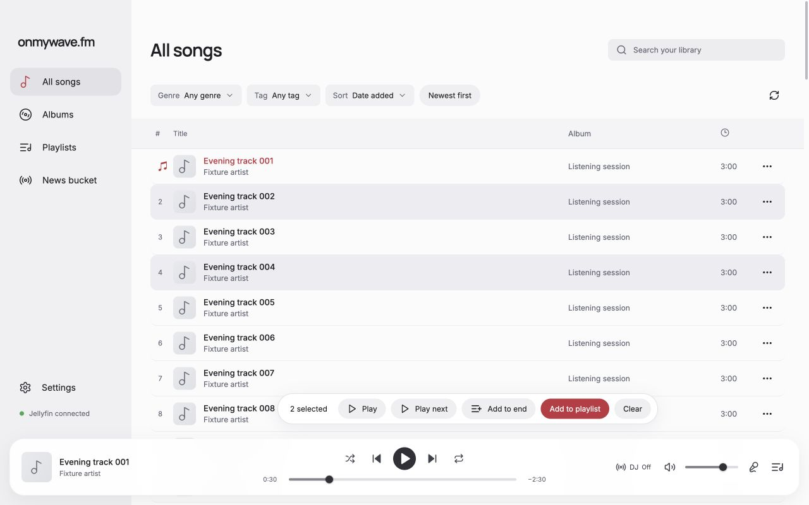
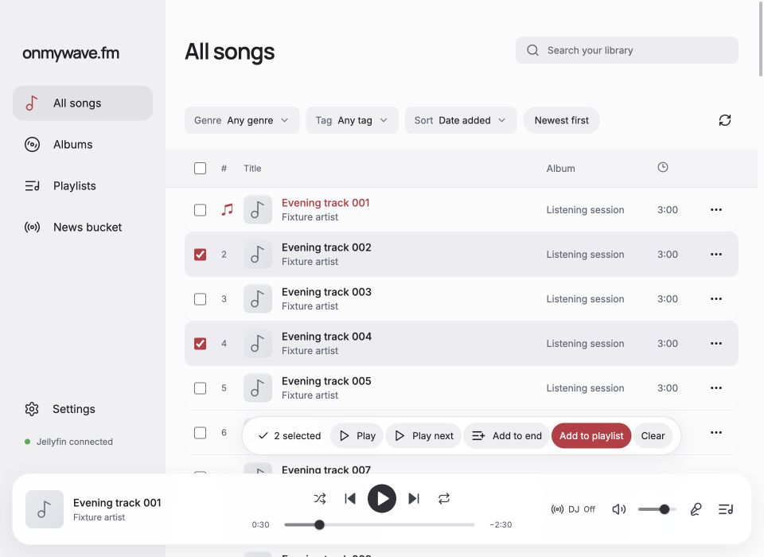
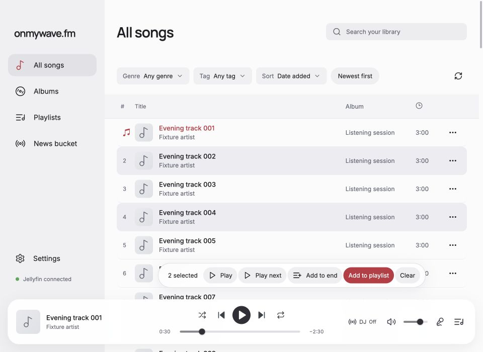

# Song list playback and Command selection

The shared TrackTable now plays songs from list artwork, titles, and ordinary row clicks. The bottom-left player cover continues to open the current song's details without affecting playback. Details also remain in the action menu. Checkboxes, the select-all checkbox column, and its unused styles are removed.

Selection requires Command. Command-click toggles a row, Command-Shift-click extends the range, and Command-A selects loaded songs when a row has focus. Selected rows use the existing theme background and expose `aria-selected`; the toolbar reports the count. Arrow navigation alone only moves focus. Enter/Space activates playback, Command-Enter selects, and Escape clears selection. Control-click retains the context menu.

## Manual verification

Run `node docs/verification/queue-editing/server.mjs` and open `http://127.0.0.1:5205/?case=song-list-check`. This reuses the actual renderer/player with synthetic catalog, bridge, and audio responses. Each case has an independent disposable playback snapshot. No live Jellyfin server or provider was used.

Before editing, clicking the list cover for song 3 opened details while song 1 remained paused at 30 seconds. The screenshots below were captured from source commit `e4ffb63` before editing, with songs 2 and 4 selected and song 1 paused at 30 seconds. After captures have identical content, selection, playback state, scroll position, and viewport.

Verified through CUA after the change:

- List cover 3 starts song 3, clears prior selection, and opens no drawer. The player cover opens song 3 details while retaining its playing state and current occurrence.
- Ordinary title and album-cell row clicks play songs 6 and 5 respectively with no selection. Cover Enter pauses and Space resumes once. Double-clicking another cover starts it once.
- Command-clicking covers, titles, and rows selects without changing playback. Repeating Command-click deselects. Command-Shift range selection and Command-Enter work; plain Shift-click plays and clears selection. Arrow navigation produces no implicit selection. Escape clears selection.
- Command-selecting songs 4 then 2 produces source-ordered `[2,4]` for both Play next and Add to end without interrupting song 8. Add to playlist opens the existing two-song dialog. No playlist write was submitted.
- Control-click opens the action menu without changing playback. Album covers play their track. Playlist covers play, and two duplicate song-4 entries remain independently selectable.
- Command-A selects all 80 loaded songs. Scrolling loads all 120 songs, with five-column virtual spacers. A selection of song 120 remains in the toolbar after 20 ArrowUp moves focus to song 100 without selecting it. Command-Enter adds song 100, rapid Command-click toggles remain correct, and Add to end appends `[100,120]`. Current song 1 remains paused at 30 seconds. Only 28 rows are mounted during this navigation.
- Background-only row selection was visually inspected in Light, Coffee, and Dark. No checkboxes remain in any of these track lists.

| Matching selection view | Before | After |
| --- | --- | --- |
| Light, 1280×800 |  |  |
| Light, 960×700 |  |  |

Additional selected-row checks: [Dark](dark-selection-1280.png), [Coffee](coffee-selection-1280.png).
