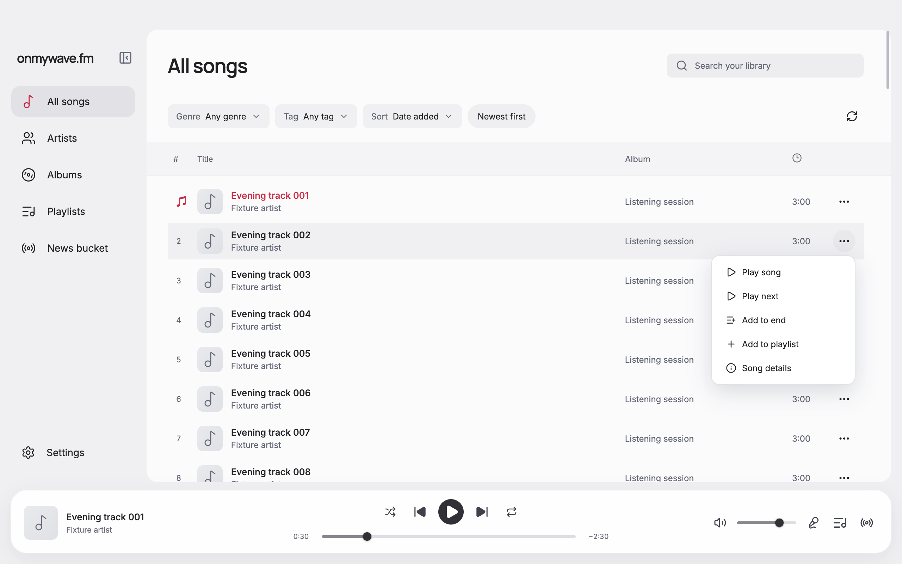
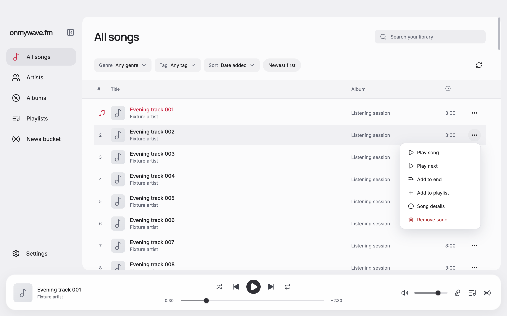
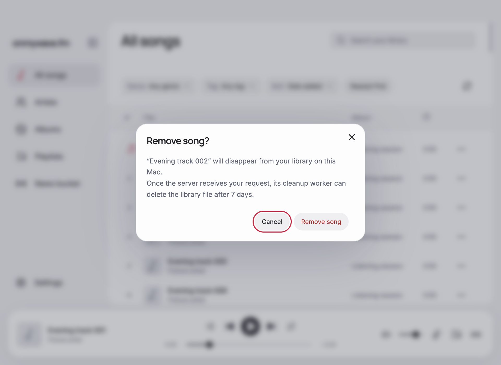

# Song removal

The shared song menu offers **Remove song**, separate from **Remove from playlist**. Confirmation writes a removal timestamp to `removed-songs.json` in Electron's user-data directory, scoped to the Jellyfin URL and user. It hides the song in catalog, search, album, artist, and playlist reads without deleting media. Pending requests survive restart and retry on sign-in, startup, and the status poll. A server receipt records the earliest cleanup eligibility time, seven days after the server first receives the request.

The server implementation and deployment instructions are in [server/song-removals](../../../server/song-removals/README.md). The cleanup worker itself remains future work. No live server or media files were changed during verification.

## Renderer verification

Run `node docs/verification/song-removal/server.mjs` from the repository root and open `http://127.0.0.1:5207/?case=soft-remove`. It uses the actual renderer with synthetic songs, a simulated bridge, and session storage. Real filesystem/API behavior is checked separately by the service and server verification scripts.

Verified in the browser:

- The menu contains Remove song. Confirmation initially focuses Cancel; Escape cancels, retains the song, and returns focus to its menu trigger.
- Confirming song 002 removes its row immediately, updates the total from 120 to 119, and leaves current song 001 paused at 30 seconds.
- With server delivery pending, a notice and Retry sync button remain visible. Reload preserves the hidden song and pending record. Enabling `window.__fixture.removalOnline` and retrying clears the notice while preserving the original removal timestamp and hidden row.
- Setting `window.__fixture.failRemoval` simulates a local storage failure. Confirmation stays open with an error, the song stays visible, and no new record is saved.
- Menu screenshots were captured and inspected at 1280×800 with identical content, viewport, scroll, playback state, and open menu. The confirmation dialog was also inspected at 960×700; text wraps and both actions fit.

| Menu | Before | After |
| --- | --- | --- |
| 1280×800 |  |  |

## Checks

Use Node 26 and run `pnpm run format`, followed by `pnpm run check` for formatting, lint, typecheck, and the production build.

Run `node docs/verification/song-removal/verify-service.mjs` for the actual desktop service and persisted removal store against a local HTTP fixture. Run `python3 server/song-removals/verify.py` for the server API against a fake Jellyfin server and temporary SQLite database. These checks use disposable data and never delete music.

Both HTTP integration checks passed. The desktop check covered durability before server acknowledgement, concurrent duplicate removal, unsupported-server fallback, filtered pagination, server/user isolation, remote imports, and reopening the local store. The server check covered authentication, retry immutability, seven-day eligibility, worker pagination, invalid input, and SQLite restart persistence. Formatting, lint, typecheck, production build, and merged Compose validation also passed. The Docker daemon was unavailable, so the container images and Nginx runtime were not started or verified.
