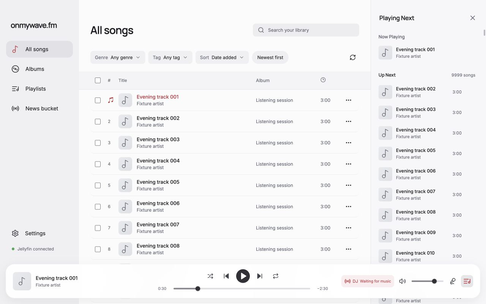
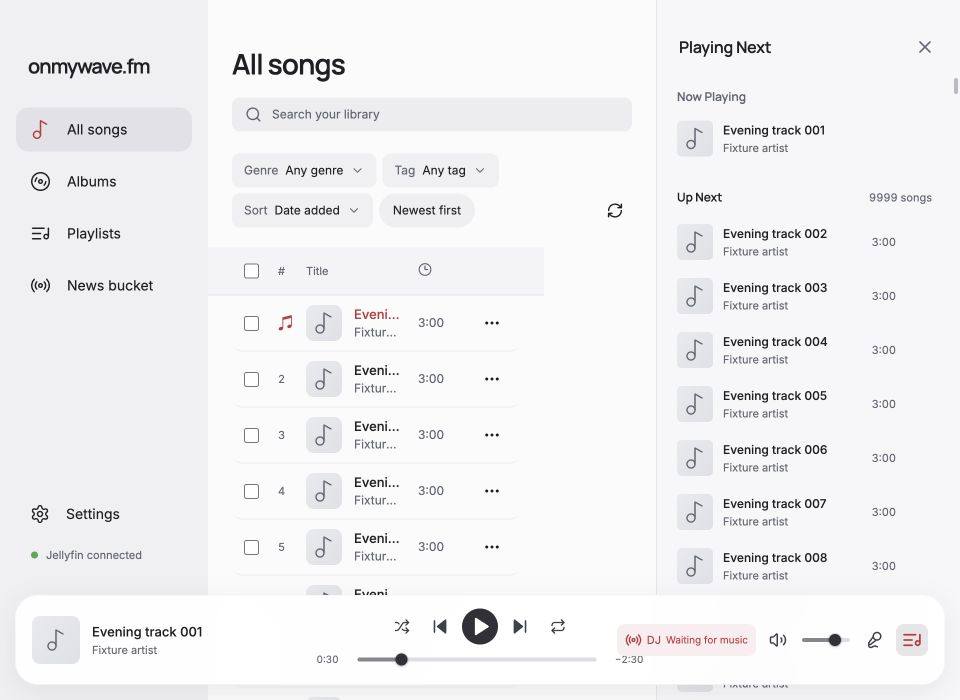

# Virtual playback queue

The real renderer is exercised through the existing playback-progress IPC/audio fixture with 10,000 persisted queue occurrences. Song IDs repeat every 120 entries, while the player supplies distinct occurrence keys. No live Jellyfin or provider requests are made.

Run `node docs/verification/virtual-queue/server.mjs` for the changed renderer on port 5201. Run `QUEUE_BASELINE=1 node docs/verification/virtual-queue/server.mjs` for the committed queue/CSS at `5a47954c8f40d8aa3af6a6c4e02c72a4197a0be2` on port 5202. Other application and fixture sources are shared. `?history` restores occurrence 9000; `?tools` adds fixture-only buttons to finish music and speech for transition verification. The fixture publishes passive playback telemetry in a hidden output element.

## Results

At 1280 × 800, opening the baseline queue mounted all 9,999 upcoming rows and took 1,851 and 1,819 ms from captured click to queue DOM publication. The changed queue mounted 17 rows, with opening samples of 44.9, 58.2 and 17 ms. These are development-mode, manually triggered browser measurements, not production benchmarks. Ordinary scrolling mounted at most 28 rows in the exercised view, including a pinned offscreen focused row.

Matched before/after screenshots at 1280 × 800 and 960 × 700 show the same restored first song, position of 30 seconds, 9,999 upcoming entries and paused state. All four images were visually inspected. The queue's composition and row dimensions are unchanged.

Browser interaction verified End/Home navigation, removing the last and first upcoming occurrences with focus retained on the surviving action, and selecting the last occurrence with focus transferred to Now Playing. Native Tab moves among mounted controls; Up/Down/Home/End navigate the logical list. Expanded 9,000-entry history remains bounded, including after an upcoming removal changes its offset. Closed history mounts no rows. Each virtual row reports its logical size and position for assistive technology. Shuffle retains the existing 50-entry planned preview and remaining count.

Opening and scrolling during fixture DJ speech preserved current song, position, natural-ending count and delivery calls. Completing speech advanced once to the next song. `results.json` retains telemetry and observed outcomes. The fixture does not establish native decoding, audible quality, VoiceOver behavior, or real-server performance.

## Design and review

Steve and Elena independently reviewed the existing queue/scroll/player boundaries. The chosen implementation uses one virtualizer per repeated list in the same drawer viewport, retaining native headings and history disclosure. Review and browser reproduction identified and fixed stale history offsets, missing assistive-technology list metadata, End-key focus loss and focus loss when a selected occurrence becomes current. The final independent source review found no remaining actionable issue.

