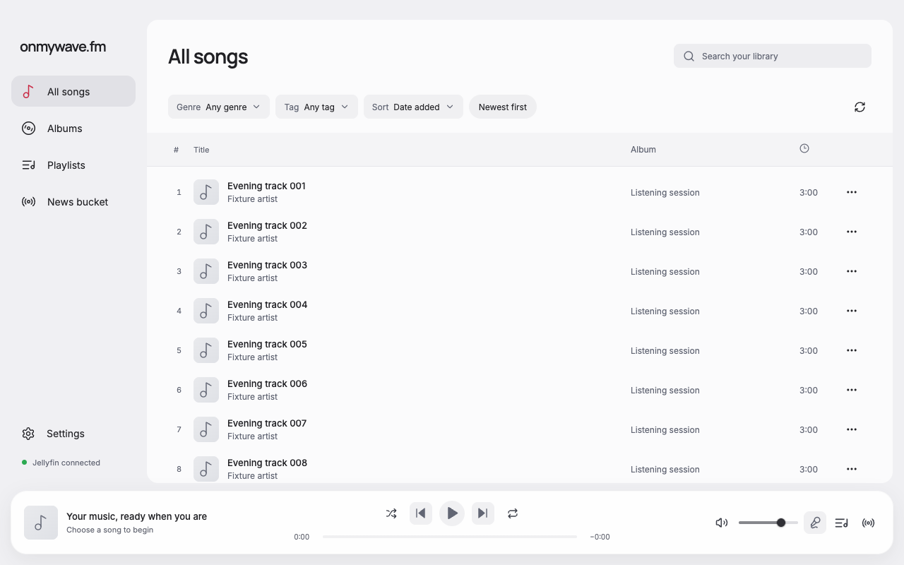
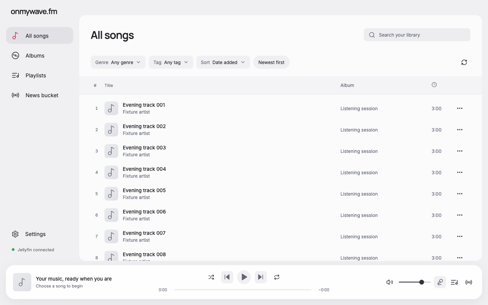
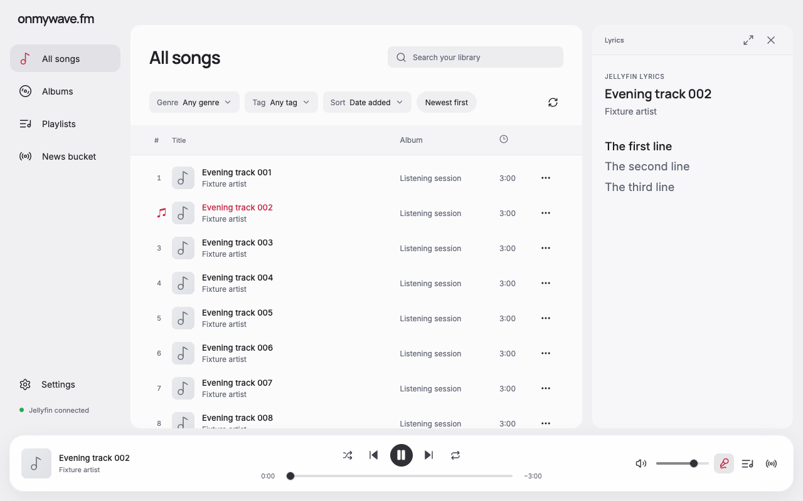

# Windows preview verification

25 October 2026. Actual source and production bundles for the first unsigned Windows x64 preview, version 0.5.3. Native Windows acceptance remains pending.

## Renderer checks

Chrome on macOS exercised the actual renderer using the existing fictional playback-progress fixture, an explicit `win32` platform, and simulated bridge/audio. Windows captures cannot show native caption controls because those are drawn outside the renderer by Electron on Windows.

The following checks passed at 1280 × 800 light, 1280 × 800 dark, 960 × 640 coffee, and 1920 × 1080 light:

- The main panel and title-bar drag region use the 40px Windows title-bar height. The sidebar identity starts at 16px, reclaiming the old 52px Mac spacer. No document horizontal overflow.
- Queue, lyrics, and DJ sidebar tops align at 40px. Expanded lyrics stays below the title bar. An initial 80px lyrics offset caused by combined inset and margin was found and fixed before the final captures.
- Ctrl-click selection, Ctrl+A selection, Ctrl+F search focus, and Ctrl+Right next track work. Windows Ctrl-click was dispatched as a DOM click event because native macOS Chrome converts physical Ctrl-click to a context menu. Other shortcuts used Playwright keyboard events.
- About identifies Windows and explains manual updates. Each theme synchronizes the requested title-bar palette through the simulated bridge. No renderer page errors.

A 1280 × 800 `darwin` regression passed the equivalent Command shortcuts, preserved the 28px main-panel inset and 52px sidebar spacer, and kept sidebar tops at 28px.

[Machine-readable report](browser-report.json). To repeat, start `node docs/verification/playback-progress/server.mjs`, then run this directory's `verify-browser.cjs` using an existing Playwright installation. Set `WAVE_PLAYWRIGHT_MODULE` to its module directory when it is not available on the normal Node module path. No dependency was added to the app.

## Before and after

Both library captures use the same fictional content, 1280 × 800 viewport, and light theme. The before capture was taken from main `daa89cd` before UI edits. The after capture selects the new Windows platform styling. These images were visually inspected along with dark, coffee, and lyrics states.

| Before | Windows layout after |
| --- | --- |
|  |  |

## Close checkpoint regression

An isolated native Electron 43.8.1 check on macOS selected the Windows close-event branch in a copied production main bundle and triggered `window.close()`. The existing playback-relaunch verifier supplied synthetic Jellyfin metadata/audio and disposable app data, with provider keys disabled. The renderer and preload were real app code. This is a Windows-code-path check on macOS, not a native Windows test.

The first run exposed a hang from synchronous `app.quit()` inside the cancelled close event. Deferring quit with `setImmediate` fixed it. The final uninstrumented run exited in 955ms, wrote live position 73 over the stale position 44, preserved the duplicate queue and edited shuffle future, and restored position 73 paused in a fresh Electron process. Removing the checkpoint barrier left position 44 despite a later live position 111, so the negative control detected the regression. [Results and exact adaptation boundaries](close-checkpoint-report.json).

## Source and artifact checks

`pnpm run format`, `pnpm run check`, and `pnpm audit` passed. The app adds no dependencies or unit-test framework. macOS signing and update support retain their separate configuration.

The Windows release script cross-builds the app and a per-user NSIS x64 installer using electron-builder v26 and Wine on macOS. Local PE inspection distinguishes the x86 NSIS setup executable from its x64 application payload; the application's architecture is x64. Installer and application certificate tables are empty, consistent with an unsigned build. This inspection is separate from Windows Authenticode verification. The source archive and SHA-256 checksums are generated alongside the installer under ignored `release/windows/`.

The Windows workflow runs quality checks, a dependency audit, packaging, PE architecture checks, and native `Get-AuthenticodeSignature` checks for the installer and app. It deliberately leaves bundled vendor helpers out of the unsigned-app assertion. Workflow execution does not establish interactive install or window behavior.

## Remaining Windows evidence

Actual Windows 11 installation/reinstallation, DPAPI persistence, native minimize/maximize/close, system menu, Snap hover, mixed-DPI display scaling, high contrast, Narrator, media keys, and audible playback remain unverified on this macOS host. The minimum remains 960 × 640, so smaller Snap zones are unsupported. Windows 10 and ARM64 support are unclaimed. See the full [release plan](../../WINDOWS_RELEASE.md) before publishing or promoting the preview as Windows-verified.
